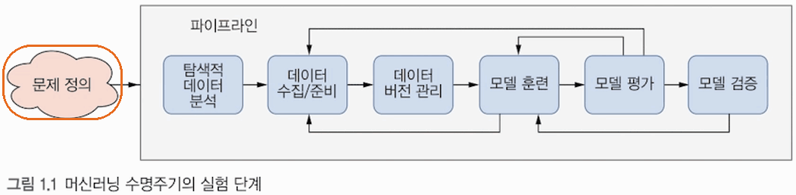
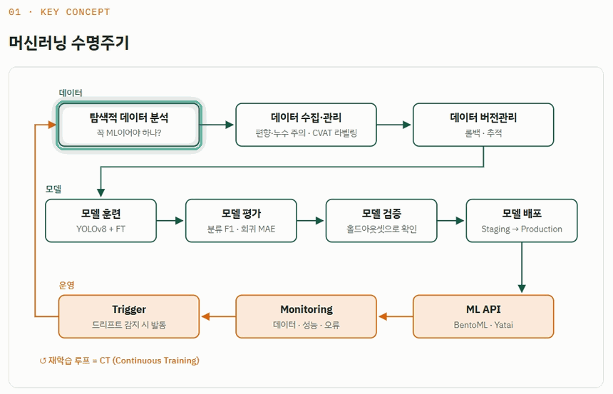
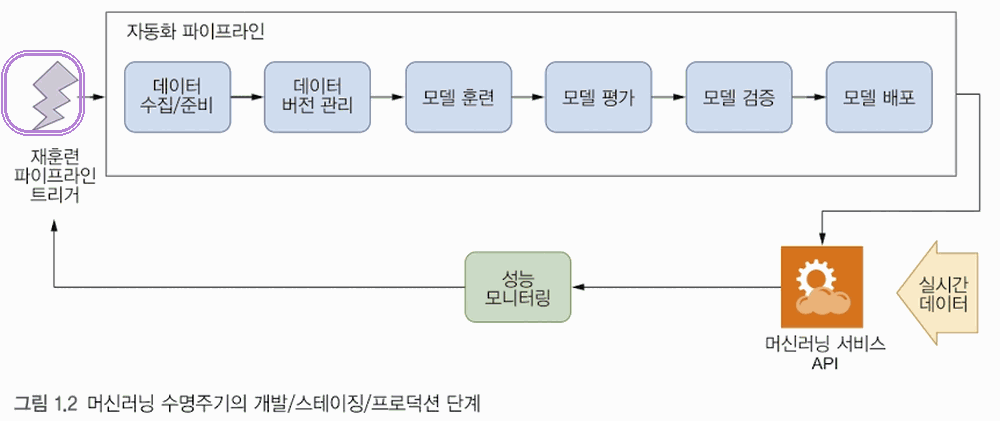
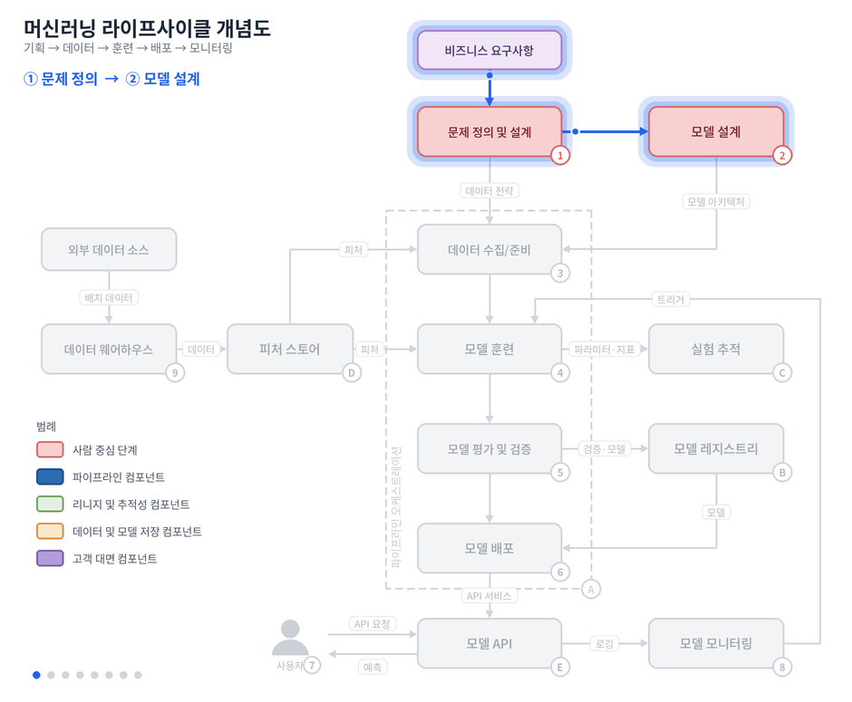
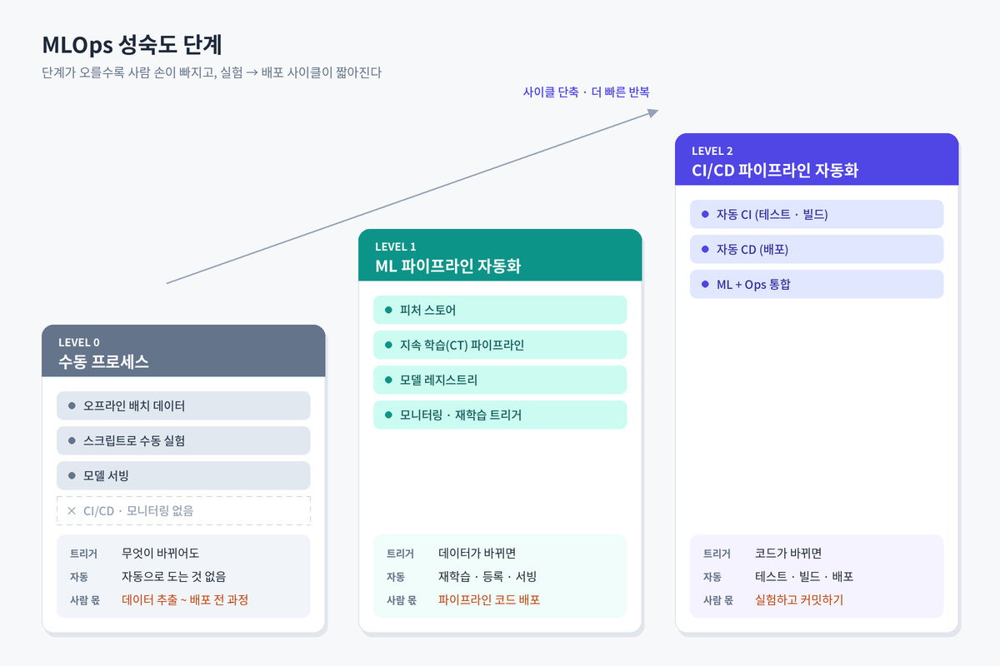
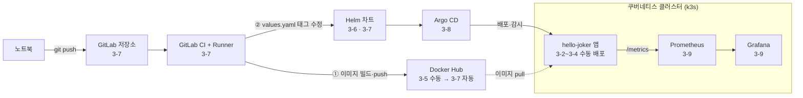
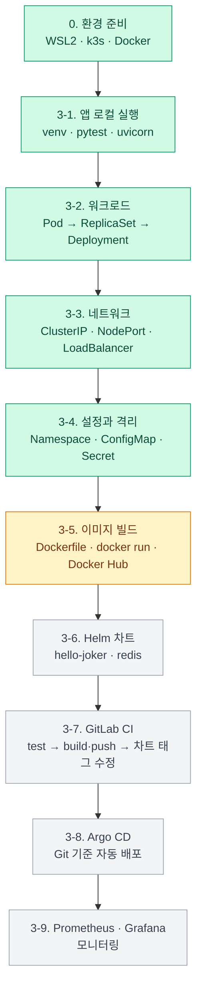

# MLOps-study
Machine Learning Platform Engineering Study

OS는 window환경에서 진행했다.
시작 전 나는 초보이기 때문에 기본 개념정리부터 하겠다
- Linux → Docker → Docker Compose → Kubernetes → CI/CD → MLOps 순으로 학습

---

1. Linux: 서버를 운영하는 기본 환경
2. Docker: 프로그램 실행 환경과 함께 포장 *도커: 컨테이너를 만들고 실행하는 플랫폼(회사 이름이기도 함)*
3. Docker Compose: 여러 컨테이너를 설정 파일 하나(`docker-compose.yml`)로 묶어 한 번에 실행

*컨테이너는 프로그램과 그 프로그램이 돌아가는 데 필요한 것들을 한 상자에 담아서, 다른 프로그램과 격리해 실행하는 방식이에요. 필요한 것에는 Python 버전, 라이브러리, 설정 파일 등이 있어요.*


  
```bash

docker compose up -d

```
*위 그림과 같은 구성의 실행을 하나의 명령어로 관리할 수 있다.*
| 용어 | 뜻 | 비유 |
|---|---|---|
| `Dockerfile` | 이미지를 만드는 설명서 | 레시피 |
| 이미지 (image) | 환경과 코드를 묶어 얼린 실행 전 템플릿 | 밀키트 |
| 컨테이너 (container) | 이미지를 실제로 실행한 것 | 조리해서 접시에 올린 요리 |
5. Kubernetes: 여러 서버의 컨테이너를 자동 관리 *여러 서버의 컨테이너 총괄 관리자*
6. CI/CD: 코드 변경부터 배포까지 자동화

*CI: 코드가 변경되면 자동으로 검사·테스트·빌드*
*CD: 검증된 코드를 배포 가능한 상태로 준비하거나 실제 배포*



7. MLOps: AI 모델의 학습·배포·성능 관리를 자동화


---

**인공지능 분야는 AI ⊃ ML ⊃ DL ⊇ 생성형 AI ⊇ LLM(Large Language Model)의 포함 관계다.**


# CH1. MLOps와 ML 엔지니어링 시작

머신러닝 프로젝트는 저마다 다르지만, 머신러닝 모델을 개발하고 배포하는 단계는 대체로 비슷합니다. 머신러닝 프로젝트는 **본질적으로 반복**적인 성격을 띱니다. 
첫 번째 배포로 프로젝트가 마무리된 사례를 아직 본 적이 없습니다.


## 1.1. 머신러닝 수명주기

**1.1.1 실험 단계**
머신러닝 프로젝트는 **수많은 시행착오를 동반하는 지속적인 실험의 연속**이다.


- 화살표가 단방향을 가리키고 있지만, 실제로는 **거의 모든 단계에서 반복이 빈번히 발생**합니다. 예를 들어, 모델 훈련과 모델 평가 evaluation 단계 사이에 있다고 가정해보겠습니다. 평가 지표가 기준에 미치지 못한다면, 다른 모델 아키텍처를 검토하거나 더 앞 단계로 돌아가 충분한 고품질 데이터가 확보되었는지 확인할 수도 있습니다. 각 단계는 상당히 복잡할 수 있으며, 단계 간 흐름은 루프를 포함한 비선형 구조인 경우가 많다는 점에 유의하십시오.
- 바로 이런 이유로, 이 **모든 단계를 하나의 오케스트레이션 파이프라인으로 통합**합니다. 오케스트레이션 파이프라인을 구성하면 처음부터 자동화가 내재되므로, 추적하기 어려운 실수를 저지를 가능성을 벗어날 수 있습니다.
**1.1.2 개발/스테이징/프로덕션 단계**
- 실험 단계와 프로덕션 단계의 구분은, 모델을 탐색하고 다듬는 작업에서 실제 환경에 배포하는 단계로의 전환을 알린다는 점에서 매우 중요합니다. 실험이 완전히 종료되는 일은 없더라도 초점이 순수한 탐색에서 프로덕션 환경의 모델 성능 유지 및 지속적인 개선으로 이동하므로, 이러한 전환을 이해하는 것은 매우 중요합니다. 바로 이 지점에서 윤리적 제약, 보안, 확장성, 견고성, 실시간 성능 등의 고려사항이 우선되어야 합니다. 이러한 변화를 인식하면 두 단계에 필요한 책임과 리소스를 적절히 분배하여 머신러닝 모델의 원활한 배포와 유지보수를 보장하는 데 도움이 됩니다.
- 이 단계에서 작동하는 모델을 확보했더라도 아직 해야 할 일이 많습니다! 우선, 모델을 아직 배포하지 않았습니다. 하지만 본론으로 넘어가지 전에, 그림 1.2에서 이 단계가 어떤 모습인지 살펴보겠습니다.
  


## 1.2 MLOps에 필요한 역량
- SW엔지니어링 역량: 가장 기본적인 조건으로, 단순하지 않은 다양한 소프트웨어 시스템을 성공적으로 배포해 본 경험이 있는 역량 있는 소프트웨어 엔지니어여야 함,  디버깅에 능숙, 성능 문제가 어디서 발생하는지 파악
- 데이터 과학 이해: tensorflow, pytorch, scikit-learn 등과 같은 프레임워크에 능숙 + 낯선 프레임워크도 익힐 수 있어야 함, 양질의 훈련 데이터 충분히 확보하는 능력 등 데이터 엔지니어링 역량 필요
- MLOps에 대하부분은 자동화, 개발/스테이징/프로덕션 환경 전반에 걸쳐 모델이 동일하게 동작하게 하려면 실험 재현성이 중요함을 알고 재현가능한 결과를 구현하는 능력
  
## 1.3 머신러닝 플랫폼 구축
아래 그림은 머신러닝 플랫폼 아키텍처의 예시다. 숫자는 데이터 컴포넌트, 알파벳은 인프라다.



이 책에서는 머신러닝 플랫폼을 처음부터 구축하는 방법을 배운다.
쿠버네티스 위에서 동작하는 오픈소스 머신러닝 플랫폼인 **큐브플로를 설치**한다.
큐브플로의 핵심 컴포넌트 중 하나인 큐브플로 **파이프라인은 파이프라인 오케스트레이션 기능을 제공**한다.

- 피처 스토어: DW에서 뽑아내고 **오프라인(주로 모델 훈련과 배치 추론용)** 과 **온라인(실시간 추론용)** 두 두가지 모드로 피처를 제공하는 핵심이다.

  *Kubeflow는 피처 스토어를 기본 제공하지 않아, 책은 테이블 형식 데이터를 다루는 프로젝트에서 오픈소스 Feast를 붙입니다. 피처는 "최근 7일 평균 결제액"처럼 원본 데이터에서 모델이 쓰기 좋게 계산해 둔 값이고, 피처 스토어는 이를 데이터 과학자와 분석가가 공유하게 해 재계산 낭비를 줄입니다. 내부적으로는 REST/gRPC로 피처를 제공하는 피처 서버, 피처 목록을 관리하는 피처 레지스트리, 영속성을 맡는 피처 스토리지로 구성됩니다.*

***피처**는 모델이 입력으로 받는 가공된 값입니다.*
***피처 스토어**는 피처를 한 번 정의하고 계산해 저장한 뒤, 훈련과 서빙이 같은 곳에서 가져다 쓰게 하는 소프트웨어입니다.*

- 모델 레지스트리: 훈련된 모델을 버전별로 저장하고, 평가를 통과한 모델을 스테이징→프로덕션으로 승격(라벨 변경)한다. 배포 컴포넌트는 레지스트리의 "프로덕션" 모델을 참조해 가져가서 API 엔드포인트로 서빙한다.
*모델 엔드포인트: 특정 서비스나 시스템에서 사용자가 접근할 수 있는 지점을 의미하며, API 호출이나 데이터 통신이 이루어지는 접점 역할을 한다. 여기서는 맥락상 **훈련·평가·배포 세 단계**가 공유하는 단일 기준점*
위 그림으로 설명하면
④ 모델 훈련 → Ⓑ: 훈련된 모델을 등록 (보통 Staging 또는 None 상태)
⑤ 모델 평가 ↔ Ⓑ: 레지스트리에서 후보 모델을 꺼내 평가하고, 검증 지표를 다시 기록. 기준을 통과하면 Production으로 승격
Ⓑ → ⑥ 모델 배포: Production 라벨이 붙은 모델을 가져가서 실제 서빙

## 1.4 머신러닝 시스템 구축
3가지 프로젝트를 진행할거다. 처음부터 끝까지 구축하는 실제 경험을 하는게 목표다.

- **프로젝트 1: OCR 시스템 구축**
    - OCR은 머신러닝 시스템에서 매우 흔한 사용 사례입니다. 이 프로젝트에서는 신분증 탐지라는 문제 정의에서 출발합니다. 데이터셋을 구축하는 방법을 파악한 뒤, 신분증을 탐지할 수 있는 이미지 탐지기를 학습시킵니다. 다음으로, 오픈소스 라이브러리를 활용해 초기 구현을 완성하고, 레이블이 달린 데이터셋으로 파인튜닝을 진행합니다. 마지막으로, 이를 서비스로 배포합니다.
- **프로젝트 2: 영화 추천기**
    - 두 번째 프로젝트는 영화 추천 서비스입니다. 진행 단계와 핵심 개념은 OCR 예제와 동일하지만, **테이블 형식 데이터**에는 몇 가지 흥미로운 특성과 고유한 도구 요건이 존재합니다. 또한 테이블 형식 데이터는 피처 스토어, 드리프트 탐지, 모델 테스트, 관측 가능성과 같은 개념을 설명하기에 더 수월합니다. 아울러 테이블 형식 데이터는 이미 수치 형식으로 되어 있거나(또는 수치 피처로 쉽게 변환할 수 있어) 실습에 유리하다는 장점도 있습니다.
- **프로젝트 3: RAG 기반 문서 도우미**
    - 세 번째 프로젝트에서는 엔지니어가 **자연어로 사내 문서를 조회**할 수 있도록 지원하는 내부 문서 어시스턴트 **DakkaBot을 통해 LLM** 기반 시스템을 소개합니다. **검색 증강 생성** Retrieval-Augmented Generation (**RAG**) 시스템은 이전 프로젝트와 동일한 MLOps 기반 위에 구축되지만, 문서 처리, 시맨틱 검색, 프롬프트 엔지니어링 등 새로운 과제를 수반합니다. 문서 수집부터 벡터 임베딩, RAG에 이르는 완전한 파이프라인을 구현한 뒤, 안전 가드레일, 비용 최적화, 시맨틱 평가로 확장합니다. 이 프로젝트는 기본 MLOps 원칙이 프로덕션 환경에서 생성형 AI 워크로드를 지원하기 위해 어떻게 적응하는지 보여줍니다.
  
# CH2. MLOps란 무엇인가
### 문제를 정의하고 이를 해결할 아키텍처를 선정한 뒤에야 비로소 진짜 어려운 질문들이 수면 위로 떠오른다.
- 모델을 어떻게 훈련할까?
- 데이터는 어떻게 모델에게 전달할까?
- 모델은 다른 서비스와 어떻게 상호작용할까?
- 모델은 어디서 실행할까?
- 시간이 지나도 모델의 정확도를 유지할 수 있는 방법은 무엇인가?
### 머신러닝의 가치는 시간이 지남에 따라 지속적으로 개선되는 폐쇠 루푸의 일부가 될때 비로소 발현 된다!
### 모델, 데이터 하이퍼파라미터는 일시적인 존재로, 전체적으로는 시간이 흐르며 진화하는 루프의 일부로 이해하는 마인드를 가져야한다. 그래야 합리적인 의사결정을 내리는데 도움을 준다.

  
## 2.1.0 문제 정의 및 설계*
머신러닝 루프는 문제를 정의하고 측정 가능한 KPI가 식별되면 모델링을 위한 데이터를 수집할지를 고민하면서 시작한다.

## 2.1.1 데이터 수집*

문제가 정의되고 KPI가 설정되면 이제 모델링을 위한 데이터를 수집해야한다.
모델(가중치 + 네트워크)과 코드(모델 아키텍처 및 지원 코드)는 서로 별개의 개체임을 명심하자.  따라서 지속 가능한 머신러닝 워크플로를 구축하려면 데이터 리니지 lineage 유지와 추적이 매우 중요합니다.


*"이 모델(또는 결과)이 무엇으로부터 어떤 과정을 거쳐 만들어졌는가"를 잇는 계보*
## 2.1.2 탐색적 데이터 분석 EDA

데이터를 탐색하고 통계적 특성의 세부 사항을 파악하는 과정 outlier, PCA, t-SNE, 공분산 행렬, 데이터 type, 스키마는 무엇인지 등 (생략)

## 2.1.3 모델링과 훈련*

데이터와 피처에 대한 바탕으로 실제 예측 모델을 구축한다.
**아래 사항들은 머신러닝 루프의 성공에 필수적이다!**
- 모델 및 데이터 버전관리
- 실험 추적
- 모델 훈련 파이프라인
- 하이퍼파라미터 탐색(사람이 하는거)- 프로젝트 초기 단계부터 코드베이스를 모듈식으로 구성하는 것이 좋다.
*위 컴포넌트들이 공통적으로 다루는 핵심 주제는 리니지와 추적 가능성이다.*


**코드베이스(codebase)** 는 프로젝트를 이루는 소스 코드 전체를 말해요. 모델 구조를 정의하는 코드, 전처리 코드, 학습 루프, 평가 스크립트처럼 Git 저장소에 들어 있는 코드 묶음이에요. 아까 GIF로 만든 그림에서는 가운데 코드 칸에 해당합니다.

**아티팩트(artifact)** 는 어떤 과정을 돌린 결과로 나온 산출물 파일이에요. 원래 소프트웨어 개발에서 빌드하면 나오는 실행 파일 같은 결과물을 부르던 말이에요. ML에서는 학습이 끝나고 저장되는 .pt, .pkl, .onnx 같은 모델 파일이 대표적인 아티팩트예요. 같은 그림의 모델 칸이 여기에 해당해요.

| 문장 속 요소 | 비유 | 실제 예 |
|---|---|---|
| 코드베이스 | 레시피 | `train.py`, `model.py` |
| 설정 | 불 세기, 조리 시간 | 학습률, 에폭 수, 배치 크기 |
| 데이터 | 재료 | 학습 데이터셋 |
| 아티팩트 (훈련된 모델) | 완성된 요리 | `model_v3.pt` |

## 2.1.4 모델 평가*

훈련과정에서 테스트 성능이 우수한 모델을 확보했다면 그 모델이 실제 목표 도메인에서도 잘 동작하는지 확인해라.
- 분류 및 탐지: 정밀도, 재현율, F1점수
- 회귀 및 예측: MAE, RMSE, MSE 등

## 2.1.5 배포*

초기 훈련된 모델이 준비되면 이를 프로뎍션 환경에 배포하여 비즈니스 가치를 창출해라.

### 일반적인 배포 방법(2가지)

- 마이크로서비스 아키텍처에 적합한 엔드포인트 생성: 이 구성에서는 모델이 API 계층 하위에서 동작하며, API 계층이 요청을 처리함
- 특정 하드웨어 환경 또는 에지 디바이스로의 배포: 위 방법보다는 널리 사용되지는 않지만, 모델이 디바이스상에서 인지(perception)와 같은 중요한 작업을 수행해야 하는 **자동차, 보안 장비, 로보틱스** 등의 분야에서는 특정 하드웨어로의 배포가 매우 중요
- 
## 2.1.6 모니터링

이 단계는 매우 중요!
모델 배포는 모델이 사용자 요청을 처리하고 비즈니스 가치를 창출할 수 있도록 함. 그러나 모델이 지속적으로 높은 성능을 유지하는지 확인하고, 하위 지표에서 이상이 발생할 경우 즉시 감지하여 수정하는 것이 중요
모델 모니터링은 다양한 지표, 데이터 이상 징후, 모델 성능을 추적함으로써 모델이 프로덕션 환경에서 의도한 대로 동작하는지 보장하는 것을 목표로 함.
- 데이터 모니터링
- 성능 모니터링
- 오류 모니터링

## 2.1.7 유지보수, 업데이트, 검토

유지보수, 업데이트, 검토는 머신러닝 루프를 효과적으로 마무리 하게 한다.

## 2.2 견고한 MLOps가 중요한 이유

앞 장에서 논의했듯이, 효과적인 머신러닝 엔지니어가 되려면 소프트웨어 공학과 고성능 컴퓨팅부터 CI/CD, 버전 관리, 통계에 이르기까지 다양한 분야에 걸친 전문성이 필요합니다. MLOps가 왜 어려운지 이해하면 이러한 과제들을 체계적으로 해결하는 데 도움이 됩니다.

## 2.3 성숙한 조직에서 MLOps의 역할

견고한 MLOps는 제품 개선이나 머신러닝 기반 제품 제공을 목표로 하는 조직에 많은 이점을 제공합니다. 머신러닝 조직이 성숙 단계에 이르면, 견고한 MLOps는 모델의 효율적인 개발, 배포, 관리, 모니터링, 최적화를 가능하게 하는 핵심 동력이 됩니다. 주요 이점은 다음과 같습니다.
- 혁신 실험의 가속화
- 비용 최적화
- 팀 간 협업
- 효율성 향상
- 반복성 및 추적성 향상
- 강력한 스케일링
## 2.4 데브옵스 vs. ML옵스
공통점
- 강력한 자동화 지향
- CI/CD 철학 강조
- 다학제 성격, 여러 도메인에 두루 익숙한 제너럴리스트를 필요로 함
차이점
- 데브옵스는 SW와 인프라 수명주기에만 초점, ML옵스는 머신러닝 모델 훈련, 배포, 모니터링, 최적화 등 다양한 영역을 다룸
- 데이터가 다른다. ML옵스는 데이터를 모델과 프로세스의 필수 컴포넌트로 간주하며, 데이터 수명주기 관리에 상당한 비중을 할애한다 반면 데브옵스는 데이터 관리에 동일한 수준의 엄격함을 적용하지 않음
- ML옵스의 모델은 코드베이스에 어떠한 코드 변경이 없어도 지속적으로 변화하고 진화
## 2.5 ML옵스 성숙도 수준



# CH3. 쿠버네티스 위에서 애플리케이션 구축하기

이 장에서는 신뢰할 수 있는 머신러닝 시스템을 구축하는 데 필요한 핵심인 **DevOps** 도구와 실천 방법을 다룬다.

이 장을 마치면 얻게 되는 것
- 도커를 사용해 애플리케이션을 일관되게 패키징합니다
- 쿠버네티스에서 애플리케이션을 배포하고 관리합니다
- CI/CD를 활용해 워크플로를 자동화합니다
- 애플리케이션의 상태와 성능을 모니터링합니

---

애플리케이션을 위한 CI/CD 중 "**Git + CI" 운영(경험 포함) 도구**에 대한 관련 간단한 투표 (중복 투표 가능)
-  **Github** + Github Action : **16명**
- **Github** + Self-hosted runners : **9명**
- **GitLab**(SaaS형) + GitLab-hosted runners(SaaS형) : **1명**
- **GitLab**(직접 설치형) + GitLab runners(직접 설치형) : 🔴 **10명**
- Git(Any) + **Jenkins** CI Pipeline Job(직접 설치형) : **4명**

---

3장은 저에게는 너무 어려웠습니다. 그래서 거꾸로 공부했습니다. 단계 단계를 클로드가 진행하면서 제게 질문하고 설명하는 식으로 진행했습니다.

# Kubernetes 실습 단계별 정리 (3장)

> **실습 범위:** 환경 준비(10/19~10/20) ~ 3-5 Docker 이미지 빌드(진행 중, 10/24)
> **환경:** Windows 11 · WSL2 Ubuntu 24.04(NAT 모드) · k3s v1.29.15 · Docker 29.9.1 · Python 3.10(uv)
> **기록 기준:** `~/ml-study/notes/ch03-k8s.md`, `notes/_progress.md` (2026-10-24 갱신)

## 1. 목표: 책 그림 3.2의 흐름

3장의 최종 목표는 아래 흐름을 직접 구성하는 것입니다. 지금은 각 화살표를 **손으로 한 번씩 해 보는** 단계이고, 3-7부터 이 손작업을 기계(CI/CD)에 맡깁니다.



| 지금 손으로 한 것 | 그림에서 자동화한 모습 |
|:---|:---|
| 3-5 `docker build` | ① GitLab CI가 이미지를 빌드하고 Docker Hub에 push |
| 3-2 `kubectl set image ...:v2` | ② CI가 Helm 차트의 이미지 태그를 수정하면 Argo CD가 클러스터에 반영 |
| 3-2 `kubectl get pods`로 상태 확인 | Argo CD가 배포 상태를 감시 |

## 2. 실습 순서와 진행 상태



초록색은 완료, 노란색은 진행 중, 회색은 예정입니다.

## 3. 단계별 정리

| 단계 | 한 일 | 기억할 점 |
|:---|:---|:---|
| **0. 환경 준비**<br/>10/19~10/20 | WSL2 Ubuntu 24.04, uv/Python, k3s, kubectl/Helm, Docker 설치 | `mirrored` 네트워크 모드에서 Pod 네트워크가 주기적으로 끊겨 **NAT 모드로 되돌림**. k3s는 **Traefik 끄고**, flannel `host-gw`로 설치. Docker 그룹 설정은 10/24에 확인(sudo 없이 `docker ps`). |
| **3-1. 앱 로컬 실행** | 챕터 전용 Python 3.10 가상환경 생성, `pytest` 테스트, `uvicorn` 실행 | 책이 `httpx` 버전을 고정하지 않아 최신 0.28이 설치되며 테스트 실패 → **`httpx<0.28`**로 해결. |
| **3-2. Pod → ReplicaSet → Deployment** | Pod 1개 → ReplicaSet으로 3개 유지 → Deployment로 v1→v2 롤링 업데이트와 롤백 | ReplicaSet은 **label이 같은 기존 Pod를 입양**함. v2 이미지는 앱을 **80번** 포트로 띄우는데 Service는 **8083**을 가리켜 응답이 없었음. 그런데도 롤아웃은 성공으로 표시 → **`readinessProbe` 필요**. |
| **3-3. Service** | ClusterIP, NodePort, LoadBalancer 생성 및 접속 | 기본 설정에서는 **LoadBalancer ⊃ NodePort ⊃ ClusterIP**(LoadBalancer에 nodePort 31319가 자동 배정됨). 요청 30개가 11/12/7개로 나뉨 → 순서대로가 아니라 **무작위 분배**. Windows `localhost`로는 접속되지 않아 **WSL IP**나 `kubectl port-forward` 사용. |
| **3-4. Namespace / ConfigMap / Secret** | `funny` Namespace 생성, 설정값과 비밀값을 환경변수로 주입 | 책 매니페스트 오류 3개를 `scratch/ch03/`에서 수정(아래 오류 표 참고). Secret의 base64는 **인코딩이지 암호화가 아님**. |
| **3-5. Docker 이미지 빌드**<br/>(진행 중) | ① 책 Dockerfile 그대로 빌드 → 실패<br/>② `FROM`만 bookworm으로 고쳐 빌드 → 성공<br/>③ `docker run -p 8083:8083`로 실행 → 응답 확인 | 베이스 이미지 `python:3.10-slim-buster`는 Debian 10 **지원 종료(EOL)** 로 `apt-get update`가 404. 오류는 3번째 줄에서 났지만 **원인은 1번째 줄(`FROM`)**. `-buster`만 지우면 그때의 최신 Debian(현재 trixie)이 되므로 **`-bookworm`처럼 코드네임을 고정**. |

## 4. 실습에서 배운 핵심 개념

### 1) "켜짐"과 "응답할 준비가 됨"은 다르다

readinessProbe가 없으면 Kubernetes는 **컨테이너 프로세스가 살아 있는지만** 확인합니다. v2는 프로세스가 잘 떠 있었지만 엉뚱한 포트(80)에서 기다리고 있었고, Kubernetes는 이를 몰랐습니다. readinessProbe를 넣으면 실제로 요청을 보내 보고 응답이 와야 트래픽을 넘깁니다. 책의 Helm 차트(`hello-joker/templates/deployment.yaml`)에는 liveness/readinessProbe가 들어 있어 3-6에서 직접 확인할 예정입니다.

> 앱 포트를 실제로 정하는 곳은 `entrypoint.sh`의 `uvicorn ... --port 8083`입니다. Dockerfile의 `EXPOSE`와 매니페스트의 `containerPort`는 **안내문일 뿐** 포트를 열지 않습니다.

### 2) ReplicaSet은 Pod 이름이 아니라 label을 본다

ReplicaSet은 `selector`와 label이 일치하는 Pod를 자기 것으로 관리합니다. 미리 떠 있던 `joker` Pod도 label이 같아 입양되었고, ReplicaSet을 지울 때 함께 지워졌습니다. Deployment는 `pod-template-hash` label을 붙여 버전별 ReplicaSet끼리 Pod가 섞이지 않게 합니다.

### 3) Service는 바뀌는 Pod 앞에 고정된 주소를 준다

| 종류 | 접근 범위 | 이번 실습 |
|:---|:---|:---|
| **ClusterIP** | 클러스터 안. DNS 이름 `<서비스>.<네임스페이스>.svc.cluster.local` | 다른 네임스페이스는 `joker-cluster-ip-service.funny`처럼 접근 |
| **NodePort** | 노드 IP + 30000~32767 포트 | `<WSL IP>:30420` |
| **LoadBalancer** | 외부 IP | k3s ServiceLB가 노드 IP(WSL IP)를 EXTERNAL-IP로 줌 |

`port`는 Service가 받는 포트(80), `targetPort`는 Pod 쪽 포트(8083)입니다.

> **왜 Windows `localhost`로는 NodePort에 접속할 수 없나:** WSL은 리눅스에서 **실제로 포트를 열고 기다리는(LISTEN)** 프로세스가 있을 때만 그 포트를 Windows `localhost`로 연결해 줍니다. NodePort는 iptables 전달 규칙일 뿐이라 LISTEN 중인 프로세스가 없습니다(`ss -ltn`에 30420이 보이지 않음). 반대로 3-5의 `docker run -p 8083:8083`은 `docker-proxy` 프로세스가 실제로 8083을 열어 두기 때문에 Windows `localhost:8083`으로 접속됩니다.

### 4) Secret은 저절로 안전해지는 금고가 아니다

Secret의 `data`는 base64로 **인코딩**만 되어 있어 `base64 -d`로 바로 원문이 나옵니다. Pod에 `exec`할 수 있는 사람은 `printenv`로 평문을 볼 수 있습니다. 보호하려면 RBAC로 Secret 읽기와 exec 권한을 제한하고, 저장 시 암호화(k3s는 `--secrets-encryption`)를 켜야 합니다. 책의 ConfigMap 예제에 들어 있는 `api-key`도 원래는 Secret에 두어야 합니다.

### 5) 버전은 고정한다. 고정한 버전은 언젠가 직접 올린다

| | 고정하지 않음 | 고정함 |
|:---|:---|:---|
| 예 | `httpx`, `python:3.10-slim` | `starlette==0.27.0`, `python:3.10-slim-buster` |
| 문제 | 모르는 사이에 **조용히 바뀜**(httpx 0.28로 테스트 깨짐) | 바뀌지 않는 대신 지원이 끝나면 **눈에 띄게 깨짐**(buster 404) |

실무에서는 보통 고정을 택합니다. 깨지더라도 언제, 왜 깨졌는지 알 수 있기 때문입니다. 2026-10 기준 `python:3.10-slim`은 Debian 13(trixie), `python:3.10-slim-bookworm`은 Debian 12를 가리킵니다.

### 6) Dockerfile은 위에서부터 쌓는 레시피다

- 빌드 로그의 `[3/8]`은 8단계 중 3단계라는 뜻이고, 한 단계라도 실패하면 이미지는 만들어지지 않습니다.
- `docker build -f <Dockerfile> -t <이름:태그> <빌드 컨텍스트>`: `COPY`는 **빌드 컨텍스트 폴더 안의 파일만** 가져올 수 있습니다. 이 방법으로 책 코드는 그대로 두고 고친 Dockerfile(`scratch/ch03/Dockerfile`)만 바꿔 끼웠습니다.
- `docker history`로 줄마다 크기를 볼 수 있습니다. 이번 이미지(909MB)는 `build-essential` 321MB, pip 패키지 104MB, `COPY .` 91.7MB 순으로 컸습니다.

## 5. 만난 오류와 교훈

| 단계 | 증상 | 원인 | 해결 / 교훈 |
|:---|:---|:---|:---|
| 환경 | Pod 네트워크가 주기적으로 끊김 | WSL `mirrored` 모드와 k3s veth 충돌 | NAT 모드 유지 |
| 3-1 | `TypeError: ... unexpected keyword argument 'app'` | httpx 0.28에서 `app` 인자 제거 | `httpx<0.28`. 의존성 고정의 이유 |
| 3-2 | 롤아웃 성공인데 응답 없음 | v2가 80번 포트 사용, probe 없음 | 롤백. readinessProbe 필요 |
| 3-4 | `namespaces "funny" not found` | 매니페스트에 적은 네임스페이스는 자동으로 생기지 않음 | `kubectl create namespace funny` 먼저 |
| 3-4 | `serviceaccount "default" not found` | 새 네임스페이스의 ServiceAccount는 비동기로 생성 | 잠시 기다린 뒤 적용 |
| 3-4 | exit 0인데 `CrashLoopBackOff` | ubuntu 컨테이너가 할 일이 없어 종료 + `restartPolicy: Always` | `command`로 할 일 지정(`env` 출력 후 `sleep infinity`) |
| 3-4 | `configmap "test-secret" not found` | Secret을 `configMapKeyRef`로 참조 | `secretKeyRef`로 수정 |
| 3-4 | `couldn't find key database-username` | 키 이름 `-`와 `_` 혼동 | `database_username`으로 수정 |
| 3-5 | `apt-get update` 404, `exit code: 100` | Debian 10(buster) EOL | `FROM python:3.10-slim-bookworm` |
| 3-5 | `docker run` 실행 시 `requires at least 1 argument` | 필수 인자 `IMAGE` 누락 | Usage 표기법 `[ ]`는 선택, 대문자는 필수 |

`CreateContainerConfigError`처럼 원인이 상태 이름에 드러나지 않을 때는 `kubectl describe pod <이름>`의 Events를 봅니다.

## 6. 앞으로 확인할 것 (검토에서 발견)

- **`.venv`가 이미지에 들어감**: `.dockerignore`에 `myvenv`라고 적혀 있는데 실제 폴더는 `.venv`(87MB). → 3-5 4단계
- **책 CI(`.gitlab-ci.yml`)는 그대로는 동작하지 않음**: test 단계는 httpx 0.28, build 단계는 buster Dockerfile과 저자 Docker Hub 계정(`varunmallya`), update 단계는 저자 gitlab.com 저장소를 씀. → 3-7에서 우리 GitLab과 계정으로 수정
- **Helm `values.yaml`의 이미지가 저자 것**(`varunmallya/hello-joker`) → 3-6에서 교체
- **앱이 지표를 내보내지 않음**: `requirements.txt`에 `prometheus-fastapi-instrumentator`는 있지만 `main.py`가 쓰지 않아 `/metrics`가 404. → 3-9에서 `scratch/`에 추가
- **메모리**: PC RAM 15.7GB, WSL 기본 7.6GB. GitLab, Argo CD, Prometheus를 동시에 띄우면 빠듯할 수 있음 → 단계별로 필요한 것만 켜기

## 7. 결정 사항

| 날짜 | 결정 | 이유 |
|:---|:---|:---|
| 10/19 | WSL2 NAT 모드 유지 | mirrored 모드에서 k3s Pod 네트워크가 끊김 |
| 10/20 | k3s flannel `host-gw` | 스터디 참고 설치 명령과 맞춤 |
| 10/24 | CI는 GitLab CE + Runner 직접 설치 | 스터디와 맞추고 GitLab 운영까지 배우기 위해 |
| 10/24 | 3-8 Argo CD, 3-9 Prometheus·Grafana 추가 | 그림 3.2 전체를 직접 구성하기 위해 |
| 10/24 | 레지스트리는 Docker Hub | 책과 같고 설정이 가장 적음 |
| 10/24 | 3-5 배포는 Docker Hub push → k3s pull | 그림 3.2 경로를 손으로 먼저 해 보기. `k3s ctr import`는 선택 |

## 8. 실습 체크리스트

- [x] WSL2 Ubuntu / Python / k3s / Docker 설치
- [x] 3-1 FastAPI 앱 테스트 및 로컬 실행
- [x] 3-2 Pod, ReplicaSet, Deployment 생성 / 롤링 업데이트와 롤백
- [x] 3-3 ClusterIP, NodePort, LoadBalancer
- [x] 3-4 Namespace, ConfigMap, Secret
- [ ] 3-5 Docker 이미지 빌드
  - [x] ① 책 Dockerfile 빌드 → buster 실패 확인
  - [x] ② bookworm으로 고쳐 빌드
  - [x] ③ `docker run`으로 실행·응답 확인
  - [ ] ④ `.dockerignore` 정리(`.venv` 제외)
  - [ ] ⑤ Docker Hub에 push
  - [ ] ⑥ k3s에서 Docker Hub 이미지로 배포
- [ ] 3-6 Helm 차트(hello-joker, redis)
- [ ] 3-7 GitLab CE + Runner 설치, CI 파이프라인(test → build·push → 차트 태그 수정)
- [ ] 3-8 Argo CD로 Git 기준 자동 배포
- [ ] 3-9 Prometheus + Grafana 모니터링

## 9. 실습 파일 위치

| 파일 | 내용 |
|:---|:---|
| `chapters/ch03-k8s/` | 책 원본 코드(수정하지 않음) |
| `scratch/ch03/pod-using-configmap-fixed.yaml` | `command` 추가 |
| `scratch/ch03/pod-using-secret-fix1.yaml`, `-fixed.yaml` | `secretKeyRef`와 키 이름 수정(2단계) |
| `scratch/ch03/Dockerfile` | `FROM python:3.10-slim-bookworm` |
| `notes/ch03-k8s.md` | 상세 노트(Q&A, 명령과 결과, 막힌 점) |
| `notes/_glossary.md` | 용어집 |

---

```bash

docker run -d --rm -p 8083:8083 --name joker-local hello-joker:bookworm

```
