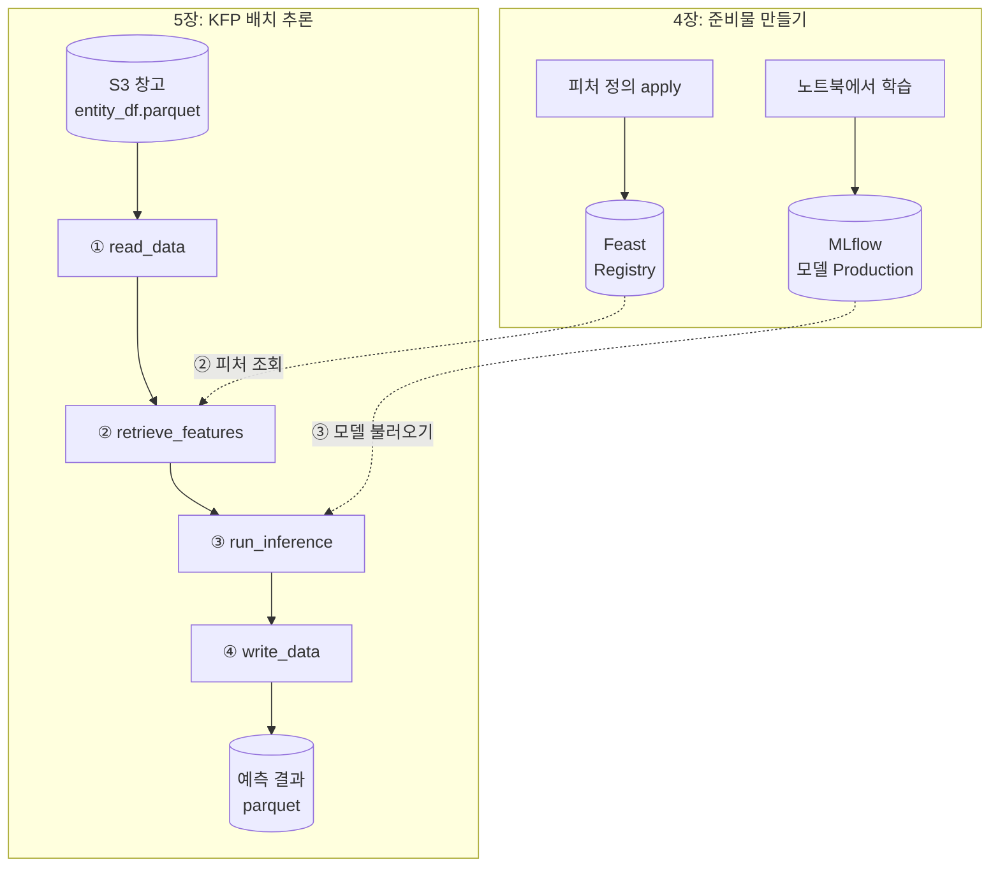
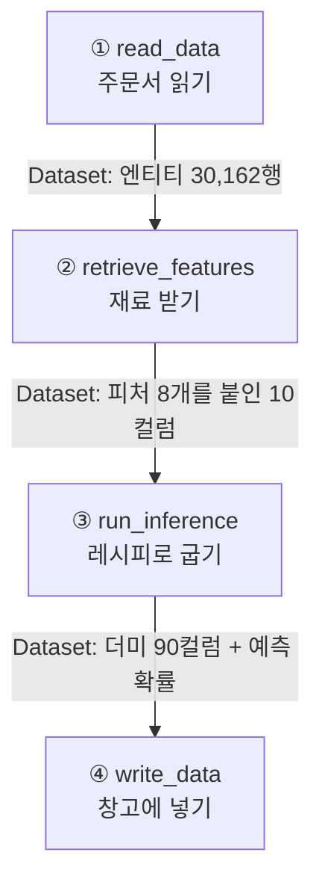

# 2주차: 실험, 피처, 파이프라인 (4~5장)

4장은 **MLflow**로 실험과 모델을, **Feast**로 피처를 관리하는 장이고, 5장은 4장에서 만든 모델과 피처 정의를 **KFP(Kubeflow Pipelines)** 로 이어 사용자 30,162명을 한 번에 예측하는 **배치 추론 파이프라인**을 만드는 장이다.

용어가 너무 많고 어려워서, 도구마다 **"공장에서 어떤 자리를 맡는가"** 와 **"엑셀로 치면 무엇인가"** 로 바꿔서 정리했다. 실습 기록은 A, B, C의 글을 참고했다(출처는 맨 아래).

---

## 0. 한눈에 보기: 예측 공장

4~5장 전체를 **사용자 소득 등급을 예측하는 공장**으로 보면 도구마다 자리가 정해진다.

| 공장 자리 | 도구 | 하는 일 | 엑셀로 치면 |
|---|---|---|---|
| 공장 부지 | kind, k3s | 쿠버네티스 클러스터 | 원본은 두고 연습용 사본 파일 만들기(kind) |
| 건설 감독 | Argo CD (GitOps) | Git의 설정대로 클러스터를 맞춘다 | 원본 서식 파일을 고치면 부서 파일이 따라 바뀜 |
| 연구실 | MLflow | 실험 기록, 모델을 이름과 버전으로 보관 | 파일 이름은 하나, 버전과 작성 조건은 자동 기록 |
| 재료실 | Feast | 피처 정의, 학습·예측 때 같은 기준으로 꺼내 줌 | 날짜 조건까지 맞춰 주는 VLOOKUP |
| 계산대 냉장고 | Redis, Valkey | 최신 피처를 빠르게 꺼내는 온라인 저장소 | 자주 쓰는 값만 따로 둔 시트 |
| 창고 | MinIO, SeaweedFS, RustFS (S3) | 데이터, 모델, 결과 파일 보관 | 용도별 최상위 폴더 |
| 생산 라인 | KFP | 단계를 순서대로 실행하고 기록 | 파워 쿼리의 "적용된 단계" |
| 라인 반장 | Argo Workflows | KFP의 단계를 실제 Pod로 띄움 | 매크로를 순서대로 실행하는 버튼 |



*5장 파이프라인은 학습을 하지 않는다. 4장에서 Production으로 지정한 모델과 Feast 정의를 가져다 예측만 한다. 그래서 4장을 먼저 끝내야 5장이 돈다.*

---

# CH4. 실험과 피처 관리 (MLflow, Feast)

## 4.1 핵심 6

| 용어 | 뜻 | 비유 |
|---|---|---|
| kind | Kubernetes IN Docker. 내 PC의 Docker 안에 연습용 쿠버네티스 클러스터를 만드는 도구 | 방 안에 차린 미니어처 공장 |
| GitOps | Git에 적힌 설정을 정답으로 삼는 운영 방식 | 본사 설계도를 고치면 시공팀이 그대로 맞춤 |
| Argo CD | GitOps를 실행하는 도구. Git과 클러스터 상태를 비교해 맞춘다(동기화) | 설계도를 들고 순찰하는 건설 감독 |
| KFP | ML 작업을 단계로 나눠 순서대로 실행하고 기록을 남기는 도구 | 생산 라인 |
| MLflow | 실험을 기록하고 고른 모델을 이름과 버전으로 보관 | 실험 노트와 공식 레시피 금고 |
| Feast | 피처를 정의하고 학습과 예측 때 같은 기준으로 꺼내 주는 피처 스토어 | 날짜 기준까지 맞춰 주는 재료실 |

*GitOps는 도구 이름이 아니라 방식이고, 그 방식을 실제로 해 주는 도구가 Argo CD다. 책은 Argo CD로 Kubeflow 전체를 설치하지만, C의 실습은 Argo CD 없이 kind에 KFP만 단독 설치했다.*

## 4.2 MLflow 용어

| 용어 | 뜻 | 비유 |
|---|---|---|
| Experiment | 같은 목적의 run을 묶는 폴더 | "소득 예측 레시피 개발" 실험 노트 한 권 |
| Run | 학습을 한 번 돌린 기록 | 실험 노트의 한 페이지 |
| Parameter | 실행할 때 정한 설정값 | 오븐 온도와 굽는 시간 |
| Metric | 결과를 숫자로 잰 점수 | 시식단의 맛 점수 |
| Artifact | 실행에서 남긴 파일(모델, 그래프, 열 목록) | 실험 사진과 완성품 샘플 |
| Model Registry | 고른 모델에 이름과 버전을 붙여 관리 | 공식 레시피 금고 |
| Stage (Production) | 모델 버전에 붙이는 상태 꼬리표 | "현재 공식" 스티커 |

- 메타데이터(run 기록, 모델 버전)는 **PostgreSQL**, 실제 모델 파일은 **S3**에 있다. MLflow 화면이 열려도 S3 연결이 끊기면 모델을 받을 수 없다.
- C의 실습: 실험 `income-classifier`에 run 4개(데이터 탐색 1 + Decision Tree, Random Forest, XGBoost). ROC AUC는 Random Forest 0.855, Decision Tree 약 0.817, XGBoost 0.714. 가장 좋은 Random Forest를 `random-forest-classifier` 버전 1로 등록하고 **Production**으로 지정했다.

*Production으로 지정해도 API 서버가 뜨지는 않는다. 꼬리표일 뿐이고, 5장 파이프라인이 이 꼬리표로 모델을 찾는다.*

## 4.3 Feast 용어

| 용어 | 뜻 | 비유 |
|---|---|---|
| 피처 (feature) | 모델에 넣는 입력값 하나 | 요리 재료 하나 (엑셀로 치면 열 하나) |
| Entity | "누구의 값인가"를 가리키는 조인 키 (`user_id`) | VLOOKUP의 찾을 값 |
| FeatureView | 한 원천에서 오는 피처 묶음 정의 | 값 없이 머리글 행만 있는 시트 |
| Registry | Entity와 FeatureView 정의를 모은 장부 파일 | 재료 목록 대장 |
| Offline store | 과거 피처 이력 전체 | 날짜별 입고 기록이 다 남은 큰 창고 |
| Online store | 최신값만 빠르게 꺼내는 저장소 (Redis) | 계산대 옆 냉장고 |
| feast apply | 정의를 Registry에 등록 (값은 안 옮김) | 목록표를 대장에 올리기 |
| materialize | 최신값을 Online store로 옮겨 담기 | 창고에서 냉장고 채우기 |
| 과거 시점 조회 | 각 행의 기준 시각에 "그때 알 수 있었던 값"을 붙임 | 날짜 조건이 붙은 VLOOKUP |
| TTL | 피처 값을 믿고 쓸 수 있는 기간 | 우유 유통기한 |

*과거 시점 조회 예: 사용자 42의 근무 시간이 5/21에 36, 6/4에 52라면 5/22 기준 조회는 36을 돌려준다. 5/22를 예측하면서 6/4 값을 쓰면 미래 정보가 섞인다(데이터 누설).*

*MLflow의 Model Registry와 Feast의 Registry는 이름만 같고 다른 것이다.*

## 4.4 4장 실습 순서 (C의 환경: Windows PC 한 대 + kind)

1. **환경과 버킷 준비** ✅: kind 클러스터에 KFP 2.4.1 단독판, 저장소(SeaweedFS), PostgreSQL, Redis, MLflow 설치. 포트포워딩(8080 KFP, 5000 MLflow, 8888 저장소 화면, 9000 S3, 6379 Redis)을 켜고 버킷 5개 생성
2. **MLflow 학습과 모델 등록** ✅: 데이터를 S3에 올리고 모델 3개 학습 → 가장 좋은 모델 등록 → Production 지정
3. **Feast 피처 정의와 조회** ✅: 원천 parquet 업로드 → `feast apply` → 과거 시점 조회 → `materialize` → 온라인 조회
4. **KFP 배치 추론** ✅: 이미지를 빌드해 kind에 넣고(`load`), Job으로 클러스터용 Registry 생성 → 파이프라인 컴파일 → 업로드 → 실행(약 2분)
5. **결과 확인** ✅: `inference-datasets/income_predictions.parquet` 생성

*SeaweedFS는 책의 MinIO 대신 넣은 S3 방식 창고다. 서비스 이름(`minio-service`)과 계정을 그대로 둬서 책 코드를 고치지 않아도 된다.*

*kind는 PC와 분리된 별도 컴퓨터처럼 움직여서, PC에서 다시 빌드한 이미지는 kind 안에 다시 넣어야 한다. 안 넣으면 `ErrImageNeverPull`.*

## 4.5 헷갈리는 짝 (4장)

| 짝 | 차이 |
|---|---|
| Argo CD ↔ Argo Workflows | 공장을 짓는 건설 감독 ↔ 라인에서 작업자를 부르는 반장. KFP를 깔면 Argo Workflows만 따라온다 |
| Kubeflow ↔ KFP | 대시보드·노트북·인증·Istio까지 든 종합 세트 ↔ 그중 파이프라인 부분 |
| MLflow 실험 ↔ KFP 실험 | 둘 다 이름이 `income-classifier`지만 서로 관계없다 |
| feast apply ↔ materialize | 정의 등록 ↔ 값 채우기. Registry에 보여도 Redis에 값이 있다는 뜻은 아니다 |
| 과거 시점 조회 ↔ 온라인 조회 | 큰 창고에서 그때 값 ↔ 냉장고에서 최신값. 5장 배치 추론은 과거 시점 조회를 쓴다 |
| localhost ↔ 서비스 주소 | PC에서는 PC, Pod 안에서는 그 Pod 자신 ↔ `이름.구역.svc.cluster.local` |
| 파라미터 ↔ 아티팩트 | 지시서에 적는 짧은 값 ↔ 다음 작업대로 넘기는 파일 |
| 컴파일 ↔ 실행 | YAML 지시서로 옮겨 적기(아무것도 안 돎) ↔ Pod가 떠서 실제 데이터를 읽음 |

---

# CH5. KFP 배치 추론 파이프라인

## 5.1 핵심 6

| 용어 | 뜻 | 비유 | 엑셀로 치면 |
|---|---|---|---|
| 오케스트레이션 | 여러 단계를 정해진 순서로 실행하며 데이터와 자원을 갖춰 주는 일 | 공장장 | 기준일 셀만 바꾸면 매크로가 가져오기→가공→계산→저장을 차례로 실행 |
| 컴포넌트 | 파이프라인의 단계 하나. 코드 → Docker 이미지 → component.yaml 세 겹. 실행할 때 Pod 하나에서 돈다 | 작업대 하나 | 인수를 받는 매크로(Sub) 하나 |
| component.yaml | 입출력, 타입, 이미지, 실행 명령을 적은 명세 | 작업대 안내판 | 함수의 인수 목록 |
| 파이프라인과 DAG | `@dsl.pipeline` 안에서 앞 태스크 출력을 다음 입력으로 넘기면 KFP가 실행 순서를 정한다 | 공정 순서도 | 셀 참조로 정해지는 계산 순서 |
| 파이프라인 파라미터 | 실행할 때마다 바꾸는 값(버킷, 파일 이름, 모델 이름, stage 등 14개) | 매번 꽂는 주문서 | 보고서 상단의 입력 셀 |
| 아티팩트 저장소 | 단계 사이 중간 데이터와 로그를 쌓는 곳 (pipeline root) | 작업대 사이 임시 선반 | 단계마다 결과를 붙여 두는 임시 시트 |

*Pod끼리는 메모리를 공유하지 않는다. 작업자(Pod)는 일이 끝나면 퇴근하니 결과를 선반(아티팩트 저장소)에 두고 가야 다음 작업자가 가져간다.*

## 5.2 파이프라인 4단계



| 단계 | 하는 일 | 결과 |
|---|---|---|
| ① read_data | S3에서 `entity_df.parquet`(user_id, event_timestamp)를 읽는다 | 엔티티 30,162행 |
| ② retrieve_features | `feature_store.yaml`로 Feast를 열고 `get_historical_features`로 피처 8개를 붙인다 | 10컬럼 |
| ③ run_inference | MLflow에서 Production 모델과 `column_list.pkl`을 받아 열 순서를 맞추고 `predict_proba`로 예측 | 더미 90컬럼 + 예측 확률 |
| ④ write_data | 결과를 버킷에 parquet로 올린다 | `inference_result.parquet` |

*② 단계는 과거 시점 조회만 해서 Redis(온라인 저장소)에 접속하지 않는다.*

## 5.3 component.yaml: 값 자리와 경로 자리

```text
# 작성할 때 (1단계 read_data, 키 인자 생략)
python3 /app/src/read_data/read_data.py
  --minio_host        {inputValue: minio_host}
  --bucket_name       {inputValue: bucket_name}
  --file_name         {inputValue: file_name}
  --data_output_path  {outputPath: data_output}      # ← 이 경로가

# 작성할 때 (2단계 retrieve_features, 일부)
python3 /app/src/retrieve_features/retrieve_features.py
  --entity_df         {inputPath: entity_df}         # ← 여기로 그대로 들어온다
  --feature_list      {inputValue: feature_list}
  --data_output       {outputPath: data_output}
```

```text
# 실행할 때 KFP가 채운 값 (A의 환경)
--minio_host        rustfs.mlflow.svc:9000
--bucket_name       inference-datasets
--data_output_path  /minio/mlpipeline/v2/artifacts/…/read-data-from-minio/…/data_output
--entity_df         /minio/mlpipeline/v2/artifacts/…/read-data-from-minio/…/data_output
```

- `inputValue`: 문자열 값이 명령줄에 그대로 들어간다 (지시서 메모)
- `inputPath`, `outputPath`: KFP가 **파일 경로**를 채운다 (선반 위치 번호)
- 앞 단계의 `outputPath`와 다음 단계의 `inputPath`가 **같은 파일**을 가리키는 것이 컴포넌트 연결의 전부다.

*Dataset 타입이라고 열 이름이나 결측을 검사해 주지는 않는다. 그런 검사는 코드에서 직접 해야 한다.*

## 5.4 실행 기록 (A의 홈랩, KFP 2.17.3)

A는 책의 `src/*.py`를 한 줄도 고치지 않고, 연결 방식과 실행 환경만 바꿨다.

1. **준비** ✅: 모델 v2를 Production으로 전환, `inference-datasets` 버킷에 `entity_df.parquet` 업로드, `feature-registry`에 `feature_store.yaml` 업로드, 아티팩트 저장소를 RustFS `mlpipeline`으로 변경
2. **컴포넌트 포장** ✅: Dockerfile 베이스를 `python:3.13-slim`으로 변경. GitHub Actions가 이미지를 빌드해 Docker Hub에 이름 4개로 푸시하고, 태그는 커밋 SHA
3. **키 전달 방식 변경** ✅: S3 키를 파라미터에서 빼고 Secret → 환경 변수로 주입. component.yaml은 `sh -c`로 감싸 환경 변수를 책 코드의 `--access_key` 인자로 넘김
4. **컴파일과 실행** ✅: 캐시 끄고 SDK 2.17.3으로 컴파일 → UI에 올리지 않고 `create_run_from_pipeline_package`로 바로 실행
5. **결과** ✅: 4단계 모두 성공, 전체 3분 6초. 결과 파일 30,162행 × 91컬럼, 결측 0

| 단계 | 10-28 (단계 안에서 설치) | 10-29 (Docker Hub 이미지) |
|---|---|---|
| read-data | 16초 | 45초 (이미지 받기 29초) |
| retrieve-features | 35초 | 20초 |
| model-inference | 43초 | 21초 |
| write-data | 16초 | 10초 |
| **전체** (driver 기동 포함) | **3분 8초** | **3분 6초** |

*예측 확률 평균 0.249, 0.5 이상 22.2% (데이터의 실제 고소득 비율 24.9%). 같은 모델로 직접 예측한 값과 차이 0.0.*

*이미지 이름은 4개지만 Dockerfile이 저장소 전체를 복사해서 내용은 모두 같다. 그래서 두 번째 단계부터는 이미지 받기가 2~4초면 끝난다.*

### 막힌 곳과 해결

| 증상 | 원인 | 해결 |
|---|---|---|
| 피처 조회 단계 실패 (1분 32초) `FeastModuleImportError` | `feature_store.yaml`에 `type: redis`가 있으면 접속하지 않아도 설정 검증 때 redis 모듈을 불러온다 | `feast[aws]` → `feast[aws,redis]` |
| 추론 단계가 로그 없이 멈춤 (12분 15초) | 노드 재기동 뒤 Postgres보다 먼저 뜬 MLflow Pod의 init 컨테이너가 재시도 간격을 약 8시간까지 늘린 채 대기 → MLflow Service에 엔드포인트 없음 | `kubectl rollout restart`로 MLflow 재기동, 멈춘 Run은 Terminate |

### 책 저장소를 그대로 쓰면 생기는 문제

- `python:3.10-slim-buster`는 지원 종료로 `apt-get update`가 실패해 이미지 빌드가 안 된다
- 이미지가 저자 계정의 `latest` 태그다 (`IfNotPresent` 정책이면 노드가 새 이미지를 안 받을 수 있음)
- 책 4장에서 stage를 지정하지 않아 Production 모델을 못 찾는다
- 책 4장 레지스트리는 `localhost`를 가리켜 Pod에서 닿지 않는다
- S3 키가 파이프라인 파라미터라 실행 기록(UI, DB)에 평문으로 남는다
- 저장소의 파이프라인 YAML은 kfp 2.9.0으로 컴파일돼 있다

## 5.5 실습 환경 짓기 (B: 블로그가 도는 k3s 한 대)

B는 "책은 Kubeflow 전체를 올리지만 4·5장이 실제로 쓰는 건 MLflow, 객체 저장소, Redis, KFP뿐"이라는 데서 출발해 필요한 것만 올렸다.

1. **부지 살피기**: arm64 VM 한 대의 k3s. CPU 2코어, 객체 저장소 없음, 실습용 Git과 CI 없음
2. **책과 비교**: Kubeflow 1.7 전체는 CPU가 넘치고, Kubernetes 1.25까지만 지원하고, MLMD와 Feast 서버에 arm64 이미지가 없음 → 필요한 것만 대체
3. **부지 넓히기**: 2코어 → 4코어 (재부팅으로 블로그가 몇 분 내려감), 앱마다 requests 합계 계산
4. **정문과 출입증**: Gateway API로 정문을 하나로 모으고, 로그인은 authentik. MLflow·KFP는 forward auth, Argo CD·Grafana·Gitea는 OIDC
5. **감독 구역 나누기**: Argo CD 프로젝트를 `ops`, `mlops-lab`, `default`로 분리
6. **공용 설비**: MinIO 대신 SeaweedFS(용도별 키), GitLab 대신 Gitea와 runner, 모니터링은 kube-prometheus-stack
7. **MLflow**: 공식 이미지, CNPG Postgres, 아티팩트 프록시, SDK는 app password로 로그인
8. **Feast와 Valkey**: Feast 서버 없이 SDK만, 냉장고는 Redis 대신 Valkey. 노트북은 SSH 터널로 접속, 5장용 레지스트리는 클러스터 안 Job으로 따로 생성
9. **KFP**: 2.17.3 단독판을 단일 사용자로, v1용 구성 요소 제거, MLMD는 arm64 빌드로 교체, 파이프라인 권한을 여러 겹으로 축소(실행 계정, Pod Security, NetworkPolicy, 입장 심사 규칙)
10. **요청 경로 정리**: 아래 그림

| 항목 | CPU (코어) | 메모리 (Gi) |
|---|---|---|
| 기존 운영 워크로드 | 1.02 | 3.34 |
| 실습 공용 기반 (SeaweedFS, Gitea, 모니터링) | 0.64 | 2.30 |
| MLflow | 0.15 | 0.81 |
| Valkey | 0.05 | 0.13 |
| KFP | 0.18 | 0.98 |
| **합계** | **2.04** | **7.56** |
| 참고: 책의 Kubeflow 전체만 | 약 3.9 | 약 10.3 |

```text
[공개 주소] 브라우저·노트북 SDK → Cloudflare(요청당 100MB) → Gateway → authentik 로그인 → MLflow·KFP
[노트북]    노트북 → SeaweedFS S3 (용도별 키)
            노트북 127.0.0.1:6379 → SSH 터널 → 노드 → Valkey (공개 주소 없음)
[클러스터]  파이프라인 Pod → NetworkPolicy → mlflow.mlflow.svc.cluster.local:5000 (로그인 없음)
            파이프라인 Pod → minio-service.kubeflow:9000 → ExternalName → SeaweedFS
```

*공개 주소는 출입증(authentik)이, 클러스터 안 주소는 출입 명단(NetworkPolicy)이 지킨다. 그래서 책의 컴포넌트에 로그인 코드를 넣지 않아도 된다.*

*ExternalName은 이름만 다른 주소로 돌려주는 Service다. `minio-service`라는 이름을 그대로 두고 실제로는 SeaweedFS로 보내서 책 코드를 고치지 않았다(번호를 그대로 둔 착신 전환).*

## 5.6 같은 책, 네 가지 환경

| | 책 | C | A | B |
|---|---|---|---|---|
| 부지 | k3s v1.24 + Kubeflow 1.7 전체 | kind (Windows PC 한 대) | 홈랩 쿠버네티스 (KFP는 amd64 노드) | 단일 노드 k3s (arm64, 4코어) |
| 창고 | MinIO | SeaweedFS (minio-service 이름 유지) | RustFS 하나로 통일 | 공용 SeaweedFS + ExternalName |
| 냉장고 | Redis | Redis | Redis | Valkey |
| 생산 라인 | Kubeflow에 든 KFP | KFP 2.4.1 단독판 | KFP 2.17.3 단독판 | KFP 2.17.3 단일 사용자판 |
| S3 키 | 파이프라인 파라미터 | 파라미터 (로컬 실습 한정) | Secret → 환경 변수 | Secret → 환경 변수 |

## 5.7 헷갈리는 짝 (5장)

| 짝 | 차이 |
|---|---|
| 컴포넌트 ↔ 태스크 | `fetch_data_op`(불러온 작업대 설계) ↔ `fetch_data_task`(오늘 라인에 놓은 작업대). 함수 정의와 셀에 한 번 쓴 함수의 차이 |
| inputValue ↔ inputPath·outputPath | 값 그대로 ↔ KFP가 채우는 파일 경로. 작업대끼리 상자를 주고받는 길은 경로 자리뿐 |
| UI 실행 ↔ SDK 실행 | Upload → Experiment → Create run ↔ `create_run_from_pipeline_package`. SDK로 돌리면 Pipelines 메뉴엔 안 보이고 Experiments 아래에만 Run이 쌓인다 |
| stage ↔ alias | 책 코드가 쓰는 상태 꼬리표 ↔ MLflow 3에서 권장하는 자유 이름표. alias만 붙이면 책 파이프라인은 모델을 못 찾는다 |
| 실행 성공 ↔ 올바른 예측 | 초록 체크 ↔ 예측이 맞는지. 아래 5.8 참고 |
| latest 태그 ↔ 커밋 SHA 태그 | 같은 이름이면 노드가 새 이미지를 안 받을 수 있음 ↔ 커밋마다 이름이 달라 항상 새로 받음 |
| 파라미터로 키 넘기기 ↔ Secret | 실행 기록에 평문으로 남음 ↔ 컴파일된 YAML에는 Secret 이름만 들어감 |
| 배치 추론 ↔ 실시간 서빙 | 모아 둔 대상을 한꺼번에 (5장, KFP) ↔ 요청마다 바로 답함 (6장, BentoML) |
| forward auth ↔ OIDC | 로그인 기능 없는 앱 앞에서 정문이 대신 확인 ↔ 앱이 직접 로그인 서버에 확인 |
| 4장 레지스트리 ↔ 5장 레지스트리 | 노트북에서 apply(노트북 기준 주소) ↔ 클러스터 안 Job으로 apply(Pod가 닿는 주소) |
| Redis ↔ Valkey | 책의 냉장고 ↔ Redis와 같은 말을 알아듣는 오픈소스 냉장고. Feast 클라이언트를 그대로 쓴다 |
| amd64 ↔ arm64 | 일반 PC·서버 ↔ 일부 VM. amd64 전용 이미지는 arm64에서 그냥은 안 돈다 |

## 5.8 오류 없이 틀리는 원-핫 인코딩

`run_inference`는 배치 데이터에 `get_dummies(drop_first=True)`를 다시 적용하고, 학습 때 열 순서로 맞추면서 없는 열은 0으로 채운다(`reindex(fill_value=0)`). 직업군(Workclass) 4개로 줄여서 따라가 보면:

- 학습 때는 알파벳순 첫 값인 **Federal-gov** 열이 지워져 `Local-gov, Private, State-gov` 3열이 남았다.
- 그런데 이번 배치에 Federal-gov가 한 명도 없으면, 배치 안에서 첫 값인 **Local-gov** 열이 지워진다.

| 직업군 | 학습 때 (Local · Private · State) | Federal-gov 없는 배치 | 모델이 읽은 값 |
|---|---|---|---|
| Local-gov | 1 0 0 | 0 0 0 | Federal-gov ❌ |
| Private | 0 1 0 | 0 1 0 | Private ✅ |
| State-gov | 0 0 1 | 0 0 1 | State-gov ✅ |

*Local-gov인 사람이 Federal-gov로 읽히는데 오류 메시지는 하나도 나지 않는다. 전체 30,162행을 넣으면 모든 직업군이 다 들어 있어서 이 문제가 드러나지 않는다.*

*엑셀로 치면: 피벗으로 0/1 열을 만든 뒤 첫 열을 지우는데, 이번 달 데이터에 무엇이 있느냐에 따라 "첫 열"이 달라지는 것과 같다.*

*고치려면 학습 때의 범주 목록을 고정해 두고 추론 때 같은 목록으로 펼쳐야 한다. 예를 들어 학습 때 쓴 인코더(scikit-learn `OneHotEncoder`)를 모델과 함께 저장해 두고 추론 때 그대로 쓰는 방법이 있다.*

---

## 정리: 2주차에 배운 것

1. **4장 결과물이 5장의 재료다.** Production 모델과 Feast 정의가 없으면 5장 파이프라인은 돌지 않는다.
2. **주소는 어디서 실행하느냐에 따라 달라진다.** PC의 `localhost`, Pod의 서비스 주소, 공개 주소가 각각 다르다. 레지스트리에도 주소가 같이 저장돼서 쓰는 곳마다 따로 만들어야 했다.
3. **키는 파라미터가 아니라 Secret으로.** 파라미터는 실행 기록에 평문으로 남는다.
4. **초록 체크는 품질 보증이 아니다.** 원-핫 인코딩처럼 조용히 틀릴 수 있다.
5. **책의 동작 원리는 그대로지만 명령과 버전은 바뀐다.** stage는 MLflow 3에서 폐지 예정이고, buster 이미지는 빌드되지 않고, KFP 2.17.3은 저장소를 바꾸려면 네 곳을 고쳐야 했다.
6. **도구는 전부 설치하는 게 아니라 필요한 것만 고른다.** B는 Kubeflow 전체(약 3.9코어) 대신 필요한 것만 올려 실습 쪽 합계를 약 1코어로 줄였다.

---

## 참고

- A : ken-0913, [Ch5. KFP로 소득 분류기 배치 추론 파이프라인 만들기](https://ken-0913.github.io/myblog/posts/mlpe/mlpe-05-1-kfp-income-pipeline/)
- B : kurtyoon, [블로그가 도는 k3s에 4, 5장 실습 환경 만들기](https://blog.somnitor.dev/posts/89/k3s-lab-for-mlflow-feast-kfp)
- C : johklo, [04. 실험, 피처, 파이프라인 연결하기](https://johklo.github.io/docs/tech/machine-learning-platform-engineering/04-experiments-features-pipelines/)

위 A, B, C의 실습 기록을 참고해 정리했다. 책 예제 코드는 [practical-mlops/chapter-5](https://github.com/practical-mlops/chapter-5)이고, 용어를 더 자세히 풀어 쓴 페이지는 [html/04-experiments-features-pipelines.html](../html/04-experiments-features-pipelines.html), [html/05-kfp-batch-inference.html](../html/05-kfp-batch-inference.html)에 있다.
