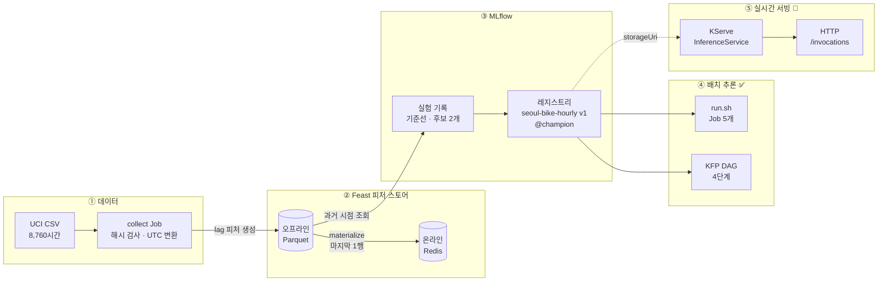
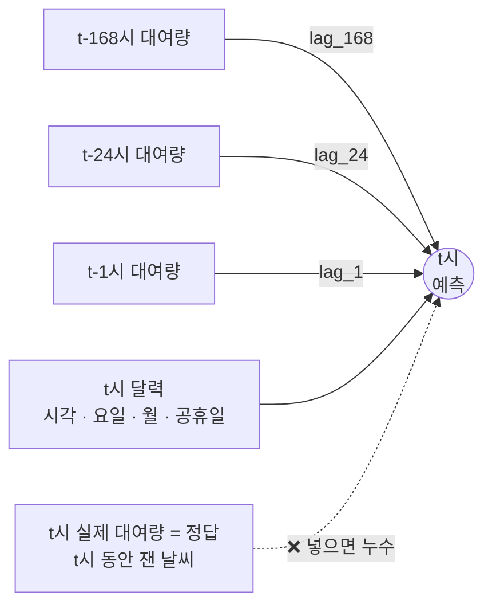
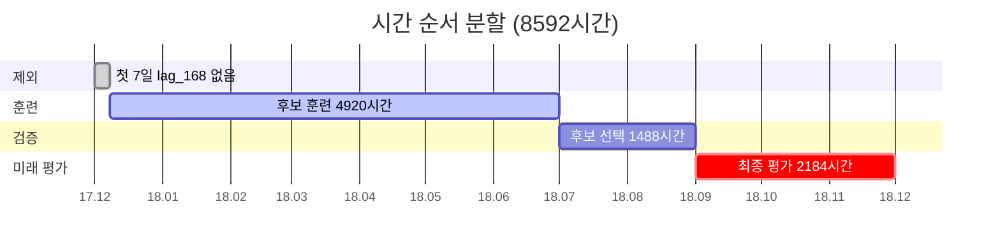
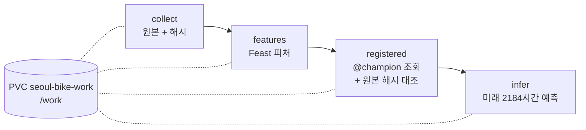
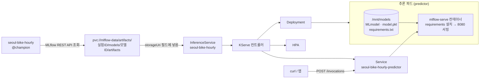

# 🚲 서울 공공자전거 수요 예측으로 따라가는 ML 플랫폼 실습을 참조하여 따라가며 진행해보았습니다.

**Feast · MLflow · Kubeflow Pipelines로 만든 모델을 KServe로 서빙하기까지**

> [!NOTE]
> 이 문서는 아래 두 자료를 하나의 흐름으로 묶고, 이해를 돕는 해설을 덧붙인 스터디 노트입니다.
>
> - **서울 자전거 실습 (본문 중심)** — [서울 자전거 데이터로 Feast·MLflow·KFP 잇기](https://ddii.dev/mlops/ml-platform-engineering-ch4-5-practice/) (Jinwoong Kim, 2026-10-31)
> - **모델 서빙 실습 (8장에서 정리)** — [Lab 1 시나리오 7. 모델 서빙: KServe를 통한 프로덕션 레벨 HTTP API 배포](https://github.com/choisungwook/portfolio/blob/master/mlops/ml-platform-engineering-part2/docs/12-lab1-model-serving.md) (choisungwook)
> - **교재** — *Machine Learning Platform Engineering* 4~5장

## 목차

- [0. 이 문서 읽는 법](#0-이-문서-읽는-법)
- [1. 한눈에 보기](#1-한눈에-보기)
- [2. 용어 먼저](#2-용어-먼저)
- [3. 데이터와 예측 문제 정하기](#3-데이터와-예측-문제-정하기)
- [4. Feast: 그때 알 수 있던 값만](#4-feast-그때-알-수-있던-값만)
- [5. MLflow: 후보 비교와 모델 등록](#5-mlflow-후보-비교와-모델-등록)
- [6. 평가: 무작위 평가와 미래 평가](#6-평가-무작위-평가와-미래-평가)
- [7. 오케스트레이션: Job 다섯 개와 KFP](#7-오케스트레이션-job-다섯-개와-kfp)
- [8. 모델 서빙: KServe로 API 만들기](#8-모델-서빙-kserve로-api-만들기)
- [9. 정리](#9-정리)
- [10. 직접 해 보기 체크리스트](#10-직접-해-보기-체크리스트)
- [참고 자료](#참고-자료)

---

## 0. 이 문서 읽는 법

| 표시 | 뜻 |
|:---:|---|
| ✅ | **실행 기록** — 블로그 또는 12번 실습에서 실제로 돌려 얻은 결과입니다. 숫자는 원문 그대로 옮겼습니다. |
| 📐 | **설계안** — 이 문서에서 서울 자전거 모델에 맞춰 새로 짠 것입니다. **아직 실행하지 않았습니다.** |
| 💡 | **해설** — 이해를 돕기 위해 덧붙인 설명과 비유입니다. |

> [!IMPORTANT]
> 블로그는 Feast → MLflow → KFP **배치 추론**까지만 실행했고, 실시간 API 서빙은 "다음 글"로 남겼습니다.
> 12번 실습의 KServe 서빙은 **소득 분류 모델(income-classifier)** 로 진행했습니다.
> 그래서 8장의 "서울 자전거 모델을 KServe로 서빙"하는 부분은 전부 📐 설계안이며, 실행 결과 숫자는 넣지 않았습니다.

---

## 1. 한눈에 보기

| 항목 | 내용 |
|---|---|
| **예측 문제** | t시가 시작될 때, 서울 공공자전거의 t시 대여 대수를 예측합니다 (1시간 앞 예측). |
| **데이터** | UCI Seoul Bike Sharing Demand · 2017-12-01 00시 ~ 2018-11-30 23시 · 8,760시간 |
| **플랫폼 도구** | Feast 0.40.1 · MLflow 3.0.0 · Kubeflow Pipelines(KFP) 2.17.3 · (서빙) KServe |
| **모델** | scikit-learn 1.5.2 `HistGradientBoostingRegressor` (CPU 훈련) |
| **실행 환경** | Mac M3 Pro · Rancher Desktop (k3s v1.34.4, arm64, VM 8 CPU · 16GB) |
| **결과 ✅** | 미래 3개월(2,184시간) **MAE 90.84대** — "하루 전 값" 기준선(386.42대)의 약 4분의 1 |
| **서빙 📐** | MLflow `seoul-bike-hourly@champion` → KServe `InferenceService` → HTTP `/invocations` |

### 전체 흐름



### 💡 네 도구를 한 줄씩

| 도구 | 한 줄 정의 | 비유 | 이 실습에서 답하는 질문 |
|---|---|---|---|
| **Feast** | 피처 스토어 | 손질법이 정해진 **재료 창고**. 과거 주문 재현용(오프라인)과 지금 주문용(온라인)에 같은 방법으로 손질한 재료를 내줍니다. | 예측 시각에 **정말 알 수 있던 값**인가? |
| **MLflow** | 실험 추적 + 모델 레지스트리 | **실험 노트 + 버전 라벨이 붙은 완제품 창고**. 도커 이미지 레지스트리와 비슷합니다. | **어떤 데이터·피처로** 고른 **몇 번째** 모델인가? |
| **KFP** | 파이프라인 오케스트레이터 | **공정표**. 단계의 순서와 상태를 관리합니다. | 등록된 모델을 **재훈련 없이** 다시 쓸 수 있는가? |
| **KServe** | 모델 서빙 플랫폼 | **주문 창구**. 창고의 완제품을 꺼내 손님 요청에 바로 답합니다. | 노트북 밖에서도 **같은 답을 HTTP로** 줄 수 있는가? |

---

## 2. 용어 먼저

<details>
<summary><b>용어 표 펼치기</b> (처음이라면 먼저 읽기를 권합니다)</summary>

| 용어 | 뜻 | 이 실습에서의 예 |
|---|---|---|
| 피처 (feature) | 모델이 입력으로 받는 가공된 값 | 시각 · 요일 · 공휴일, 직전 대여량 |
| 시차 피처 (lag feature) | 과거 시점의 값을 현재 입력으로 가져온 피처. `lag_k` = k시간 전 값 | `lag_1`(1시간 전), `lag_24`(하루 전), `lag_168`(일주일 전) |
| 기준선 (baseline) | 모델이 넘어야 할 단순 비교 기준. 훈련 없이 규칙으로 답합니다 | "하루 전 같은 시각 대여량을 그대로 답한다" |
| 훈련 · 검증 · 평가 분할 | 배우는 데이터 / 후보 중 고르는 데이터 / 마지막에 재는 데이터 | 17.12~18.06 훈련, 7~8월 검증, 9~11월 미래 평가 |
| 홀드아웃 (holdout) | 훈련에 쓰지 않고 떼어 둔 평가 전용 데이터 | 무작위 25%, 9~11월 미래 구간 |
| 데이터 누수 (leakage) | 예측 시점엔 알 수 없던 미래 정보가 입력에 섞이는 것. 점수를 거짓으로 좋게 만듭니다 | t시 예측에 t시 실제 대여량을 넣는 것 |
| 과거 시점 조회 (point-in-time lookup) | 예측 시각마다 "그때 알 수 있던" 피처 값만 골라 오는 조회 | Feast `get_historical_features` |
| 오프라인 / 온라인 스토어 | 오프라인 = 과거 전체 이력(훈련 · 배치용), 온라인 = 최신 값만(실시간용) | Parquet 파일 / Redis |
| materialize (적재) | 오프라인 값을 온라인 스토어로 옮기는 작업 | 마지막 시각 1행을 Redis로 |
| TTL (time-to-live) | 피처 행이 유효한 기간. 너무 오래된 값을 조용히 끌어오지 않게 막습니다 | 1시간 |
| MAE | 예측과 실제 차이의 절댓값 평균. 작을수록 좋습니다 | MAE 90 ≈ 한 시간에 평균 90대 빗나감 |
| RMSE | 오차를 제곱해 평균한 뒤 제곱근. 큰 오차에 더 민감합니다 | RMSE ≫ MAE 이면 가끔 크게 틀린다는 신호 |
| 레지스트리 · 버전 · 별칭 | 모델을 이름 · 번호로 등록하고, `champion` 같은 이름표로 가리킵니다 | `seoul-bike-hourly` 버전 1 = `@champion` |
| 배치 추론 / 실시간 서빙 | 쌓인 여러 건을 한 번에 예측 / 요청이 올 때마다 1건씩 예측 | 2,184시간 한 번에 / HTTP 요청 1건 |
| InferenceService | KServe의 쿠버네티스 커스텀 리소스. "이 경로의 모델을 이 런타임으로 띄워라" | `seoul-bike-hourly` (📐) |
| ServingRuntime | 모델을 실제로 실행하는 서버 컨테이너의 정의 | `mlflow-serve` |
| storageUri | 모델 파일이 있는 저장소 주소 | `s3://...`(12번), `pvc://...`(📐) |
| 학습-서빙 왜곡 (training-serving skew) | 학습 때와 서빙 때 입력을 만드는 방법이 달라 예측이 틀어지는 것 | 호출자가 시각을 UTC로 계산해 `hour`가 9시간 밀림 |
| PVC | 파드가 쓰는 쿠버네티스 저장 공간 요청서 | `mlflow-data`(2Gi), `experiment-data`(1Gi) |

</details>

### 💡 MAE와 RMSE를 식으로

```math
\mathrm{MAE}=\frac{1}{n}\sum_{i=1}^{n}\left|y_i-\hat{y}_i\right|
\qquad
\mathrm{RMSE}=\sqrt{\frac{1}{n}\sum_{i=1}^{n}\left(y_i-\hat{y}_i\right)^2}
```

- $y_i$ 는 실제 대여 대수, $\hat{y}_i$ 는 예측 대수입니다.
- RMSE는 오차를 **제곱**하므로, 한 번 크게 틀린 시간이 있으면 MAE보다 훨씬 커집니다.

---

## 3. 데이터와 예측 문제 정하기

### 왜 이 데이터인가

| 기준 | 확인한 내용 | 이 실습에서 얻는 것 |
|---|---|---|
| 지역 | 서울 공공자전거 대여 기록 | 한국의 실제 수요 |
| 시점 | 2017-12-01 00시 ~ 2018-11-30 23시, **연속 8,760시간** | "예측 시점보다 늦게 나온 값은 뺀다"는 규칙을 연습할 수 있음 |
| 정답 | 매 시간의 실제 대여 대수 | MAE를 "대"라는 단위로 바로 해석 가능 |
| 크기 | CSV 약 0.6MB | 노트북 한 대의 로컬 쿠버네티스에서도 전체 실습 가능 |
| 라이선스 | CC BY 4.0 (DOI: 10.24432/C5F62R) | 출처 표기 후 자유롭게 사용 |

> [!WARNING]
> 한 도시 · 1년치 **집계** 자료입니다. 대여소별 수요나 여러 해의 추세로 일반화하면 안 됩니다.
> 또 평가는 "직전 시간 실제 대여량"을 보며 **한 시간씩 전진**하는 방식입니다. 3개월을 한 번에 미리 예보한 결과가 아닙니다.

### 💡 핵심은 "예측 시각을 먼저 정한다"

목표는 **t시가 시작하는 순간** t시의 대여 대수를 맞히는 것입니다.
CSV의 한 행에는 t시의 대여량과 t시의 날씨가 같이 들어 있지만, 그 순간에는 둘 다 아직 모릅니다.



| 입력 | 계산 방법 | t시 시작 순간에 쓸 수 있나? |
|---|---|---|
| 시각 · 요일 · 월 · 공휴일 | t의 달력 | ✅ 가능 (공휴일은 미리 공지된 일정이라고 가정) |
| `lag_1` | t-1시 실제 대여량 | ✅ 직전 시간 집계가 마감됐다는 가정 아래 가능 |
| `lag_24` · `lag_168` | t-24시 · t-168시 실제 대여량 | ✅ 가능 |
| `prev_temperature` · `prev_rainfall` | t-1시 날씨 | ✅ 직전 관측이 들어왔다는 가정 아래 가능 (후보 하나에만 사용) |
| t시 실제 대여량 · t시 날씨 | 같은 행에 있음 | ❌ 사용 불가 |

### 수집 단계에서 지킨 규칙 ✅

- **시간대**: CSV의 날짜 · 시각은 서울 시각입니다. `Asia/Seoul`을 붙인 뒤, Feast에는 **UTC** `event_timestamp`로 저장했습니다. (서울 2018-11-30 23시 = UTC 14시)
- **무결성**: 다운로드 ZIP의 SHA-256이 바뀌면 수집 Job이 멈춥니다. 중복 시각 · 빠진 시간 · 빈 셀도 검사했습니다.
- **인코딩**: 컬럼 이름의 `°C`가 깨지지 않도록 CSV를 `latin1`로 읽었습니다.
- **행 수**: 일주일 전 값(`lag_168`)이 없는 처음 168행을 빼서 **8,592시간**을 실험 대상으로 삼았습니다.

```python
local_time = pd.to_datetime(
    df["Date"] + " " + df["Hour"].astype(str).str.zfill(2),
    format="%d/%m/%Y %H",
).dt.tz_localize("Asia/Seoul")

features["lag_1"] = df["Rented Bike Count"].shift(1)      # 1시간 전
features["lag_24"] = df["Rented Bike Count"].shift(24)    # 하루 전
features["lag_168"] = df["Rented Bike Count"].shift(168)  # 일주일 전
```

### 무작위가 아니라 달력 순서로 나눴다



| 구간 | 기간 | 시간 수 | 용도 |
|---|---|---:|---|
| 훈련 | 2017-12-08 ~ 2018-06-30 | 4,920 | 후보 모델 학습 |
| 검증 | 2018-07-01 ~ 2018-08-31 | 1,488 | 후보 중 하나 고르기 |
| 미래 평가 | 2018-09-01 ~ 2018-11-30 | 2,184 | 고른 뒤 마지막 측정 (손대지 않고 남겨 둠) |

---

## 4. Feast: 그때 알 수 있던 값만

### 구성

| 요소 | 값 |
|---|---|
| Entity | `city_id` (이번 자료엔 `"seoul"` 하나뿐) |
| FeatureView | `bike_hourly` — `lag_1`, `lag_24`, `lag_168`, `prev_temperature`, `prev_rainfall` |
| TTL | 1시간 |
| 오프라인 스토어 | 파일 (`/work/features.parquet`) |
| 온라인 스토어 | Redis (`redis:6379`) |

### 💡 `event_timestamp`가 뜻하는 것

피처 행의 `event_timestamp`는 **"이 값들을 예측에 쓸 수 있게 되는 t시의 시작"** 입니다.
그래서 t행의 `lag_1`에는 t-1행의 대여량이 들어 있습니다.
`get_historical_features`에 "예측할 시각 목록"을 넘기면, Feast가 각 시각에 맞는 행만 골라 붙여 줍니다. 이것이 과거 시점 조회입니다.

### 💡 TTL 1시간과 `lag_168`(일주일 전)은 충돌하지 않는다

- TTL은 **피처 행 자체**가 유효한 시간입니다. 매 시간 행을 만들었으니, 빠진 시간이 없으면 항상 그 시간의 행을 씁니다.
- 어느 시간 행이 빠지면, 하루 전 행을 **조용히 끌어오지 않고** 빈 값이 됩니다. 이걸 막으려는 설정입니다.
- `lag_168`은 "현재 행 안에 들어 있는 일주일 전 값"이라서 TTL과 상관이 없습니다.

### 검증 결과 ✅

- **과거 시점 조회**: 32개 시점을 고르게 뽑아 Feast 반환값과 미리 계산한 시차 값을 대조 → 다섯 피처 모두 일치
- **온라인 조회**: 마지막 시각 1행만 Redis로 materialize (`redis-cli dbsize` = 1) → 오프라인 값과 일치

| 마지막 조회 대상 (서울 2018-11-30 23:00) | 오프라인 (Parquet) | 온라인 (Redis) |
|---|---:|---:|
| `lag_1` | 712 | 712 |
| `lag_24` | 559 | 559 |
| `lag_168` | 548 | 548 |
| 직전 온도 | 약 2.1°C | 약 2.1°C |
| 직전 강수량 | 0 | 0 |

> [!NOTE]
> 마지막 1행만 확인했으므로 **전 기간의 온라인/오프라인 일치를 보증하지는 않습니다.**
> 매 시간 온라인 값을 바꿔 넣는 실시간 수집 파이프라인도 이번에는 만들지 않았습니다.

### 트러블슈팅: 한 번에 다 조인하다 OOM ✅

> [!WARNING]
> 처음에는 8,592개 시점을 `get_historical_features` 한 번에 넣었다가, Feast 0.40.1 파일 스토어의 조인 Job이 **메모리 상한 2GiB에 걸려 `OOMKilled`** 됐습니다.
> "피처 값이 8,592 × 5개뿐이니 메모리도 작겠지"라고 생각한 것이 실수였습니다. 조인 도중의 중간 테이블은 훨씬 큽니다.

해결: **168개 시점(일주일)씩 나눠 조회한 뒤 합쳤습니다.** 168은 이 로컬 환경에서 통과한 값일 뿐, 모든 Feast 백엔드에 맞는 숫자는 아닙니다.

```python
parts = []
for start in range(0, len(entity), 168):
    part = store.get_historical_features(
        entity_df=entity.iloc[start:start + 168],
        features=["bike_hourly:lag_1", "bike_hourly:lag_24", "..."],
    ).to_df()
    parts.append(part)
joined = pd.concat(parts, ignore_index=True)
```

---

## 5. MLflow: 후보 비교와 모델 등록

### 후보 비교 (7~8월 검증 구간) ✅

| 후보 | 검증 MAE ↓ | 검증 RMSE ↓ | 결정 |
|---|---:|---:|---|
| 하루 전 같은 시각 (`lag_24` 그대로) | 265.55 | 456.26 | 단순 기준선 |
| **달력 + 시차 1 · 24 · 168시간** | **103.76** | **157.44** | **선택** |
| 달력 + 시차 + 직전 온도 · 강수량 | 118.46 | 171.30 | 이번 검증에서는 더 나쁨 |

### 💡 이 표를 읽는 법

- 기준선 265.55 → 선택 모델 103.76. 모델이 기준선 오차를 **약 61% 줄였습니다.** 기준선이 있어야 "모델이 정말 쓸모 있나"를 말할 수 있습니다.
- **날씨를 더했더니 오히려 나빠졌습니다.** "온도와 수요는 관계없다"는 뜻이 아닙니다. 계절별 자료량, 습도 · 강설 누락, 모델 설정, 관측 지연 같은 다른 이유일 수 있습니다.
- 이 데이터로 할 수 있는 정직한 판단은 하나입니다. **검증 MAE가 낮은 더 단순한 후보를 등록한다.**

### 최종 모델 등록 ✅

1. 선택한 후보를 **훈련 + 검증 6,408시간**으로 다시 훈련했습니다.
2. 기준선 · 후보 2개 · 최종 모델을 각각 별도 실행(run)으로 MLflow에 남겼습니다.
3. 실행마다 **데이터 SHA-256 · 피처 이름 · 분할 경계 · 검증 지표**를 기록했습니다.
4. `seoul-bike-hourly` **버전 1**로 등록하고 **`champion` 별칭**을 붙였습니다.

```python
with mlflow.start_run(run_name="champion-calendar-and-lags"):
    mlflow.log_params({"features": ",".join(columns),
                       "dataset_sha256": csv_sha256})
    model_info = mlflow.sklearn.log_model(final_model, name="model")

registered = mlflow.register_model(model_info.model_uri, "seoul-bike-hourly")
MlflowClient().set_registered_model_alias("seoul-bike-hourly",
                                          "champion", registered.version)
```

### 💡 버전과 별칭의 차이

- **버전 번호**(1, 2, 3 …)는 한 번 붙으면 바뀌지 않는 **고정 주소**입니다.
- **별칭**(`champion`)은 **옮겨 붙일 수 있는 이름표**입니다. 더 좋은 버전이 나오면 이름표만 옮기면 됩니다.
- 그래서 사용하는 쪽이 `models:/seoul-bike-hourly@champion`만 알면, 모델이 바뀌어도 코드를 고치지 않아도 됩니다. (단, KServe는 이 이름표 이동을 **스스로 알아채지 못합니다** → [8장 운영 시사점](#88-운영-시사점))

> [!CAUTION]
> 블로그 모델은 MLflow에 **입력 signature와 입력 예시(input_example)를 기록하지 않았습니다.**
> 그래서 12번 실습에 있던 `serving_input_example.json`이 이 모델에는 없습니다. 서빙 요청 JSON을 직접 만들어야 합니다(8.7 참고).

---

## 6. 평가: 무작위 평가와 미래 평가

같은 코드 · 같은 피처로 두 가지 방식으로 평가했습니다. ✅

| 평가 | MAE ↓ | RMSE ↓ | 읽는 방법 |
|---|---:|---:|---|
| 전체 기간을 섞은 **무작위 25%** 홀드아웃 | 67.88 | 124.66 | 모든 계절이 훈련 · 평가에 섞인 참고 실험 |
| **2018년 9~11월 미래 2,184시간** | **90.84** | **147.33** | **이 실습의 모델 성능** |
| 같은 미래 구간의 하루 전 기준선 | 386.42 | 651.68 | 같은 기간의 단순 비교 |

### 💡 왜 무작위 평가가 더 좋아 보이나

```text
무작위 분할:  [훈련][평가][훈련][훈련][평가][훈련][평가] ...   ← 9~11월의 이웃 시간이 훈련에도 섞임
시간 분할:    [────────── 훈련 ──────────][── 검증 ──][──── 미래 평가 ────]
```

- 무작위로 섞으면 평가할 시간의 **바로 옆 시간**이 훈련에 들어갑니다. 시차 피처는 이웃 시간과 강하게 연결돼 있어 문제가 쉬워집니다.
- 실제 운영은 "8월까지 배운 모델로 9월 이후를 맞히는" 상황입니다.
- 그래서 67.88이 아니라 **90.84를 배포 성능으로 읽습니다.**

### 평균 뒤에 숨은 것 ✅

| 월 | 미래 MAE |
|---|---:|
| 2018-09 | 98.18 |
| 2018-10 | 98.09 |
| 2018-11 | 76.02 |

- RMSE(147.33)가 MAE(90.84)보다 훨씬 큽니다 → 가끔 크게 틀립니다. **최대 절대오차는 974.27대**였습니다.

### 운행하지 않은 247시간 ✅

- 미래 구간에서 `Functioning Day = No`(운행 안 함)인 시간이 **247시간**이었고, 이때 실제 대여량은 모두 0이었습니다.
- 모델은 이 시간에 평균 **64.75대**를 예측했습니다. 수요를 못 맞힌 게 아니라 **운행 여부를 몰라서** 생긴 오차입니다.
- 이 247시간의 예측을 0으로 바꾸는 **사후 계산**을 하면 미래 MAE가 **90.84 → 83.52** 로 내려갑니다.

> [!IMPORTANT]
> 83.52는 **배포 모델의 성능이 아닙니다.** "운행 일정 정보가 예측 전에 제때 들어온다면" 얻을 수 있는 개선의 단서일 뿐입니다.
> 실제로 쓰려면 운영 중단 공지의 **발생 시각**을 모으고, `공지 시각 ≤ 예측 시각`일 때만 입력해야 합니다.

---

## 7. 오케스트레이션: Job 다섯 개와 KFP

### 1차: `run.sh`가 쿠버네티스 Job 5개를 순서대로 ✅

`run.sh`는 컨텍스트가 `rancher-desktop`인지 확인하고, 이미지를 arm64로 빌드한 뒤, 각 Job이 `Complete`가 되어야 다음 Job을 시작합니다. 실패하면 그 Job의 로그를 출력합니다.

| 순서 | Job | 하는 일 | 걸린 시간 |
|:---:|---|---|---:|
| 1 | `collect` | UCI ZIP 다운로드 · 해시 검사 · UTC 변환 | 13s |
| 2 | `features` | 시차 피처 생성 · Feast 등록 · 32개 시점 대조 | 7s |
| 3 | `train` | 기준선 · 후보 비교 · 최종 모델 MLflow 등록 | 2m23s |
| 4 | `infer` | 레지스트리 버전 1을 다시 받아 미래 구간 배치 예측 | 41s |
| 5 | `online` | 마지막 1행 Redis 적재 · 온라인/오프라인 대조 | 7s |

```text
python3 verify.py
VERIFY {"source_rows": 8760, "feature_rows": 8592,
        "test_rows": 2184, "test_mae": 90.8443,
        "baseline_mae": 386.4167, "online_matches_offline": true}
```

<details>
<summary><b>Job YAML 핵심 (train)</b></summary>

```yaml
apiVersion: batch/v1
kind: Job
metadata:
  name: train
  namespace: mlpe-seoul-bike
spec:
  backoffLimit: 0                 # 실패하면 재시도하지 않음
  template:
    spec:
      restartPolicy: Never
      containers:
        - name: train
          image: seoul-bike-ml:dev
          imagePullPolicy: Never  # 로컬 Rancher Desktop에서 빌드한 이미지를 그대로 사용
          args: ["train"]
          env:
            - {name: MLFLOW_TRACKING_URI, value: "http://mlflow:5000"}
          resources:
            requests: {cpu: 500m, memory: 1Gi}
            limits: {memory: 3Gi}
          volumeMounts:
            - {name: data, mountPath: /work}
      volumes:
        - name: data
          persistentVolumeClaim: {claimName: experiment-data}
```

</details>

> [!TIP]
> 💡 파드 안에서 MLflow 주소는 `http://mlflow:5000`(같은 네임스페이스의 Service 이름)입니다.
> Mac에서 쓰던 `localhost:5000`을 파드에 넣으면, 파드 **자기 자신**을 가리키므로 연결되지 않습니다.

### 2차: KFP가 같은 일을 DAG로 ✅

1차에서는 단계 순서를 **Mac의 셸 스크립트**가 관리했습니다. 교재 5장의 KFP가 이 순서를 관리할 수 있는지 확인하려고, KFP 2.17.3 **standalone**을 `kubeflow` 네임스페이스에 따로 설치했습니다. (Kubeflow 전체 플랫폼이 아닙니다. MySQL · SeaweedFS · Argo Workflow · KFP API/UI가 함께 올라옵니다.)

이 파이프라인은 **모델을 다시 훈련하지 않습니다.** 4장에서 등록한 모델로 배치 추론만 합니다.



- 네 컴포넌트 모두 같은 이미지(`seoul-bike-ml:dev`)를 `@dsl.container_component`로 재사용합니다.
- `.after()`로 순서를 선언하고, `kfp.kubernetes.mount_pvc()`로 같은 PVC를 붙였습니다. PVC 파일이 바뀌므로 **캐시는 껐습니다.**
- `registered` 단계는 MLflow 별칭이 가리키는 실행에 적힌 **원본 CSV 해시**가 이번 `collect`의 해시와 **같아야만** 다음으로 넘어갑니다. → 데이터 계보(lineage) 검사
- 네임스페이스가 다르므로 MLflow 주소는 `http://mlflow.mlpe-seoul-bike.svc.cluster.local:5000`(네임스페이스까지 붙인 이름)을 썼습니다.

```python
@dsl.pipeline(name="seoul-bike-registered-batch-inference")
def pipeline():
    collected = collect()
    feature_view = features().after(collected)
    model = registered().after(feature_view)
    predictions = infer().after(model)
    for task in (collected, feature_view, model, predictions):
        kfp.kubernetes.mount_pvc(task, pvc_name="seoul-bike-work", mount_path="/work")
        task.set_caching_options(False)
```

### 두 실행 대조 ✅

| 대조 항목 | Job 실행 | KFP 실행 |
|---|---|---|
| 원본 CSV SHA-256 | `373339b7…7b749c60` | 같음 |
| MLflow 모델 | `seoul-bike-hourly` 버전 1 | 같음 |
| 미래 평가 행 수 | 2,184 | 2,184 |
| 미래 MAE | 90.8443대 | 90.8443대 |
| 상태 | Job 5개 `Complete` | KFP Run `SUCCEEDED` |

> [!NOTE]
> 💡 "파이프라인이 성공했다"는 초록불보다 **같은 데이터 해시 · 같은 모델 버전 · 같은 MAE**가 나왔다는 대조가 더 강한 검증입니다.

<details>
<summary><b>Mac arm64에서 만난 이미지 문제 두 가지</b></summary>

| 문제 | 증상 | 처리 |
|---|---|---|
| `kfp-metadata-writer:2.17.3`에 arm64 이미지가 없음 | `ErrImagePull`, `no matching manifest for linux/arm64/v8` | 이 로컬 실습에서만 amd64 이미지를 받아 별도 태그로 바꿔 씀 (VM이 amd64 에뮬레이션 가능함을 먼저 확인) |
| `kfp-launcher` 다운로드 중 네트워크 타임아웃 | 쿠버네티스 API도 잠깐 TLS handshake timeout, 노드 일시 NotReady | 노드 회복 뒤 arm64 이미지를 미리 받아 두자 워크플로가 재시도되며 진행 |

두 문제는 원인이 다릅니다(아키텍처 vs 네트워크). 각각 로그를 보고 따로 처리해야 했습니다.

</details>

### 남은 한계

`.after()`는 **실행 순서**만 KFP에 알려 줍니다. 네 컴포넌트가 공유 PVC의 `/work/*.parquet`를 읽고 쓰는 관계는 정식 입출력으로 선언하지 않았습니다.
그래서 KFP UI에 태스크와 로그는 남지만 **데이터 아티팩트의 계보는 완성되지 않습니다.** 다음 버전에서는 `Output[Dataset]` · `Input[Dataset]`으로 파일을 넘기는 것이 과제입니다.

---

## 8. 모델 서빙: KServe로 API 만들기

> 이 장은 **12번 실습(소득 분류 모델)의 내용을 정리**하고, 그것을 **서울 자전거 모델에 적용하는 📐 설계안**을 덧붙였습니다.

### 8.1 왜 서빙이 필요한가

학습이 끝난 모델은 디스크에 저장된 **정적 파일(아티팩트)** 일 뿐입니다.
데이터 사이언티스트는 노트북에서 `model.predict()`를 부르면 되지만, 웹 앱이나 백엔드 서버는 파이썬 객체를 직접 부를 수 없습니다.
**모델 서빙**은 이 파일을 HTTP/gRPC 요청을 받아 예측을 돌려주는 **독립된 웹 API**로 만드는 일입니다.

> 💡 12번 실습의 비유: 모델 레지스트리는 **도커 이미지 레지스트리**와 같습니다. 이미지를 푸시하는 궁극적인 이유가 "배포"이듯, 모델을 등록하는 이유도 결국 "서빙"입니다.

| 구분 | 배치 추론 (블로그 ✅) | 실시간 서빙 (12번 실습 · 📐) |
|---|---|---|
| 언제 예측하나 | 쌓인 2,184시간을 한 번에 | 요청이 올 때마다 1건씩 |
| 실행 형태 | Job · KFP — 끝나면 종료 | 계속 떠 있는 Deployment + Service |
| 입력은 어디서 | Feast 과거 시점 조회 | 호출하는 쪽이 JSON으로 보냄 |
| 결과는 어디로 | Parquet · JSON 파일 | HTTP 응답 |
| 주로 신경 쓸 것 | 정확도 · 재현성 | 정확도 · 재현성 **+ 응답 시간 · 가용성 · 확장** |

### 8.2 KServe가 해결하는 실무 문제 (12번 정리)

| 직접 구축 (전통적 방식) | KServe 기반 서빙 플랫폼 |
|---|---|
| 모델마다 Flask/FastAPI 서버 코드와 Dockerfile을 새로 작성 | 모델 경로(`storageUri`)와 형식(`modelFormat`)만 선언하면 자동 서빙 |
| 개발자마다 API 주소 · 입출력 JSON 규격이 제각각 | 표준 규격(KServe v2 프로토콜 또는 MLflow 규격)으로 통일 |
| 새 모델마다 이미지 빌드 + CI/CD | `storageUri`만 바꾸면 새 모델을 받아 롤링 업데이트 |
| 오토스케일링(HPA) · 헬스체크 · GPU 설정을 매번 YAML로 손수 작성 | `InferenceService` 필드에서 선언적으로 관리 |

> 💡 블로그 부록의 `serve.py`(FastAPI)가 바로 왼쪽 "직접 구축" 방식입니다. KServe를 쓰면 이 서버 코드 대신 YAML 한 장으로 같은 일을 합니다.

### 8.3 컴포넌트 역할 (12번 정리)

| 컴포넌트 | 하는 일 |
|---|---|
| **InferenceService** | "이 저장 경로의 모델을 이 런타임으로 배포하라"는 쿠버네티스 커스텀 리소스(CR) |
| **Storage Initializer** (init 컨테이너) | 파드가 뜰 때 `storageUri`에서 모델 폴더를 받아 `/mnt/models`에 둠 |
| **ServingRuntime** (`mlflow-serve`) | 모델에 함께 저장된 `requirements.txt`를 설치하고 `mlflow models serve`로 8080 포트에서 HTTP 수신 |
| **Secret / ServiceAccount** (`kserve-s3`) | Storage Initializer가 오브젝트 스토리지(SeaweedFS)에 접근할 자격 증명 |

KServe 컨트롤러는 `InferenceService`를 보고 **Deployment · Service · HPA**를 자동으로 만듭니다(12번 실습의 Standard / RawDeployment 모드 기준).

### 8.4 12번 실습과 서울 자전거 모델의 차이

| 항목 | 12번 실습 (소득 분류 ✅) | 서울 자전거 적용 (📐) |
|---|---|---|
| 모델 | `income-classifier` (XGBoost 3.4.1) | `seoul-bike-hourly` (scikit-learn 1.5.2) |
| 모델 파일 위치 | SeaweedFS S3 → `s3://mlflow-artifacts/...` | MLflow 파드의 PVC `mlflow-data` → `pvc://mlflow-data/artifacts/...` |
| 자격 증명 | Secret + ServiceAccount `kserve-s3` 필요 | 필요 없음 (같은 네임스페이스의 PVC를 직접 붙임) |
| 네임스페이스 | `kubeflow-user-example-com` | `mlpe-seoul-bike` (PVC와 같아야 함) |
| 런타임 Python | 3.12 (모델의 `python_env.yaml`과 같게) | 3.11 (학습 이미지 `python:3.11-slim-bookworm`과 같게) |
| 요청 예시 | 패키징할 때 저장된 `serving_input_example.json` | **없음** → 직접 작성 |
| 입력 | 원본 8컬럼 → 원-핫 90컬럼 | 7컬럼: `hour, weekday, month, holiday, lag_1, lag_24, lag_168` |
| 출력 | 고소득(`>50K`) 확률 | 대여 대수 (음수가 나올 수 있음 → 8.8 참고) |

> [!NOTE]
> 💡 왜 `pvc://`인가: 블로그의 MLflow 서버는 `--artifacts-destination /mlflow/artifacts`로 모델 파일을 **PVC `mlflow-data`** 에 저장합니다(별도 S3가 없음).
> KServe는 `pvc://<PVC 이름>/<경로>` 주소도 받으므로, S3 다운로드 대신 이 PVC를 파드에 붙여 모델 폴더를 `/mnt/models`로 보이게 합니다(KServe 설정에 따라 복사 또는 직접 마운트).

### 8.5 아키텍처 (📐)



### 8.6 실무 교훈: "Ready 상태가 정확한 예측을 보장하지 않는다" (12번 정리 ✅)

12번 실습은 처음에 KServe 기본 제공 런타임 `kserve-mlserver`(이미지 `seldonio/mlserver:1.7.1`)를 썼습니다.
파드는 `Ready`, 응답은 HTTP 200, 에러도 없었습니다. 그런데 노트북의 예측값과 **소수점 단위로 대조**하자 전혀 다른 값이 나왔습니다.

| 환경 | XGBoost 버전 | 같은 샘플 3행의 예측 확률 (`>50K`) |
|---|---|---|
| **학습 · 저장 환경** (`mlflow.pyfunc`) | **3.4.1** | **`[0.3466, 0.2710, 0.2093]`** (정상) |
| `kserve-mlserver` 기본 이미지 | 3.0.2 | `[0.6169, 0.5303, 0.4455]` (틀린 결과) |

- **원인**: 서빙 이미지의 XGBoost(3.0.2)가 학습 때 버전(3.4.1)보다 낮았습니다. 낮은 버전이 높은 버전의 모델 파일(`.ubj`)을 **에러 없이** 읽으면서 내부 계산이 어긋나 엉뚱한 확률을 냈습니다.
- **해결**: 모델 폴더에 함께 저장된 `requirements.txt`를 **실행할 때 그대로 설치**하는 전용 런타임 `mlflow-serve`를 만들어, 학습 환경과 같은 실행 환경을 보장했습니다.
- **결과**: `{"predictions": [0.3465737998485565, 0.2710471451282501, 0.20925606787204742]}` — 노트북 값과 소수점 끝자리까지 일치했습니다.

> [!WARNING]
> 💡 **서울 자전거 모델에도 그대로 해당합니다.** 이 모델은 scikit-learn 1.5.2로 피클 저장됐습니다.
> scikit-learn은 다른 버전에서 저장된 모델을 불러오면 `InconsistentVersionWarning`만 내고 **그대로 동작**할 수 있으며, 결과가 같다는 보장은 없습니다.
> "파드가 Ready다", "200이 왔다"로 끝내지 말고, **노트북(학습 환경)의 예측값과 숫자로 대조**해야 합니다(8.7의 6단계).

### 8.7 📐 단계별 절차 (설계안 — 아직 실행하지 않음)

> [!CAUTION]
> 아래는 블로그 환경(`mlpe-seoul-bike` 네임스페이스, MLflow 3.0.0, PVC `mlflow-data`)과 12번 실습의 매니페스트를 맞춰 짠 **설계안**입니다.
> 블로그 환경에는 **KServe가 설치돼 있지 않으므로** 먼저 설치해야 합니다. 출력 예시는 "형태"만 적었고, 실제 값은 실행해서 채워야 합니다.

#### 0) 준비

- 블로그 부록의 `run.sh`까지 끝나 `seoul-bike-hourly@champion`이 등록된 상태
- 같은 클러스터에 KServe 설치 (12번 실습처럼 Standard / RawDeployment 모드)
- 로컬에 `jq`, MLflow 포트 포워딩:

```bash
kubectl -n mlpe-seoul-bike port-forward svc/mlflow 15002:5000   # 별도 터미널에서 유지
```

#### 1) champion 모델의 저장 경로 찾기

12번 실습과 같은 MLflow REST API를 쓰고, 마지막 주소만 `s3://` 대신 `pvc://`로 만듭니다.

```bash
MODEL_ID=$(curl -s "localhost:15002/api/2.0/mlflow/registered-models/alias?name=seoul-bike-hourly&alias=champion" \
  | jq -r '.model_version.source | sub("models:/";"")')
ARTIFACT_PATH=$(curl -s "localhost:15002/api/2.0/mlflow/logged-models/$MODEL_ID" \
  | jq -r '.model.info.artifact_uri | sub("mlflow-artifacts:/";"")')
echo "pvc://mlflow-data/artifacts/$ARTIFACT_PATH"
```

```text
출력 형태: pvc://mlflow-data/artifacts/<실험 ID>/models/m-<모델 ID>/artifacts
```

> 💡 MLflow 파드는 PVC `mlflow-data`를 `/mlflow`에 붙이고 모델을 `/mlflow/artifacts/...`에 저장합니다. 그래서 PVC 기준 경로는 `artifacts/...`로 시작합니다.

#### 2) 모델 파일이 정말 거기 있는지 확인

```bash
kubectl -n mlpe-seoul-bike exec deploy/mlflow -- ls /mlflow/artifacts/$ARTIFACT_PATH
```

```text
기대: MLmodel  conda.yaml  model.pkl  python_env.yaml  requirements.txt
```

`requirements.txt`가 있어야 다음 단계의 런타임이 학습 때와 같은 버전(mlflow 3.0.0, scikit-learn 1.5.2 등)을 설치할 수 있습니다.

#### 3) ServingRuntime 만들기 — `serving/mlflow-serve-servingruntime.yaml`

12번 실습의 `mlflow-serve`와 같은 방식이고, 이미지 Python만 학습 환경(3.11)에 맞췄습니다.

```yaml
# 모델과 함께 저장된 requirements.txt(mlflow 포함)를 설치한 뒤 mlflow models serve로 서빙한다.
apiVersion: serving.kserve.io/v1alpha1
kind: ServingRuntime
metadata:
  name: mlflow-serve
  namespace: mlpe-seoul-bike
spec:
  supportedModelFormats:
  - name: mlflow
    version: "3"
  containers:
  - name: kserve-container
    image: python:3.11-slim-bookworm      # 블로그 학습 이미지와 같은 Python 3.11
    command: ["sh", "-c"]
    args:
    - pip install --no-cache-dir -r /mnt/models/requirements.txt && exec mlflow models serve -m /mnt/models -h 0.0.0.0 -p 8080 --env-manager local
    ports:
    - containerPort: 8080
      protocol: TCP
    resources:
      requests:
        cpu: 500m
        memory: 1Gi
      limits:
        cpu: "1"
        memory: 2Gi
```

> [!TIP]
> 로컬 Rancher Desktop이라면 이미 같은 버전이 깔린 학습 이미지 `seoul-bike-ml:dev`(`imagePullPolicy: Never`)를 런타임 이미지로 써서 `pip install` 시간을 줄이는 방법도 있습니다. 이때는 `ENTRYPOINT`가 `experiment.py`이므로 `command`를 꼭 덮어써야 합니다.

#### 4) InferenceService 배포 — `serving/seoul-bike-inferenceservice.yaml`

```yaml
# MLflow 레지스트리의 champion 모델을 mlflow-serve 런타임으로 서빙한다.
# KServe는 models:/ 주소를 모르므로, champion이 가리키는 실제 경로를 storageUri에 넣는다.
apiVersion: serving.kserve.io/v1beta1
kind: InferenceService
metadata:
  name: seoul-bike-hourly
  namespace: mlpe-seoul-bike
spec:
  predictor:
    model:
      modelFormat:
        name: mlflow
        version: "3"
      runtime: mlflow-serve
      storageUri: pvc://mlflow-data/artifacts/REPLACE_ME   # 1)에서 구한 경로로 바꿔 넣음
```

```bash
kubectl apply -f serving/mlflow-serve-servingruntime.yaml

sed "s|storageUri: .*|storageUri: pvc://mlflow-data/artifacts/$ARTIFACT_PATH|" \
  serving/seoul-bike-inferenceservice.yaml | kubectl apply -f -

kubectl -n mlpe-seoul-bike wait isvc/seoul-bike-hourly --for=condition=Ready --timeout=15m
kubectl -n mlpe-seoul-bike get deploy,pod,svc,hpa -l serving.kserve.io/inferenceservice=seoul-bike-hourly
```

> [!NOTE]
> 💡 PVC `mlflow-data`는 `ReadWriteOnce`입니다. 이것은 "한 **노드**에서만 붙일 수 있다"는 뜻이라, 노드가 하나인 Rancher Desktop에서는 MLflow 파드와 추론 파드가 함께 붙일 수 있습니다.
> 노드가 여러 개인 클러스터라면 `ReadWriteMany` 저장소나 12번 실습처럼 S3 호환 오브젝트 스토리지로 바꿔야 합니다.

#### 5) 요청 보내기

이 모델에는 `serving_input_example.json`이 없으므로 직접 만듭니다. 값은 블로그 4장의 온라인 조회 결과(서울 2018-11-30 23:00, 금요일)를 썼습니다.

```bash
cat > request.json <<'EOF'
{
  "dataframe_split": {
    "columns": ["hour", "weekday", "month", "holiday", "lag_1", "lag_24", "lag_168"],
    "data": [[23, 4, 11, 0, 712.0, 559.0, 548.0]]
  }
}
EOF

kubectl -n mlpe-seoul-bike port-forward svc/seoul-bike-hourly-predictor 8085:80   # 별도 터미널
curl -s -X POST localhost:8085/invocations -H 'Content-Type: application/json' -d @request.json
```

```text
응답 형태: {"predictions": [<예측 대여 대수>]}
```

| 컬럼 | 값 | 뜻 |
|---|---:|---|
| `hour` | 23 | 서울 시각 기준 23시 (UTC 아님!) |
| `weekday` | 4 | 월요일 = 0 기준 → 금요일 |
| `month` | 11 | 11월 |
| `holiday` | 0 | 공휴일 아님 |
| `lag_1` · `lag_24` · `lag_168` | 712 · 559 · 548 | 1시간 전 · 하루 전 · 일주일 전 대여량 |

#### 6) 정밀도 검증 — "Ready"가 아니라 "숫자"로 확인

학습 환경과 같은 버전이 깔린 `seoul-bike-ml:dev` 이미지로 클러스터 안에서 대조합니다. 노트북 쪽 버전이 다르면 비교 기준 자체가 흔들리기 때문입니다.

```python
# parity_check.py — MLflow에서 직접 불러온 예측과 KServe API 응답이 같은지 확인
import json, urllib.request
import mlflow, pandas as pd

req = {"dataframe_split": {
    "columns": ["hour", "weekday", "month", "holiday", "lag_1", "lag_24", "lag_168"],
    "data": [[23, 4, 11, 0, 712.0, 559.0, 548.0]]}}

mlflow.set_tracking_uri("http://mlflow:5000")
X = pd.DataFrame(req["dataframe_split"]["data"], columns=req["dataframe_split"]["columns"])
local = mlflow.sklearn.load_model("models:/seoul-bike-hourly@champion").predict(X).tolist()

http = urllib.request.Request("http://seoul-bike-hourly-predictor/invocations",
                              data=json.dumps(req).encode(),
                              headers={"Content-Type": "application/json"})
api = json.loads(urllib.request.urlopen(http).read())["predictions"]

print("local:", local, "api:", api)
assert all(abs(a - b) < 1e-9 for a, b in zip(local, api)), "학습 환경과 서빙 결과가 다름"
print("PARITY OK")
```

```bash
kubectl -n mlpe-seoul-bike run parity --rm -i --restart=Never \
  --image=seoul-bike-ml:dev --image-pull-policy=Never \
  --command -- python - < parity_check.py
```

### 8.8 운영 시사점

| 12번 실습이 짚은 점 | 서울 자전거 모델에서는 |
|---|---|
| **KServe는 `@champion` 이동을 감지하지 않는다.** 실무에선 CI/CD가 승격을 감지해 `storageUri`를 새 경로로 패치한다. | 블로그 KFP의 `registered` 단계(별칭 조회 + 해시 대조) 뒤에 "`storageUri` 패치" 단계를 붙이면 재훈련 → 등록 → 서빙 교체가 한 줄로 이어집니다. |
| **호출하는 쪽의 전처리 부담.** 원본 8컬럼을 90개 원-핫 컬럼으로 바꿔 보내야 하고, 이 로직이 학습 때와 조금만 달라도 **학습-서빙 왜곡**이 생긴다. | 호출자가 `lag_1 · lag_24 · lag_168`과 달력 값을 직접 계산해야 합니다. 예: `hour`를 UTC로 계산하면 **9시간이 밀린** 입력이 되어도 에러 없이 틀린 답이 나옵니다. |
| (해당 없음) | **후처리도 왜곡의 원인입니다.** 블로그 코드는 `predict(...).clip(min=0)`으로 음수를 0으로 잘랐지만, 이 처리는 **모델 파일 밖**에 있습니다. API는 음수를 그대로 돌려줄 수 있으니 호출자가 잘라야 합니다(또는 pyfunc로 감싸 모델 안에 넣기). |
| 다음 시나리오 **피처 스토어**가 전처리 중복과 왜곡을 근본적으로 해결한다. | 블로그 부록 `serve.py`는 API 안에서 **Feast 온라인 스토어(Redis)** 를 조회해 피처를 채웁니다. KServe에서는 predictor 앞에 **Transformer**를 두어 같은 일을 할 수 있습니다. 그러면 호출자는 "몇 시를 예측할지"만 보내면 됩니다. |

---

## 9. 정리

| 도구 | 붙잡은 질문 | 이 실습의 답 |
|---|---|---|
| **Feast** | 이 예측 시각에 정말 쓸 수 있던 피처인가? | ✅ 32개 시점 과거 시점 조회 일치, 마지막 행 온라인/오프라인 일치 |
| **MLflow** | 어느 데이터 · 피처로 고른 몇 번째 모델인가? | ✅ 데이터 SHA-256 · 피처 · 분할 경계 기록, `seoul-bike-hourly` v1 `@champion` |
| **KFP** | 등록 모델을 재훈련 없이 다시 쓸 수 있는가? | ✅ Job과 KFP가 같은 모델 · 같은 2,184시간에 같은 MAE 90.8443 |
| **KServe** | 노트북 밖에서 같은 답을 HTTP로 줄 수 있는가? | 📐 설계안 — 12번 실습은 소수점 16자리 일치를 확인 ✅ |

### 기억할 다섯 가지

1. **예측 시각을 먼저 정한다.** 같은 숫자라도 "언제 알 수 있었는지"가 빠지면 좋은 점수가 서비스의 답이 되지 않습니다.
2. **무작위 평가는 착시를 만든다.** 시계열은 시간 순서로 나눠야 합니다(67.88 vs 90.84).
3. **기록이 곧 계보다.** 데이터 해시 · 피처 목록 · 모델 버전을 남겨야 "같은 모델인가"를 증명할 수 있습니다.
4. **Ready ≠ 정확.** 서빙 환경의 라이브러리 버전이 다르면 에러 없이 틀린 답이 나옵니다. 숫자로 대조합니다.
5. **전처리 · 후처리도 모델의 일부다.** 모델 파일 밖에 있는 로직(시차 계산, 시간대, `clip`)은 서빙에서 어긋나기 쉽습니다.

---

## 10. 직접 해 보기 체크리스트

- [ ] 블로그 부록 A의 코드로 `bash run.sh` 실행 → Job 5개 `Complete`
- [ ] `python3 verify.py` → `test_mae`가 90.84 근처인지 확인
- [ ] `bash run_kfp.sh` → Workflow `Succeeded`, Job 실행과 MAE가 같은지 대조
- [ ] 같은 클러스터에 KServe 설치
- [ ] 8.7의 1~4단계로 `seoul-bike-hourly` InferenceService `Ready`
- [ ] 8.7의 5단계로 `/invocations` 호출 → `{"predictions": [...]}` 응답
- [ ] 8.7의 6단계 `PARITY OK` 확인
- [ ] (보강) `log_model`에 `signature`와 `input_example`을 추가 → `serving_input_example.json`이 생기는지 확인

---

## 참고 자료

- 블로그: [서울 자전거 데이터로 Feast·MLflow·KFP 잇기](https://ddii.dev/mlops/ml-platform-engineering-ch4-5-practice/) — Jinwoong Kim
- 실습 문서: [Lab 1 시나리오 7. 모델 서빙 (KServe)](https://github.com/choisungwook/portfolio/blob/master/mlops/ml-platform-engineering-part2/docs/12-lab1-model-serving.md) · [KServe 매니페스트](https://github.com/choisungwook/portfolio/tree/master/mlops/ml-platform-engineering-part2/manifests/kserve-inference) — choisungwook
- 교재: *Machine Learning Platform Engineering* 4~5장
- 데이터: [UCI Seoul Bike Sharing Demand](https://archive.ics.uci.edu/dataset/560/seoul+bike+sharing+demand) (2020), DOI: [10.24432/C5F62R](https://doi.org/10.24432/C5F62R), CC BY 4.0
- 공식 문서: [Feast](https://docs.feast.dev/) · [MLflow](https://mlflow.org/docs/latest/) · [Kubeflow Pipelines](https://www.kubeflow.org/docs/components/pipelines/) · [KServe](https://kserve.github.io/website/)

<sub>✅ 숫자는 위 두 자료의 실행 기록에서 옮겼습니다. 📐 표시 부분은 이 문서에서 새로 설계한 것으로 실행 결과가 아닙니다. 데이터는 CC BY 4.0이며, 원본에서 t-1 · t-24 · t-168 시차 피처를 만들어 사용했습니다.</sub>
