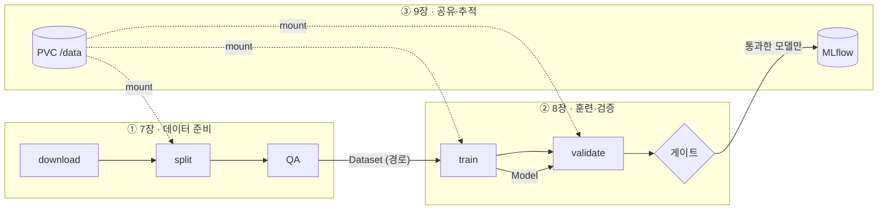
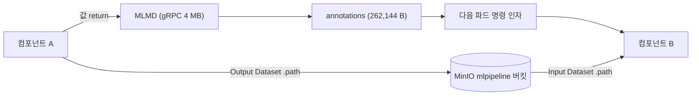
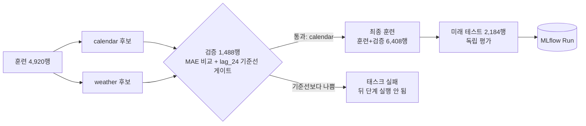
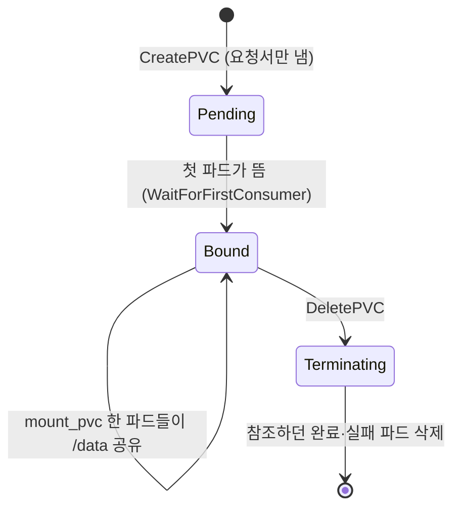

# 📦 4주차 · CH7~9 — 데이터는 경로로, 훈련은 컴포넌트로, 공유는 PVC로

**KFP 아티팩트 · 데이터 준비 파이프라인 · YOLO 훈련/검증 게이트 · PVC 데이터 공유 · MLflow 추적**

> [!NOTE]
> 과제 제출표의 4주차 제출물 가운데 정리가 잘 된 두 자료를 골라, 책 7~9장의 순서로 하나의 흐름으로 묶은 스터디 노트입니다.
>
> - **개념과 실측 (책 순서 그대로)**: Devlos Archive(박준희)의 4주차 3편, [① CH7 데이터 분석 및 준비](https://devlos.tistory.com/146) · [② CH8 모델 훈련과 검증 Part 1](https://devlos.tistory.com/147) · [③ CH9 모델 훈련과 검증 Part 2](https://devlos.tistory.com/148) (2026-11-08)
> - **서울 자전거 실습 (3주차에 이어서)**: Cloud Catalyst(김진웅)의 [Apple container로 KFP 훈련·검증, PVC 공유와 MLflow 추적](https://ddii.dev/mlops/ml-platform-engineering-ch7-9-practice/)
> - **교재**: *Machine Learning Platform Engineering* 7~9장

## 목차

- [0. 이 문서 읽는 법](#0-이-문서-읽는-법)
- [1. 한눈에 보기](#1-한눈에-보기)
- [2. 용어 먼저](#2-용어-먼저)
- [3. CH7: 데이터는 값이 아니라 경로로](#3-ch7-데이터는-값이-아니라-경로로)
- [4. CH8: 훈련은 컴포넌트로, 검증은 지표로](#4-ch8-훈련은-컴포넌트로-검증은-지표로)
- [5. CH9: 데이터는 PVC로 한 번만](#5-ch9-데이터는-pvc로-한-번만)
- [6. 두 글을 겹쳐 읽으면](#6-두-글을-겹쳐-읽으면)
- [7. 정리](#7-정리)
- [8. 직접 해 보기 체크리스트](#8-직접-해-보기-체크리스트)
- [참고 자료](#참고-자료)

---

## 0. 이 문서 읽는 법

| 표시 | 뜻 |
|:---:|---|
| ✅ | **실행 기록**: 원문에 적힌 실제 실행 결과입니다. 숫자는 원문 그대로 옮겼습니다. |
| 💡 | **해설**: 이해를 돕기 위해 덧붙인 설명과 비유입니다. |
| ⚠️ | **막힌 곳**: 실습에서 실제로 걸린 지점과 해결 방법입니다. |

> [!IMPORTANT]
> 두 자료는 실행한 주체와 데이터가 다릅니다. 숫자를 섞어 비교하지 않도록 각 절 머리에 출처를 적었습니다.
>
> | 자료 | 누가 돌렸나 | 데이터 | 환경 |
> |---|---|---|---|
> | **Devlos 3편** | 스터디 모임장의 리모트 서버 (글쓴이가 정리) | 책 캡스톤: MIDV-500 신분증 사진(YOLO), MovieLens 25M | kind, CPU 16코어, GPU 없음, KFP 백엔드 2.4.1 · SDK 2.9.0 |
> | **Cloud Catalyst** | 글쓴이 본인 | UCI 서울 공공자전거 시간별 대여량 (3주차와 같은 데이터) | Apple container 1.7.1 로컬 Kubernetes v1.35.5, KFP 2.17.3, MLflow 3.0.0 |

---

## 1. 한눈에 보기

| 장 | 책이 붙잡는 질문 | 핵심 API | 책 캡스톤 결과 ✅ (Devlos) | 서울 자전거 결과 ✅ (Cloud Catalyst) |
|---|---|---|---|---|
| **7장** | 큰 데이터를 컴포넌트 사이로 어떻게 넘기나? | `Output[Dataset]`, 아티팩트 타입 7종 | 10.28 GB tar → 이미지·라벨 5,609쌍 → 4,206 / 841 / 562 | 8,760시간 → 피처 8,592행 → 4,920 / 1,488 / 2,184시간 |
| **8장** | 훈련·검증을 어떻게 파드에서 매번 같게 돌리나? | `@dsl.container_component`, `Output[Model]`, `Output[Metrics]` | 1 epoch 53분 33초, mAP50 0.977 · mAP50-95 0.832 | 미래 MAE **90.8443** (기준선 386.4167) |
| **9장** | 같은 데이터가 단계마다 오가는 비용을 어떻게 줄이나? | `CreatePVC` · `mount_pvc` · `DeletePVC`, `.after()` | 처음부터 473초 → PVC 재사용 406초 | PVC 적재 80초 → 재사용 50초, 같은 해시·같은 MAE |

> [!TIP]
> 서울 자전거의 미래 MAE 90.8443은 [3주차 README](../week3/README.md)의 결과와 소수 넷째 자리까지 같습니다. 이번에는 같은 값을 **데이터 준비부터 MLflow 기록까지 이어진 KFP 통합 파이프라인 한 번**으로 다시 냈다는 점이 다릅니다.

### 전체 흐름



### 💡 세 장을 한 줄씩

| 장 | 한 줄 |
|---|---|
| **7장** | 파드 사이로는 **데이터가 아니라 경로**가 다닙니다. 큰 것은 전부 아티팩트로 넘깁니다. |
| **8장** | 노트북의 `model.train()`을 **파드 안의 절차**로 바꾸고, 점수는 로그가 아니라 `Metrics` 아티팩트로 남깁니다. |
| **9장** | 같은 데이터셋을 단계마다 올리고 내려받던 것을 **PVC 하나를 같이 마운트**하는 것으로 바꿉니다. 대신 순서와 정리는 사람이 챙깁니다. |

---

## 2. 용어 먼저

| 용어 | 뜻 |
|---|---|
| **파라미터(값) 전달** | 컴포넌트가 `return`한 숫자·짧은 문자열을 다음 파드의 명령 인자로 넘기는 방식입니다. 크기 한도가 있습니다. |
| **아티팩트(경로) 전달** | 컴포넌트가 `.path`에 파일을 쓰면 KFP가 객체 저장소에 올리고, 다음 파드에는 그 경로를 내려주는 방식입니다. |
| **`.path`** | KFP가 파드 안에 만들어 주는 로컬 경로입니다. 실제 저장 위치는 `mlpipeline` 버킷의 같은 키입니다. |
| **MinIO / SeaweedFS** | KFP가 아티팩트를 보관하는 S3 호환 저장소입니다. 두 실습 모두 이름은 "minio"였지만 실제로는 SeaweedFS였습니다. |
| **MLMD** | ML Metadata. 파라미터와 아티팩트의 이름·타입·경로·지표 값을 기록하는 KFP의 메타데이터 저장소입니다. |
| **`dsl.importer`** | 이미 저장소에 있는 파일을 아티팩트로 등록해 파이프라인 입력으로 쓰는 방법입니다. 데이터 준비 단계를 건너뛸 때 씁니다. |
| **container component** | `@dsl.container_component` + `dsl.ContainerSpec`. 이미지·셸 명령·인자를 직접 적는 컴포넌트로, `apt-get`이 필요할 때 씁니다. |
| **IoU** | 예측 상자와 정답 상자의 겹친 면적 ÷ 합친 면적입니다. |
| **mAP50 / mAP75 / mAP50-95** | IoU 0.5 / 0.75 / 0.5~0.95(0.05 간격 10단계 평균)를 맞힘 기준으로 잡은 평균 정밀도입니다. 뒤로 갈수록 엄격합니다. |
| **`best.pt`** | Ultralytics가 epoch마다 검증 점수(fitness)를 재서 가장 좋았던 시점의 가중치를 저장한 파일입니다. |
| **검증 게이트** | 지표가 임곗값보다 나쁘면 태스크를 실패시켜, 뒤 단계(최종 훈련·등록)로 나쁜 모델이 못 가게 막는 컴포넌트입니다. |
| **PVC** | PersistentVolumeClaim. 파드가 마운트해 쓰는 쿠버네티스 볼륨 요청서입니다. 여러 파드가 같은 파일을 볼 수 있습니다. |
| **WaitForFirstConsumer** | PVC를 만들어도 첫 파드가 뜰 때까지 실제 볼륨(PV)을 배정하지 않는 StorageClass 바인딩 모드입니다. |
| **`.after()`** | 데이터를 주고받지 않는 두 태스크 사이에 실행 순서만 거는 KFP 메서드입니다. |

---

## 3. CH7: 데이터는 값이 아니라 경로로

### 3.1 값 전달은 어디서 막히나 ✅

*출처: Devlos ① 2장, 숫자는 스터디 모임장의 3주차 실측*

3주차의 농담 파이프라인(`generate_joke` → `count_words`)에서 넘기는 문자열 크기만 키워 본 결과입니다.

| 넘긴 크기 | 값 전달 | 막힌 곳 |
|---|---|---|
| 10 KB · 60 KB | 성공 | |
| 100 KB | **실패** | `argument list too long`. 값이 다음 파드의 `--executor_input` 인자에 통째로 들어갑니다. |
| 1 MB | **실패** | Workflow annotations 262,144바이트 초과 |
| 10 MB | **실패** | MLMD gRPC 10,240,924 vs 한도 4,194,304 |
| 10 MB · 200 MB | **경로 전달은 성공** | 디렉터리 아티팩트가 MinIO 키 접두사로 저장됩니다. |



> 💡 **비유: 택배 상자와 운송장.** 값 전달은 상자를 직접 들고 옆방에 가는 것이라, 문(명령 인자)·게시판(annotations)·우편함(MLMD) 중 어디 하나에 걸립니다. 경로 전달은 상자를 집하장(MinIO)에 맡기고 운송장 번호만 건넵니다. 번호는 상자 크기와 상관없이 한 줄이지만, 올리고 내리는 시간은 듭니다.

**코드에서 바뀌는 곳은 두 함수와 연결 방법뿐입니다** (요지):

```python
@dsl.component
def generate_joke(num_jokes: int, output_jokes: Output[Artifact]):
    os.makedirs(output_jokes.path, exist_ok=True)          # KFP가 준 경로에 디렉터리를 만들고
    with open(os.path.join(output_jokes.path, "jokes.txt"), "w") as f:
        ...                                                 # 파일로 쓴다. return 없음

@dsl.component
def count_words(jokes_file: Input[Artifact]) -> int:       # 문자열 대신 아티팩트를 받는다
    ...

@dsl.pipeline
def joke_pipeline(num_jokes: int = 42):
    jokes = generate_joke(num_jokes=num_jokes)
    count = count_words(jokes_file=jokes.outputs["output_jokes"])  # 아티팩트는 이름으로
    output_result(count=count.output)                               # 값은 .output으로
```

✅ `num_jokes` 42 → 539단어, 5 → 72단어로 책 코드 그대로 성공했습니다.

**고르는 기준**: 숫자·짧은 문자열·플래그·버킷 이름처럼 명령줄에 적어도 되는 것은 값, 파일·디렉터리·데이터셋·가중치는 경로입니다. 애매하면 경로입니다.

### 3.2 아티팩트 타입 7종: 무엇을 넘기는지 이름표를 붙인다

*출처: Devlos ① 3장, Cloud Catalyst 1장*

| 타입 | 쓰는 법 | 저장 위치 | 쓰임 |
|---|---|---|---|
| `Dataset` | `.path`에 파일 쓰기 | MinIO 파일 + MLMD | 데이터 |
| `Model` | `.path`에 파일 쓰기 | MinIO 파일 + MLMD | 가중치·체크포인트 |
| `Artifact` | `.path`에 파일 쓰기 | MinIO 파일 + MLMD | 어디에도 안 맞는 것 (설정 JSON, 중간 산출물) |
| `HTML` · `Markdown` | `.path`에 파일 쓰기 | MinIO 파일 + MLMD | 사람이 볼 보고서. UI가 문서로 그려 줍니다. |
| `Metrics` | `metrics.log_metric("accuracy", 0.93)` | **MLMD에만** | 숫자 지표. UI의 Visualization 탭에 표로 보입니다. |
| `ClassificationMetrics` | `log_confusion_matrix(categories, matrix)` | **MLMD에만** | 혼동 행렬 |

> 💡 **파일이 없는 두 타입.** `Metrics`와 `ClassificationMetrics`는 MinIO에 파일이 생기지 않습니다. `aws s3 ls`로 찾으면 없고, 같은 run의 Markdown 보고서는 파일로 있습니다. "출력이 사라졌다"가 아니라 MLMD를 봐야 하는 것입니다.

✅ 모임장은 영화 추천 QA 컴포넌트에 `report: Output[Markdown]`과 `metrics: Output[Metrics]`를 더해 지표 8개(`train_rows` 18,750,071 · `val_rows` 3,750,014 · `test_rows` 2,500,010 · `total_rows` 25,000,095 · `train_columns` 4 · `train_ratio` 0.75 · `movies_rows` 62,423 · `rating_mean` 3.5336)를 UI 표로 남겼습니다.

서울 자전거 실습은 결과물마다 타입을 이렇게 골랐습니다.

| 이 파이프라인의 결과 | KFP 타입 | 고른 이유 |
|---|---|---|
| 원본·피처·시간 분할 Parquet | `Dataset` | 훈련 데이터와 변환 결과를 다음 Pod에 전달 |
| 후보·최종 훈련 가중치 | `Model` | 모델 파일과 훈련 정보의 계보를 함께 확인 |
| 검증·미래 테스트 MAE | `Metrics` | KFP Run 화면에서 숫자를 바로 확인 |
| QA·선택 기록·MLflow Run ID | `Artifact` | JSON 보고서와 추적용 식별자를 파일로 보존 |

### 3.3 캡스톤 ① 객체 탐지 데이터 준비: 10 GB를 받고, 두 번 나누고, 확인한다 ✅

*출처: Devlos ① 4장*

`download_dataset` → `split_dataset` → `output_file_contents` 세 컴포넌트를 `Dataset` 아티팩트로 잇습니다.

| 단계 | 숫자 |
|---|---|
| 받기 | MIDV-500 FULL tar 10.28 GB → 압축 해제 16.9 GB (이미지 `.tif` 5,609 + 라벨 `.txt` 5,609 = 파일 11,218개) |
| 1단계 분할 | `ceil(5,609 × 0.25)` = 1,403 → train **4,206** |
| 2단계 분할 | 나머지 1,403을 `test_size=0.4`로: test `ceil(561.2)` = **562** → val **841** |
| 결과 | 75.0 / 15.0 / 10.0 %, 크기 12.68 / 2.53 / 1.69 GB, 짝 불일치 0 |
| 저장량 | 원본 아티팩트 16.9 GB + 분할 셋 16.9 GB = **MinIO에 33.8 GB** (같은 파일이 두 번 올라감) |
| 시간 | 다운로드 파드 약 25분, 분할 약 9분, 확인 약 1분 |

스터디 수정본은 책과 세 군데가 다릅니다.

- 이미지와 라벨을 따로 섞지 않고 **파일 이름(stem)으로 먼저 짝을 맞춘 뒤 정렬해서** 나눕니다. 책처럼 따로 나누면 같은 이름의 사진과 라벨이 다른 분할로 갈 수 있습니다.
- 다운로드 chunk를 1 KiB → 1 MiB로 키웠습니다. 10 GB를 1 KiB씩 쓰면 반복이 천만 번이고 로그가 폭주합니다.
- 책의 boto3 직접 업로드 단계는 뺐습니다. `Output[Dataset]`이 업로드를 대신합니다.

> [!WARNING]
> ⚠️ **업로드 500의 원인은 디스크가 아니라 볼륨 슬롯이었습니다.** 첫 실행은 다운로드·압축 해제(약 15분)를 마치고 아티팩트 업로드 중 `status code: 500`으로 죽었습니다. 호스트 디스크는 333 GB, PVC는 20 Gi가 비어 있었습니다. minio 파드 로그에 `No writable volumes and no free volumes left`가 있었고, Deployment 인자가 `-volume.max=100 -master.volumeSizeLimitMB=64`였습니다. **한도 = 100 × 64 MB = 6.4 GB**였던 것입니다. `volume.max`를 1000으로 올려(한도 64 GB) 재실행이 성공했고, 이후 사용량은 볼륨 338개 · 40.4 GB였습니다.

### 3.4 캡스톤 ② 영화 추천 데이터 준비: 컴포넌트 여섯과 QA 하나 ✅

*출처: Devlos ① 5장, run `mr-dataprep-A-1108`*

MovieLens 25M(zip 262 MB, ratings 25,000,095행 · 678 MB, movies 62,423행)을 받아 Parquet 넷으로 만듭니다.

| 태스크 | 시간 | 하는 일 |
|---|---:|---|
| `download_ml25m_data` | 363 s | zip을 `Output[Artifact]`에 그대로 씁니다. 전체의 절반 이상입니다. |
| `unzip_data` | 24 s | 입력 하나에서 출력 둘(ratings, movies) |
| `csv_to_parquet` (ratings) ‖ `csv_to_parquet-2` (movies) | 52 s ‖ 32 s | **같은 컴포넌트를 입력만 바꿔 두 번**, 서로 병렬 |
| `split_dataset` | 96 s | 75 / 15 / 10 → 18,750,071 / 3,750,014 / 2,500,010행 |
| `put_to_minio-2` (u2) ‖ `put_to_minio` (u1) | 20 s ‖ 21 s | 우리가 고른 `datasets/ml-25m/` 버킷으로 업로드 |
| `qa_data` | 27 s | 데이터 연결이 없어 `.after(u2)`로 순서를 겁니다. |

긴 길(critical path)은 363 + 24 + 52 + 96 + 20 + 27 = **582초**, driver와 파드 시작을 더해 전체 약 11분이었습니다.

> 💡 **왜 CSV를 Parquet로 바꾸나.** CSV는 한 행이 한 줄인 글자 파일이라 평균 평점 하나를 구해도 파일 끝까지 훑고 네 열을 다 읽습니다. Parquet은 row group 안에서 **열마다 한 덩어리로 묶고 덩어리마다 압축**하며, footer에 스키마·위치·최솟값/최댓값을 둡니다. 필요한 열만 꺼내 읽을 수 있고 타입 변환도 없습니다.

### 3.5 컴포넌트를 이미지로: target_image와 실행 방법 두 가지 ✅

*출처: Devlos ① 6장*

경량 컴포넌트는 **파드가 뜰 때마다 pip로 패키지를 설치**합니다. `target_image`를 주면 `kfp component build`가 패키지를 넣은 이미지를 미리 만듭니다.

| 비교 | A: 경량 (런타임 pip) | B: 컨테이너화 (`data_preprocessor:1.0.0`, 2.51 GB) |
|---|---|---|
| `qa_data` | 27 s | **10 s** |
| `csv_to_parquet` (movies) | 32 s | **20 s** |
| `split_dataset` | 96 s (fastparquet) | **344 s** (pyarrow, gzip 기본 레벨 9) → `compression_level=1`로 **32 s** |

> [!WARNING]
> ⚠️ **같은 split 코드가 이미지 하나 바뀌었다고 3.6배 느려졌습니다.** QA용으로 이미지에 pyarrow를 넣자 `engine="auto"`가 fastparquet 대신 pyarrow를 골랐고, gzip 기본 레벨이 6 → 9로 바뀌었습니다. 인덱스 열 이름·위치도 달라졌습니다(`index` 맨 앞 → `__index_level_0__` 맨 뒤). **`engine`, `compression_level`, `index=False`를 명시**하는 것이 답입니다.
>
> ⚠️ **레지스트리 주소.** 책 그대로 `127.0.0.1:5000`에 이미지를 올리려 했는데, 그 호스트의 5000번은 MLflow 포워딩이었습니다. 레지스트리 port-forward를 5001로 따로 열었습니다.
>
> ⚠️ **책과 다르게 돈 것.** 책은 `target_image`면 런타임 설치가 없다고 하지만, SDK 2.9.0으로 컴파일한 YAML에는 `pip install` 명령이 그대로 남아 있었습니다(kfp 자동 설치만 빠짐). 컴파일된 YAML에는 컴포넌트 소스도 들어가지 않으므로, 코드를 고쳤는지는 이미지 안을 봐야 합니다.

파이프라인 실행 방법도 둘입니다.

| 방법 | API | 만드는 것 | UI에서 보이는 곳 |
|---|---|---|---|
| inline run | `client.create_run_from_pipeline_package(...)` | Run 1개 | Experiments · Runs |
| 등록 후 실행 | `client.upload_pipeline(..., pipeline_name=...)` | Pipeline + Version + Run | Pipelines에도 보임 |

책의 `client.pipeline_uploads.upload_pipeline(name=…)`은 v1 API라 SDK 2.9에서는 위처럼 바꿔야 했습니다.

### 3.6 서울 자전거에 적용하면: 분할보다 앞에 데이터 계약을 둔다 ✅

*출처: Cloud Catalyst 2장*

책의 75/15/10 **무작위 분할을 그대로 쓰지 않았습니다.** 목표가 미래 시간의 대여량이기 때문입니다.

1. **원본 고정**: UCI ZIP과 내부 CSV의 SHA-256을 고정하고, 다르면 실패합니다.
2. **원본 검증**: CSV는 `latin1`로 읽어 `Temperature(°C)` 같은 열 이름을 유지하고, `Date`·`Hour`를 Asia/Seoul로 해석해 UTC `event_timestamp`를 만듭니다. 8,760개 시각이 1시간 간격으로 이어지는지, 중복·결측이 없는지 별도 태스크로 검사합니다.
3. **피처**: 예측 시각 t에 이미 아는 값만 씁니다. `lag_1` · `lag_24` · `lag_168`(1시간·하루·일주일 전 대여량), 날씨도 이전 시간 값으로 밀었습니다. `lag_168`을 만들 수 없는 처음 168행을 빼면 8,592행입니다.
4. **달력 순서 분할**:

| 구간 | 행 수 | 기간 | 쓰임 |
|---|---:|---|---|
| 훈련 | 4,920시간 | 2018-07-01 00:00 KST 이전 | 후보 적합 |
| 검증 | 1,488시간 | 2018-07-01 ~ 2018-08-31 | 모델 선택 |
| 미래 테스트 | 2,184시간 | 2018-09-01 이후 | 선택과 최종 훈련이 끝난 뒤에만 엽니다 |

5. **QA**: 세 파일의 크기, 모델 컬럼 결측, `train < validation < future_test` 시각 순서를 확인합니다.

> 💡 **QA가 훈련을 막으려면 `.after()`가 필요합니다.** 훈련 태스크가 `train` 아티팩트만 입력으로 받으면, 분할이 끝나는 순간 QA와 **동시에** 시작할 수 있습니다. 그래서 `train_candidates(...).after(verified)`를 붙였습니다. 데이터 의존이 없는 곳의 순서는 코드에 직접 적어야 합니다. 이 원리는 9장의 PVC에서 다시 나옵니다.

---

## 4. CH8: 훈련은 컴포넌트로, 검증은 지표로

### 4.1 data.yaml 한 장과 train() 한 줄

*출처: Devlos ② 2장*

Ultralytics는 훈련 루프·손실·증강을 전부 감춥니다. 내가 정하는 것은 셋뿐이고, 이 셋이 그대로 컴포넌트의 입력 파라미터가 됩니다.

| 정할 것 | 값 | 설명 |
|---|---|---|
| 데이터 위치 | `data.yaml` | 세 분할 폴더와 클래스 이름(`0: id_card`). 라벨은 `images/` 옆 `labels/`에서 같은 이름으로 찾습니다. |
| 모델 크기 | `yolov8n.pt` (nano) | "이 데이터로 되긴 되나"를 가장 싼 값으로 먼저 확인합니다. |
| 반복 | `epochs` · `batch` · `imgsz=640` | 파이프라인은 1 epoch, batch 4~8 |

✅ train 4,206장 ÷ batch 8 = **526번 갱신**(로그의 526 iteration과 일치), 약 1.7초/it로 약 15분(CPU 12코어)입니다. 526 < 10,000이라 `optimizer=auto`는 AdamW를 골랐습니다.

| `train()`이 남기는 것 | 내용 |
|---|---|
| `weights/best.pt` | fitness(= 0.1 × mAP50 + 0.9 × mAP50-95)가 가장 높았던 epoch의 가중치. 다음 단계로 넘기는 파일입니다. |
| `weights/last.pt` | 마지막 epoch 가중치 (이어서 훈련할 때) |
| `results.csv` · `results.png` | epoch별 손실(box·cls·dfl)과 precision·recall·mAP 추이 |
| `confusion_matrix.png` · `PR_curve.png` | 혼동 행렬, 정밀도-재현율 곡선 |

> [!CAUTION]
> Ultralytics 패키지는 **AGPL-3.0**이고, 회사는 이 코드로 훈련한 모델에도 라이선스가 미친다고 밝힙니다. 사내 도구·제품에 들이기 전에 라이선스 확인이 필요합니다.

### 4.2 컨테이너 컴포넌트: apt가 필요할 때 명령을 직접 적는다

*출처: Devlos ② 3장*

Ultralytics → OpenCV → `libGL.so.1`. 이 라이브러리는 pip로 안 깔리고 `apt-get`이 필요합니다. `@dsl.component`의 `packages_to_install`은 pip 목록이라 여기서 막힙니다. 그래서 훈련은 `@dsl.container_component`로 **이미지 + 셸 명령 + 인자**를 직접 적고, 훈련 스크립트는 heredoc으로 컨테이너 안에 써 넣습니다.

```python
# 요지: 책 코드에 스터디 수정(libgl1, CPU torch, 버전 고정, 들여쓰기 제거)을 반영
@dsl.container_component
def train_model(epochs: int, batch: int,
                train_dataset: Input[Dataset], validation_dataset: Input[Dataset],
                test_dataset: Input[Dataset],
                model_output: Output[Model], data_yaml: Output[Artifact]):
    return dsl.ContainerSpec(
        image="python:3.11-slim",
        command=["sh", "-c", f"""
apt-get update && apt-get install -y libgl1 libglib2.0-0 && \\
pip install torch==2.15.0 --index-url https://download.pytorch.org/whl/cpu && \\
pip install ultralytics==8.4.207 && \\
cat > /train.py <<'EOF'
{TRAINING_SCRIPT}
EOF
python3 /train.py --train-path "$0" ...
"""],
        args=[train_dataset.path, validation_dataset.path, test_dataset.path,
              epochs, batch, model_output.path, data_yaml.path],   # → $0, $1, ...
    )
```

> 💡 `sh -c "명령" a b c`에서 a가 `$0`, b가 `$1`이 됩니다. 입력·출력 아티팩트는 `.path` 문자열이 되어 이 위치 인자로 들어갑니다. `{TRAINING_SCRIPT}`는 f-string 치환이라 스크립트 본문에 중괄호가 있으면 두 겹(`{{ }}`)으로 써야 합니다.

> [!WARNING]
> ⚠️ **책 코드 그대로는 돌지 않는 곳 다섯.** ① `ContainerSpec` 인자 목록의 쉼표 누락, ② heredoc 본문과 `EOF`의 들여쓰기, ③ `libgl1-mesa-glx` → `libgl1` (`python:3.11-slim`이 Debian 13 trixie라 옛 패키지가 없음), ④ GPU가 없어 torch를 CPU 휠로, ⑤ `ultralytics==8.4.207` · `torch==2.15.0` 버전 고정. ①·②는 문법이라 어디서든, ③~⑤는 환경 때문에 걸립니다.

검증 컴포넌트는 반대로 **이미 다 들어 있는 이미지**(`ultralytics/ultralytics:8.0.194-cpu`) 위의 보통 `@dsl.component`입니다. 8.4.207로 훈련한 `best.pt`를 8.0.194가 정상으로 읽는 것도 확인했습니다.

### 4.3 mAP 숫자 읽는 법

*출처: Devlos ② 4장*

✅ 스터디 1 epoch: **mAP50 0.977 > mAP75 0.960 > mAP50-95 0.832** (precision 0.980, recall 0.957). 같은 답안인데 채점 기준이 엄격해질수록 점수가 내려갑니다.

> 💡 **IoU 한 번 계산해 보기.** 정답 상자 10×6 = 60. 같은 크기의 예측 상자를 오른쪽 2, 아래 1만큼 밀면 겹친 부분 8×5 = 40, 합친 부분 60 + 60 − 40 = 80, **IoU = 40/80 = 0.50**. mAP50에서는 턱걸이 정답, mAP75에서는 오답입니다.

혼동 행렬도 같은 숫자로 읽을 수 있습니다 (val 841장, 사진마다 신분증 하나, 원문의 설명용 역산값).

| 예측 ＼ 정답 | 정답: id_card | 정답: background |
|---|---|---|
| **예측: id_card** | 찾음(TP) 약 805 | 헛상자(FP) 약 17 |
| **예측: background** | 놓침(FN) 약 36 | 세지 않음 |

recall = 805 ÷ (805 + 36) ≈ 0.957, precision = 805 ÷ (805 + 17) ≈ 0.980.

### 4.4 53분 33초는 어디에 쓰였나 ✅

*출처: Devlos ② 5장*

| 태스크 | 시간 | 비고 |
|---|---:|---|
| download | 911 s | 7장과 같은 컴포넌트 |
| split | 471 s | 데이터 준비 합 1,382초 ≈ **23분 (43%)** |
| train | 1,512 s | **25분 12초 (47%)**. 입력 17 GB 받기 + apt·pip + 학습 21.4분 + 업로드, cpu 12 / mem 6G |
| validate | 269 s | 약 4.5분, 841장 batch 1 |
| **run 전체** | **53분 33초** | 태스크 합과의 차이는 파드 기동·아티팩트 전달 |

> [!WARNING]
> ⚠️ **캐시를 켜도 download·split이 다시 돌았습니다** (원인 미확인). 모임장은 분할 결과 17 GB를 MinIO 고정 경로(`mlpipeline/datasets/od/split/`)에 복사해 두고 **`dsl.importer`로 가져오는 파이프라인**을 따로 만들어 반복 실험마다 23분을 없앴습니다. 대가는 저장 공간(SeaweedFS 볼륨 347 → 424 / 1,000)과, 분할 비율·seed를 바꾸려면 split만 따로 다시 돌려야 한다는 점입니다.

### 4.5 가중치 검증과 게이트 ✅

*출처: Devlos ② 6장*

책은 "신뢰하되 검증하라"고 합니다. 훈련 안 된 기본 가중치와 훈련한 가중치로 **같은 test 562장**을 추론해 비교했습니다.

| test 562장 | 기본 `yolov8n.pt` | 훈련한 `best.pt` |
|---|---|---|
| 검출 1개 이상인 이미지 | 546 | 547 |
| 최상위 클래스 | book 265 · person 146 · keyboard 83 · scissors 10 · tv 9 | **id_card 547** |
| 정답 위치를 IoU ≥ 0.5로 찾은 비율 | 84.2% | **96.3%** |
| 최상위 상자 평균 신뢰도 | 0.653 | 0.849 |
| 평균 최고 IoU | 0.816 | 0.880 |

> 💡 기본 모델도 "무언가"는 거의 다 찾고 위치도 꽤 맞힙니다. 훈련이 바꾼 것은 **이름(book → id_card)과 정밀도**입니다.

**epochs 1 → 3**: 훈련 시간 약 22분 → 74분(run 전체 79분 47초), test mAP50-95 **0.8097 → 0.9853 (+0.1756)**. 엄격한 지표에서 차이가 가장 큽니다.

**검증 게이트**: 모임장의 `validate_model_gate`는 검증 컴포넌트에 검사 6개를 더한 것입니다.

| 임곗값 | 결과 |
|---|---|
| 기본 (mAP50 ≥ 0.90 · mAP50-95 ≥ 0.60 · precision ≥ 0.90) | 6 / 6 PASS |
| 0.999로 올림 | `AssertionError: validation gate failed: mAP50, precision` → **FAILED** |

임곗값은 첫 결과를 보고 정하되 **파라미터로** 둡니다. 게이트가 실패하면 파이프라인이 거기서 멈추므로, 다음 주의 레지스트리 등록 앞에 두면 나쁜 모델이 올라가는 일을 막습니다.

### 4.6 서울 자전거에 적용하면: 검증으로 고르고, 고른 뒤 다시 훈련한다 ✅

*출처: Cloud Catalyst 3장*

같은 `HistGradientBoostingRegressor`로 입력 컬럼만 다른 후보 둘을 만들었습니다.

| 후보 | 모델 입력 |
|---|---|
| `calendar` | hour, weekday, month, holiday, lag_1, lag_24, lag_168 |
| `weather` | calendar의 7개 + prev_temperature, prev_rainfall |



게이트는 `dsl.If` 같은 조건 분기가 아니라 **예외**입니다. 컴포넌트가 예외를 던지면 그 태스크가 실패하고, 입력을 기다리던 뒤 단계는 실행되지 않습니다 (원문 발췌).

```python
@dsl.component(base_image=IMAGE, install_kfp_package=False)
def validate_candidates(
    validation: dsl.Input[dsl.Dataset],
    calendar_model: dsl.Input[dsl.Model],
    weather_model: dsl.Input[dsl.Model],
    selection: dsl.Output[dsl.Artifact],
    metrics: dsl.Output[dsl.Metrics],
):
    frame = pd.read_parquet(validation.path)       # 입력은 .path로 읽고
    ...
    metrics.log_metric(f"val_mae_{name}", scores[name])   # KFP UI에 숫자 지표로 남는다
    if not np.isfinite(scores[chosen]) or scores[chosen] >= baseline:
        raise ValueError("Validation gate failed ...")    # 예외가 곧 게이트
```

| 지표 (대여 대수) | 결과 ✅ |
|---|---:|
| 검증 MAE, calendar | **103.7623** |
| 검증 MAE, weather | 118.4589 |
| 검증 MAE, lag_24 기준선 | 265.5457 |
| 최종 모델 미래 테스트 MAE | **90.8443** |
| 최종 모델 미래 테스트 RMSE | 147.3341 |
| 미래 테스트 lag_24 기준선 MAE | 386.4167 |

> 💡 **검증 MAE와 미래 MAE는 뜻이 다릅니다.** 최종 모델은 검증 1,488행까지 넣어 다시 훈련했습니다. 이 모델을 검증 구간에서 다시 재면 이미 본 문제를 푼 점수입니다. 그래서 최종 모델의 독립 평가는 미래 테스트 2,184행에서만 합니다. 날씨를 더한 후보가 오히려 나빴다는 점도 눈여겨볼 만합니다.

✅ 통합 Run(데이터 준비 → 후보 훈련 → 게이트 → 최종 훈련 → 미래 평가)은 **258초**. 분할 결과 세 개를 `dsl.importer`로 가져와 모델 단계만 다시 돌린 Run은 **111초**에 같은 점수(검증 103.7623, 미래 90.8443)를 냈습니다.

### 4.7 캐시: 시간을 줄이지만 부수 효과도 건너뛴다 ✅

*출처: Cloud Catalyst 1장, 2026-11-14 실험*

같은 YAML을 세 번 제출했습니다.

| Run | 캐시 | 실행된 컴포넌트 Pod | KFP 소요 시간 | 새 MLflow Run |
|---|---|---:|---:|---|
| `seoul-bike-ch7-9-baseline` | 끔 | 9개 | 3분 44초 | 생성 |
| `seoul-bike-cache-on-1` | 켬, 첫 실행 | 9개 | 3분 11초 | 생성 |
| `seoul-bike-cache-on-2` | 켬, 같은 입력 재실행 | **0개** | 1분 40초 | **생성 안 됨** |

- 첫 캐시 Run도 9개를 다 돌았습니다. 앞 Run이 캐시를 끈 채 돌아 재사용할 항목을 남기지 않았기 때문입니다.
- 두 번째에는 태스크마다 driver Pod만 떠서 캐시를 찾았고, 남은 1분 40초는 driver Pod 10개를 띄우고 정리한 시간입니다.
- **KFP Run은 셋인데 MLflow Run은 둘뿐입니다.** MLflow 기록이 `finalize-model` 컴포넌트 안에서 일어나므로, 그 태스크가 캐시로 건너뛰어지면 기록도 생기지 않습니다.

> [!TIP]
> MLflow 기록·외부 업로드·알림처럼 **매번 일어나야 하는 동작이 든 태스크**만 `set_caching_options(False)`로 두고, 실행 단위 제출 인자(`enable_caching=...`)로 태스크 설정을 덮어쓰지 않도록 합니다. 제출 인자가 YAML에 컴파일된 태스크별 설정보다 우선합니다.

---

## 5. CH9: 데이터는 PVC로 한 번만

### 5.1 왜 PVC인가: 같은 데이터를 세 번 내려받던 파이프라인

*출처: Devlos ③ 2장. 이동 횟수는 책 설명을 센 것이며 실측이 아님*

책은 8장 파이프라인을 "동작은 하지만 이상적이지 않다"고 합니다. 전체 데이터셋은 download에서, 분할본 셋은 train에서, 검증본은 validate에서 다시 받기 때문입니다. MinIO는 POSIX 파일시스템이 아니라 파일 이동·디렉터리 나누기도 객체를 다시 쓰는 일이 됩니다.

| 비교 | artifact 길 (7~8장) | PVC 길 (9장) |
|---|---|---|
| 데이터 이동 | 외부 1 + MinIO 올리기 4 + 내려받기 5 = **10회** | 외부 1 + 복사 0 = **1회** |
| 실행 순서 | 데이터 의존으로 KFP가 정함 | **`.after()`로 사람이 적음** |
| 계보(lineage) | MinIO 경로 + MLMD에 남음 | 파이프라인 밖(PVC)에 있어 줄어듦 |
| 컴포넌트 코드 | 입출력 인수 + MinIO 클라이언트 | `/data/...` 경로만 남음 |

> 💡 **비유: 택배와 공용 창고.** artifact 길은 작업자마다 상자를 받아 뜯고, 일하고, 다시 싸서 보냅니다. PVC 길은 첫 작업자가 창고에 물건을 넣으면 나머지는 열쇠만 받아 그 자리에서 일합니다. 대신 "누가 언제 창고를 쓰고 비우는지"는 사람이 챙깁니다.

### 5.2 PVC가 만들어져 사라지기까지 ✅

*출처: Devlos ③ 3장, 시험 파이프라인 `pvc-smoke-dynamic` · `pvc-smoke-static`*



| 방식 | 이름 | DeletePVC | 쓰임 |
|---|---|---|---|
| 자동 이름 | `<run uuid>-smoke` (suffix) | 있음 | run마다 새로 받기 |
| 고정 이름 | `ch09-smoke-static` | 없음 | 데이터를 채워 두고 다음 run에서 재사용. 다시 돌려도 createpvc 5초에 성공했습니다. |

> [!WARNING]
> ⚠️ **PVC를 지웠는데 안 사라집니다.** DeletePVC 태스크는 성공했는데 `kubectl get pvc`에 `Terminating`이 2분 30초 넘게 남았습니다. 완료된(Succeeded) 파드가 아직 그 PVC를 참조하고 있어 `kubernetes.io/pvc-protection` finalizer가 풀리지 않은 것입니다. 시험 파드 둘을 지우자 PVC·PV·노드 디렉터리(`/var/local-path-provisioner/pvc-<uid>_kubeflow_<name>/`)가 바로 사라졌습니다.

### 5.3 리팩터링: 무엇이 사라지고 무엇이 생기나

*출처: Devlos ③ 4장*

| 컴포넌트 | 사라진 것 | 남은 것 |
|---|---|---|
| download | 출력 인수, MinIO 업로드 코드 | `/data`에 풀기 |
| split | 분할본 셋의 입출력 인수 | `/data/<split>/`로 복사 |
| train | `InputPath` 인수 **6개 → 0개**, MinIO 다운로드 | `epochs` · `batch` · `yolo_model_name`, 출력 `model_output` · `data_yaml` |
| validate | 가중치·데이터 내려받기 코드 | artifact 입력(모델·data.yaml) + PVC 마운트 |

**데이터셋은 PVC로, 모델·data.yaml·지표는 여전히 artifact로** 갑니다. 나중에 어느 run의 결과인지 찾아야 하기 때문입니다. 남는 artifact는 `data_yaml` · `model_output` · `metrics` 3개입니다.

```python
# 요지: kfp-kubernetes로 PVC를 붙이는 파이프라인 함수
from kfp import dsl, kubernetes

@dsl.pipeline(name="yolo-pvc")                   # 이름이 길면 createpvc driver가 실패했다 (5.4)
def yolo_pvc_pipeline(epochs: int = 1):
    pvc = kubernetes.CreatePVC(
        pvc_name="yolo-data-pvc",                # 고정 이름 = 재사용용. run마다 새로면 pvc_name_suffix
        access_modes=["ReadWriteOnce"],
        size="10Gi",
        storage_class_name="standard",           # 책은 local-path. 클러스터마다 다르다
    )
    download = download_op()
    split = split_op().after(download)           # 데이터 의존이 없으니 순서를 직접 적는다
    train = train_op(epochs=epochs).after(split)
    validate = validate_op(model=train.outputs["model_output"],      # 모델은 여전히 artifact
                           data_yaml=train.outputs["data_yaml"])
    for task in (download, split, train, validate):
        kubernetes.mount_pvc(task, pvc_name=pvc.outputs["name"], mount_path="/data")
```

> 💡 컴포넌트에 `Input[Dataset]`이 없으면 KFP는 순서를 모릅니다. **`mount_pvc`를 적은 태스크에는 `.after()`를 같이 적는 습관**이 필요합니다.

### 5.4 스터디 실측: 473초와 406초 ✅

*출처: Devlos ③ 5장. MINIDATA(약 1.23 GB, 이미지·라벨 570쌍 → 427 / 85 / 58)로 실행. 7~8장의 FULL 데이터와는 다름*

| 태스크 | A1 처음부터 (`yolo-pvc`) | A2 PVC 재사용 (`yolo-a2`) |
|---|---:|---:|
| createpvc | 4 s | |
| download | 89 s | **생략** |
| split | 31 s | **생략** |
| train | 172 s | 180 s |
| validate | 121 s (ultralytics 이미지 첫 pull 포함) | 47 s |
| 태스크 합 / DAG 전체 | 417 s / **473 s** | 227 s / **406 s** (실패한 첫 시도 89초 + 재시도 대기 포함) |

download·split 120초가 통째로 빠졌습니다. 1 epoch라 mAP50-95 7e-5, mAP50 4e-4로 사실상 학습 전이며, 이 run의 목적은 데이터 접근 방식 확인입니다.

**막힌 곳 넷** ⚠️

| 증상 | 원인 (노트의 판단) | 처리 |
|---|---|---|
| createpvc driver가 `pods "…drive" not found`로 실패 | 파이프라인 이름 `YOLO Object Detection Pipeline`이 길어 파드 이름이 잘린 것으로 추정 (미확인) | 이름을 `yolo-pvc`로 줄임 |
| 다음 run이 `persistentvolumeclaims "yolo-pipeline-pvc" already exists` | 실패한 첫 run이 고정 이름 PVC를 Pending으로 남김. 참조하는 실패 파드 때문에 Terminating에서 멈춤 | 실패한 workflow를 지워 PVC를 풀고, 이름을 `yolo-data-pvc`로 변경 |
| download 파드에서 `NameError: MINIDATA_URL` | 기본 인자가 모듈 상수를 참조. **경량 컴포넌트는 함수 본문만 직렬화**됨 | URL을 리터럴로 교체 |
| 재사용 run의 train이 504로 실패 | `yolov8n.pt`를 GitHub에서 받는 중 응답 없음 | `set_retry(2, 30s)` 추가 후 성공 |

그 밖에 책과 다른 점: `pip install kfp[kubernetes]`를 그대로 하면 kfp 자체가 올라가 기존 컴파일 결과가 바뀔 수 있어 **kfp 2.9.0을 고정**하고 kfp-kubernetes 1.5.0만 추가했습니다. StorageClass는 책의 `local-path`가 없어 `standard`(provisioner `rancher.io/local-path`, WaitForFirstConsumer, reclaim Delete)로 바꿨습니다.

### 5.5 서울 자전거에 적용하면: PVC 적재·재사용과 MLflow 기록 ✅

*출처: Cloud Catalyst 4장*

`pvc_pipeline.py`에 파이프라인 셋을 두었습니다.

| 파이프라인 | 하는 일 | 결과 |
|---|---|---|
| `seoul-bike-pvc-stage` | 원본 다운로드부터 PVC 적재까지 | Mac 브리지 프록시 시간 초과로 실패 |
| `seoul-bike-pvc-from-artifacts` | 통합 Run의 train·validation Dataset URI를 `dsl.importer`로 가져와 CreatePVC(1Gi)에 적재 | **80초** 성공 |
| `seoul-bike-pvc-reuse` | 남아 있는 PVC 이름만 받아 적재 단계 없이 훈련·검증 | **50초** 성공 |

두 Run의 훈련 Pod가 확인한 train 4,920행의 SHA-256(`6585ac53…`)이 같았고, 검증 Pod도 1,488행에서 MAE 103.7623을 똑같이 기록했습니다.

설계에서 눈여겨볼 점이 셋 있습니다.

1. **미래 테스트는 PVC에 올리지 않았습니다.** 훈련 Pod가 미래 정답 파일에 접근할 수 없도록 하기 위해서입니다.
2. **PVC는 파일이 바뀌어도 KFP가 데이터 버전을 모릅니다.** 그래서 적재할 때 두 Parquet의 SHA-256을 JSON으로 남기고, 훈련·검증 Pod가 읽기 직전에 다시 검사합니다.
3. **`train_on_pvc().after(staged)`**: 파일 적재가 끝난 뒤 훈련하도록 순서를 직접 걸었습니다.

> [!WARNING]
> ⚠️ CreatePVC가 요청한 StorageClass 이름 `standard`가 이 클러스터에 없어 PVC가 **Pending**으로 남았습니다. `storage_class_name="local-path"`를 명시한 뒤 바인딩과 세 Pod의 `/data` 공유를 확인했습니다. **Devlos 실습과 정반대 방향으로 같은 문제를 만난 셈입니다** (6장).

> 💡 책의 listing 9.5는 파일을 "이동"한다고 설명하지만 실제 호출은 `shutil.copy2`입니다. 원본이 남으므로 PVC를 쓴다는 이유만으로 저장량이 줄었다고 계산할 수 없습니다. 또 이 실습은 작은 Parquet 두 개를 공유한 사례라, 대용량 이미지 데이터의 이득으로 일반화할 수는 없습니다.

**MLflow에는 모델 선택의 근거를 남겼습니다.** 최종 훈련 컴포넌트가 원본 CSV 해시 · 선택된 피처 · 분할 행 수 · 난수 시드 · 검증 MAE를 Run에 기록하고, `selection.json`과 모델을 올린 뒤, **MLflow Run ID를 KFP Model 아티팩트 메타데이터와 `tracking_record`에 적습니다.** 마지막 미래 테스트 컴포넌트가 같은 Run ID에 MAE·RMSE를 덧붙입니다. 기존 `seoul-bike-hourly`의 champion 별칭은 바꾸지 않았습니다.

| 어디서 보나 | 무엇을 보나 |
|---|---|
| **KFP** | 단계와 파일의 흐름 (무엇이 어디로 갔나) |
| **MLflow** | 모델 선택 근거와 훈련 결과 (왜 이 모델인가) |

책 9.2절의 TensorBoard는 scikit-learn 부스팅이 이벤트 파일을 만들지 않아 확인하지 않았습니다. 에포크별 손실을 내는 신경망이라면 로그 디렉터리를 PVC에 쓰고 그 PVC를 뷰어 Pod에 마운트하면 됩니다.

---

## 6. 두 글을 겹쳐 읽으면

| 관점 | Devlos (책 캡스톤, 모임장 실측) | Cloud Catalyst (서울 자전거, 본인 실측) |
|---|---|---|
| 데이터 | 이미지 10.28 GB, 평점 2,500만 행 | 표 8,760행 |
| 분할 | 무작위 75 / 15 / 10 (이미지·라벨 짝 맞춤) | **달력 순서** 4,920 / 1,488 / 2,184 |
| 훈련 컴포넌트 | `container_component` (apt 필요) | 데이터 준비만 `ContainerSpec`, 훈련·검증은 미리 빌드한 이미지 위 `@dsl.component` |
| 검증 지표 | mAP50 · mAP75 · mAP50-95 | MAE · RMSE, lag_24 기준선 |
| 게이트 | `assert` 기반 `validate_model_gate` | `raise ValueError` 기반 `validate_candidates` |
| 반복 실행 단축 | `dsl.importer`로 준비 23분 → 0 | `dsl.importer`로 258초 → 111초 |
| 캐시 | 켜도 준비 단계가 다시 돎 (원인 미확인) | 같은 입력 재실행 시 Pod 0개, **MLflow 기록도 건너뜀** |
| PVC StorageClass | 책 `local-path` 없음 → `standard`로 | 요청한 `standard` 없음 → `local-path`로 |
| PVC 재사용 효과 | 473초 → 406초 (download·split 120초 생략) | 80초 → 50초, 같은 해시·같은 MAE |
| 추적 | (TensorBoard·MLflow는 5주차) | MLflow Run ID를 KFP Model 메타데이터에 연결 |

> [!IMPORTANT]
> **두 글이 공통으로 말하는 것: 막히는 곳은 컴포넌트 코드가 아니라 그 주변이었습니다.** 저장소 볼륨 슬롯(SeaweedFS `volume.max`), 레지스트리 주소, 이미지에 섞여 들어간 Parquet 엔진, 클러스터마다 다른 StorageClass 이름, 실패한 run이 남긴 PVC, 부수 효과를 건너뛰는 캐시. 책 코드를 옮기기 전에 **클러스터부터 확인**하는 습관이 가장 큰 교훈입니다.

---

## 7. 정리

| 장 | 붙잡은 질문 | 답 |
|---|---|---|
| **7장** | 10 GB를 다음 컴포넌트는 어떻게 받나? | ✅ 받지 않는다. 데이터는 저장소에 두고 `Output[Dataset]`의 경로만 건넨다 (값은 100 KB에서 막힘) |
| **8장** | 노트북 한 줄이면 되는 훈련을 왜 컴포넌트로? | ✅ 같은 데이터·같은 코드에서 같은 점수가 나오고, 그 점수가 `Metrics` 아티팩트로 남게 하려고 |
| **9장** | 이미 돌아가는 파이프라인의 전달 방식을 왜 바꾸나? | ✅ 같은 데이터셋이 단계마다 오가서. PVC 하나로 복사를 없애는 대신 순서·계보·정리는 사람 몫 |

### 기억할 다섯 가지

1. **큰 데이터는 경로로.** 함수에 `Output[Dataset]`을 더하고 `.path`에 쓰면 KFP가 올리고 내립니다. 지표는 `Metrics`(MLMD에만), 보고서는 `Markdown`으로 넘기면 UI가 그려 줍니다.
2. **데이터 의존이 없으면 순서도 없다.** QA 뒤의 훈련, PVC를 마운트한 태스크에는 `.after()`를 직접 적습니다.
3. **게이트는 예외로 만든다.** 지표가 임곗값보다 나쁘면 `assert`·`raise`로 태스크를 실패시켜, 나쁜 모델이 다음 단계로 못 가게 합니다. 임곗값은 파라미터로 둡니다.
4. **고른 모델과 평가할 모델을 나눈다.** 검증으로 고른 뒤 재훈련한 모델은 검증 점수가 아니라 따로 남겨 둔 test·미래 구간으로 잽니다.
5. **PVC와 캐시는 공짜가 아니다.** PVC는 복사를 없애지만 실패한 run이 잠글 수 있고, 캐시는 시간을 줄이지만 MLflow 기록 같은 부수 효과까지 건너뜁니다.

---

## 8. 직접 해 보기 체크리스트

- [ ] `kubectl get storageclass`로 StorageClass 이름과 바인딩 모드(WaitForFirstConsumer 여부)부터 확인
- [ ] KFP의 아티팩트 저장소가 SeaweedFS라면 Deployment 인자의 `volume.max × volumeSizeLimitMB` 한도 계산
- [ ] 농담 파이프라인으로 값 전달 10 KB → 100 KB를 넘겨 `argument list too long`을 직접 확인한 뒤, `Output[Artifact]`로 바꿔 통과시키기
- [ ] QA 컴포넌트에 `Output[Metrics]` + `Output[Markdown]`을 붙이고 Visualization 탭에서 확인
- [ ] 분할 결과를 고정 경로에 두고 `dsl.importer`로 가져와 훈련부터 다시 돌리기
- [ ] 검증 게이트 임곗값을 파라미터로 두고, 0.999로 올려 파이프라인이 멈추는지 확인
- [ ] `CreatePVC` 고정 이름으로 적재 → 다른 run에서 재사용 → 일부러 실패시킨 뒤 `Terminating` 정리까지 해 보기
- [ ] 캐시를 켜고 같은 입력으로 두 번 제출해 MLflow Run이 새로 생기는지 확인

---

## 참고 자료

- 블로그: [CH7 데이터 분석 및 준비(2/2)](https://devlos.tistory.com/146) · [CH8 Model training and validation: Part 1](https://devlos.tistory.com/147) · [CH9 Model training and validation: Part 2](https://devlos.tistory.com/148), Devlos Archive (박준희)
- 블로그: [Apple container로 KFP 훈련·검증, PVC 공유와 MLflow 추적](https://ddii.dev/mlops/ml-platform-engineering-ch7-9-practice/), Cloud Catalyst (Jinwoong Kim)
- 교재: *Machine Learning Platform Engineering* 7~9장
- 데이터: [UCI Seoul Bike Sharing Demand](https://archive.ics.uci.edu/dataset/560/seoul+bike+sharing+demand) (CC BY 4.0) · MIDV-500 · MovieLens 25M
- 공식 문서: [Kubeflow Pipelines](https://www.kubeflow.org/docs/components/pipelines/) · [Ultralytics YOLO](https://docs.ultralytics.com/) · [MLflow](https://mlflow.org/docs/latest/)

<sub>✅ 숫자는 위 두 자료에 적힌 실행 기록을 그대로 옮겼습니다. Devlos 3편의 수치는 스터디 모임장의 실측을 글쓴이가 정리한 값이고, Cloud Catalyst의 수치는 글쓴이 본인의 실행 결과입니다. "요지"로 표시한 코드는 원문 설명을 바탕으로 줄여 쓴 것이며 그대로 실행되는 전체 코드가 아닙니다.</sub>
