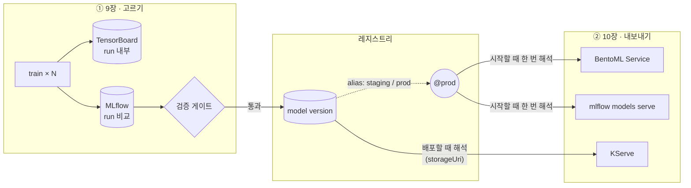
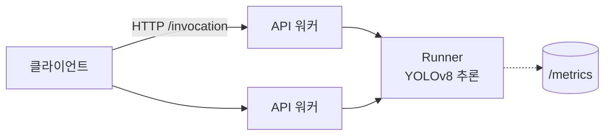

# 🚚 5주차 · CH9~10 — 고른 모델을 내보내고, 내보낸 모델이 무엇인지 남긴다

**TensorBoard · 영화 추천 파이프라인 · MLflow 레지스트리와 검증 게이트 · BentoML · mlflow models serve · KServe · 별칭(alias)과 GitOps**

> [!NOTE]
> 5주차 수업 노션과, 그 노션의 「멤버 작성 과제 추천」과 Slack `#mlops`에서 함께 추천된 제출물 두 편을 책 9~10장 순서로 묶은 스터디 노트입니다.
>
> - **수업 노션**: *CH9~CH11 & 멤버발표(조해윤)*. 11장은 6주차로 넘어가서 이번 주 범위는 9장 후반(9.2~9.4)과 10장입니다.
> - **책 흐름 그대로 실습**: 김지호님의 [검증 지표 기반 추천 모델 선택부터 출시·배치 멱등성·모니터링까지](https://jiho0735.tistory.com/378) (2026-11-20)
> - **10장 심화 (별칭과 서빙 버전)**: 송이레님의 [10.7.1 모델 별칭과 서빙 버전의 변경 시점](https://sirzzang.github.io/MLOps-ML-Platform-Engineering-10-07-01-Alias-Serving-Version/) · [10.7.2 모델 승격의 기록 위치: 별칭과 GitOps](https://sirzzang.github.io/MLOps-ML-Platform-Engineering-10-07-02-Alias-Promotion-Record/)
> - **교재**: *Machine Learning Platform Engineering* 9~10장

## 목차

- [0. 이 문서 읽는 법](#0-이-문서-읽는-법)
- [1. 한눈에 보기](#1-한눈에-보기)
- [2. 용어 먼저](#2-용어-먼저)
- [3. CH9 후반: 고르는 규칙을 먼저 정한다](#3-ch9-후반-고르는-규칙을-먼저-정한다)
- [4. CH10: 서빙은 모델을 언제 읽는가](#4-ch10-서빙은-모델을-언제-읽는가)
- [5. 출시를 하나의 단위로 묶기 (김지호)](#5-출시를-하나의-단위로-묶기-김지호)
- [6. 별칭을 옮기면 서빙은 언제 바뀌나 (송이레)](#6-별칭을-옮기면-서빙은-언제-바뀌나-송이레)
- [7. 두 글을 겹쳐 읽으면](#7-두-글을-겹쳐-읽으면)
- [8. 정리](#8-정리)
- [9. 직접 해 보기 체크리스트](#9-직접-해-보기-체크리스트)
- [참고 자료](#참고-자료)

---

## 0. 이 문서 읽는 법

| 표시 | 뜻 |
|:---:|---|
| ✅ | **실행 기록**: 원문에 적힌 실제 실행 결과입니다. 숫자는 원문 그대로 옮겼습니다. |
| 💡 | **해설**: 이해를 돕기 위해 덧붙인 설명과 비유입니다. |
| ⚠️ | **막힌 곳**: 실습에서 실제로 걸린 지점과 해결 방법입니다. |

> [!IMPORTANT]
> 세 자료는 실행한 주체와 환경이 다릅니다. 숫자를 섞어 비교하지 않도록 각 절 머리에 출처를 적었습니다.
>
> | 자료 | 누가 돌렸나 | 데이터 · 모델 | 환경 |
> |---|---|---|---|
> | **수업 노션** | 스터디 모임장 | MovieLens(소형 81명 추출본), MIDV-500 신분증 YOLOv8 | KFP + SeaweedFS + MLflow, BentoML 1.1.6 · torch 2.5.1+cpu · ultralytics 8.0.194 |
> | **김지호** | 글쓴이 본인 | 합성 영화 추천 데이터(seed 43), 128×128 카드 탐지 | 책 실습 저장소 `ml-labs` CLI, Linux 서버, Evidently 0.4.40 |
> | **송이레** | 글쓴이 본인 | `DummyRegressor` 두 버전(응답값 = 버전) | kind(Kubernetes v1.29.14), Argo CD v2.6.7, MLflow 3.17.1, 서빙 레플리카 3 |

---

## 1. 한눈에 보기

| 장 | 책이 붙잡는 질문 | 핵심 도구 | 이번 주 결과 ✅ |
|---|---|---|---|
| **9장 후반** | 여러 run 가운데 무엇을 어떤 규칙으로 고르나? | TensorBoard, MLflow Tracking · Registry, 검증 게이트 | 김지호: 검증 NDCG@5 0.5036(rank 2) vs 0.4000(rank 4) → rank 2 선택, test recall@5 ≈ 0.6667로 게이트 통과 |
| **10장** | 고른 모델을 어떻게 API로 내보내나? | BentoML Service · Runner · Bento, `mlflow models serve`, KServe | 노션: Bento 빌드 약 4초 · 5.99 MiB, 컨테이너 이미지 6.66 GB |
| **10.7 심화** | 별칭을 옮기면 떠 있는 서빙은 언제 바뀌나? | MLflow alias, Argo CD | 송이레: **다음 컨테이너 시작 때**. 그 사이 Service 뒤에서 v1·v2가 섞이고, Git·Argo CD에는 아무 기록도 없음 |

### 전체 흐름



### 💡 두 장을 한 줄씩

| 장 | 한 줄 |
|---|---|
| **9장 후반** | 좋은 모델을 "보고" 고르지 말고, 고르는 규칙을 먼저 정한 뒤 검증 지표로만 고른다. |
| **10장** | 서빙 프레임워크는 모델을 API로 감싸 주지만, *어느 버전이 지금 떠 있는지*는 따로 남겨야 한다. |

---

## 2. 용어 먼저

| 용어 | 뜻 | 이번 주에 나오는 곳 |
|---|---|---|
| **TensorBoard** | 한 run의 내부(손실 곡선, 학습률, 그래프)를 깊게 들여다보는 도구 | 9.2, YOLO `runs/` 디렉터리 |
| **MLflow Tracking** | 여러 run의 파라미터·지표·아티팩트를 모아 비교하는 저장소 | 9.3.4 |
| **Model Registry** | 등록된 모델을 버전(1, 2, 3…)으로 쌓는 곳 | 9.3.5 |
| **별칭(alias)** | 버전 하나를 가리키는 이름(`@staging`, `@prod`, `@champion`). 옮길 수 있는 포인터 | 9.3.5, 10.6~10.7 |
| **검증 게이트** | 지표가 기준보다 나쁘면 다음 단계로 못 가게 막는 단계 | 9.3.5 |
| **BentoML Service / Runner** | API 서버(Service)와 모델 실행 단위(Runner)를 나눠 따로 확장하는 구조 | 10.3 |
| **Bento** | 코드·모델·의존성을 묶은 배포 단위. 태그로 버전을 매김 | 10.5 |
| **KServe** | Kubernetes 위의 표준 서빙 CRD(`InferenceService`). `storageUri`로 모델 위치를 받음 | 10.8 |
| **멱등성(idempotency)** | 같은 작업을 여러 번 해도 결과가 한 번 한 것과 같음 | 김지호 배치 |
| **해석 시점** | `models:/이름@별칭`을 실제 버전 번호로 바꾸는 순간 (송이레의 용어) | 송이레 실험 |

---

## 3. CH9 후반: 고르는 규칙을 먼저 정한다

### 3.1 TensorBoard와 MLflow는 보는 높이가 다르다 ✅ (노션)

노션 실습은 9.1에서 PVC에 남긴 YOLO 학습 결과(`runs/` 아래 19개 디렉터리, 2,326개 파일)를 TensorBoard로 다시 열었습니다.

| 도구 | 잘 보는 것 | 비유 💡 |
|---|---|---|
| **TensorBoard** | run **하나**의 내부: 손실 곡선, 학습률 변화, mAP 추이 | 한 경기의 리플레이 |
| **MLflow** | run **여러 개**의 비교와 아티팩트 보관, 레지스트리 | 시즌 기록표 |

책 9.4 요약도 같은 말을 합니다. "둘은 같은 일을 하는 것처럼 보이지만, MLflow는 여러 실험의 추적과 아티팩트 저장에, TensorBoard는 단일 run의 깊은 관찰에 맞다."

### 3.2 영화 추천 파이프라인: 데이터 → 훈련 → 평가 → 등록 ✅ (노션)

```text
qa-data → get-dataset-metadata → negative-sampling → get-test-valid-dataset → train-model → evaluate → promote(staging)
```

- **QA → 메타데이터 → 네거티브 샘플링**: 사용자가 보지 않은 영화를 "음성 예시"로 더해 훈련 데이터를 만듭니다. test/val은 네거티브를 더하지 않고 실제 평점만 씁니다. 평가는 사용자가 실제로 준 평점으로 해야 의미가 있기 때문입니다.
- **훈련**: 사용자·영화를 작은 벡터(임베딩)로 바꿔 곱하는 행렬 분해 모델. SGD + `StepLR(step_size=10, gamma=0.1)` + L1Loss.
- **평가**: 평점 오차(RMS)와 사용자별 precision/recall@k.
- **등록**: 지표를 `staging`과 비교해 나쁘지 않으면 `staging` 별칭을 옮깁니다. staging이 비어 있으면 첫 모델(v1)이 자동으로 staging이 됩니다.

> [!WARNING]
> ⚠️ 노션이 짚은 함정 세 가지
> - **게이트가 너무 관대하다**: 기본 임곗값 `-0.3`, `-0.2`는 precision이 0.3, recall이 0.2까지 떨어져도 통과시킨다는 뜻입니다.
> - **`rms`는 평점 단위 RMSE가 아니다**: 배치 평균끼리의 RMSE입니다. precision/recall도 사용자가 이미 평가한 항목 안에서의 순위 평가입니다.
> - **학습률이 너무 빨리 죽는다**: `lr=0.001`로 시작하면 10 epoch마다 1/10이 되어 후반에는 가중치가 거의 안 움직입니다. MLflow Compare로 `lr=0.01`과 손실 곡선을 겹쳐 보면 평평해지는 구간이 보입니다.

### 3.3 데이터 분할도 결정적으로 ✅ (노션 참고 블록)

랜덤 분할은 데이터가 늘 때마다 테스트 샘플이 훈련 쪽으로 넘어올 수 있습니다. 노션은 식별자를 `crc32`로 해시해 `< 0.2 × 2³²`이면 테스트로 보내는 방식을 소개합니다.

```python
from zlib import crc32

def is_id_in_test_set(identifier, test_ratio):
    return crc32(np.int64(identifier)) < test_ratio * 2**32   # 같은 ID는 언제나 같은 쪽
```

💡 핵심은 "랜덤이 아니라 결정적"이라는 점입니다. 새 데이터가 들어와도 기존 테스트 샘플은 그대로 테스트에 남아 데이터 누설을 막습니다.

### 3.4 김지호: 테스트 점수를 보기 전에 규칙을 못 박는다 ✅

김지호님은 seed 43으로 새 데이터를 만들고 행렬 분해의 잠재 차원만 바꾼 두 후보(rank 2, rank 4)를 학습했습니다. 그리고 **비교 전에** 규칙을 정했습니다.

> 검증 NDCG@5가 높은 후보를 먼저 고르고, 같을 때만 검증 RMSE가 낮은 쪽을 고른다.

```python
ranked.sort(key=lambda x: (-x["NDCG"], x["RMSE"]))   # NDCG 내림차순, RMSE 오름차순
```

| 후보 | 검증 NDCG@5 | 비고 |
|---|---:|---|
| **rank 2** | **0.5036** | 순위 품질이 더 좋음 → 선택 |
| rank 4 | 0.4000 | 평점 오차(RMSE)는 rank 4 쪽이 더 좋았음 |

두 지표가 서로 다른 모델을 가리키는 상충이 실제로 나왔고, 미리 정한 규칙 덕분에 해석이 끼어들 틈이 없었습니다. 그다음에야 잠가 둔 테스트 분할을 **한 번** 열어 품질 게이트로 썼습니다.

| 최종 평가 ✅ | 값 |
|---|---|
| `passed` | `true` |
| `test_recall_at_5` | 약 0.6667 |
| `observed_lift` (기준선 대비) | 약 0.2174 |
| 등록 | `models:/book-movie-selected/1` |

> [!CAUTION]
> 검증 세트에서 순위를 평가한 사용자가 **5명**뿐이라, 한두 명의 순위만 바뀌어도 NDCG@5가 크게 흔들립니다. 0.5036과 0.4000의 차이는 이 분산을 감안해 읽어야 합니다. (김지호님이 직접 적은 한계)

### 💡 9장 후반을 한 문장으로

테스트 세트는 "고르는 데" 쓰는 순간 미래 데이터 역할을 잃습니다. 고르는 건 검증으로, 테스트는 고른 하나에 한 번만.

---

## 4. CH10: 서빙은 모델을 언제 읽는가

### 4.1 왜 모델 배포는 어려운가 (10.1)

책은 버전 관리·테스트·CI/CD로 이미 복잡한 소프트웨어 배포에 ML 고유의 고려 사항이 더해진다고 정리합니다. 추론 패턴(배치·실시간), 모델 확장성, 성능 모니터링과 드리프트, 지속적 학습, **데이터 의존성**(학습 때 전처리를 서빙에서도 똑같이 재현), 하드웨어(GPU), **모델 버전 관리와 롤백**, 설명 가능성, 리소스 관리, 보안과 프라이버시. 그래서 "모델을 API로 감싸는 일"을 표준화한 도구가 필요하다는 것이 10장의 출발점입니다.

### 4.2 BentoML: Service와 Runner를 나눈다 ✅ (노션)



- **Service**는 HTTP 요청을 받고 전·후처리를 합니다. **Runner**는 모델 추론만 합니다. 둘을 나누면 CPU 바운드 API와 무거운 추론을 따로 늘릴 수 있습니다. 노션 실습의 워커는 총 3개(러너 1, API 2)였습니다.
- 신분증 샘플 3장을 `/invocation`에 보냈을 때 `img_1`만 신뢰도가 0.58로 낮았습니다.
- `/metrics`를 호출하면 요청 카운터가 늘어나는 것을 확인할 수 있고, 11장 모니터링이 이 엔드포인트를 그대로 씁니다.

| 빌드 단계 ✅ | 노션 결과 |
|---|---|
| `bentoml build` | 약 4초, Bento ≈ 5.99 MiB (가중치 포함) |
| `bentoml containerize` | 이미지 6.66 GB (베이스 `ultralytics/ultralytics:8.0.203-cpu` pull이 대부분) |
| 영화 추천 Bento (책 그대로) | 이미지 **13.2 GB** |

> [!WARNING]
> ⚠️ **추천 Bento가 13.2 GB가 된 이유**: BentoML 1.4 build가 의존성을 PyPI에서 풀어 `requirements.txt`로 잠그는데, 그냥 `torch`라고 적으면 CUDA 휠과 `nvidia-*` 패키지 17개 정도가 딸려 옵니다. 실행 로그에도 `Stored model version '2.15.0+cpu' does not match installed PyTorch version '2.15.0+cu132'`가 찍혔습니다. 노션은 `docker.base_image`를 9.3에서 만든 CPU torch + MLflow 이미지로 지정해 해결했습니다.

### 4.3 BentoML + MLflow (10.6)

추천 서비스의 `__init__`은 모델 파일을 이미지 안에 넣지 않고, **시작할 때** MLflow에서 `prod` 별칭의 모델을 받아 옵니다. 노션 실습에서 확인하니 어떤 모델이 올라왔는지는 `v3 prod`로 찍혔습니다.

💡 이 한 줄이 이번 주의 가장 중요한 복선입니다. "시작할 때 받아 온다"는 것은 **떠 있는 동안에는 다시 읽지 않는다**는 뜻이기 때문입니다. 6절에서 송이레님이 이것을 실험으로 확인합니다.

### 4.4 MLflow만으로 서빙하기 (10.7)

```bash
export MLFLOW_TRACKING_URI=http://mlflow:5000
mlflow models serve -m "models:/recommender_production@prod"

# 컨테이너로 만들 때
mlflow models build-docker -m models:/recommender_production@prod -n recommender_service --enable-mlserver
```

BentoML 없이도 MLflow만으로 학습 기록 → 레지스트리 등록 → REST 서빙(`/health`, `/invocations`)까지 이어집니다. 도구를 하나로 줄이는 대신 러너 분리·커스텀 지표 같은 기능은 직접 붙여야 합니다.

### 4.5 KServe: Kubernetes 표준 서빙 (10.8) ✅ (노션)

```yaml
# 요지: 노션 스모크 테스트(d1_sklearn.yaml, 11줄)
kind: InferenceService
metadata:
  name: sklearn-iris
spec:
  predictor:
    serviceAccountName: kserve-sa          # S3 자격 증명을 담은 SA
    model:
      modelFormat: {name: sklearn}
      storageUri: s3://datasets/kserve-smoke/sklearn-iris   # 배포할 때 위치가 정해진다
```

노션은 `kserve/sklearnserver:v0.19.0` 이미지(약 11초, 822 MB) **안에서** iris를 학습해 서버와 scikit-learn 버전을 맞춘 뒤 올렸고, `InferenceService`가 Ready가 되기까지 56초가 걸렸습니다. S3 자격 증명 annotation 이름은 KServe v0.19.0 소스(`pkg/credentials/s3/s3_secret.go`) 기준으로 맞췄습니다.

| 서빙 방식 | 모델 위치를 아는 때 | 잘 맞는 곳 |
|---|---|---|
| **BentoML** | 빌드할 때(모델 포함) 또는 시작할 때(MLflow에서 로드) | 전·후처리가 많은 서비스, 커스텀 지표 |
| **mlflow models serve** | 시작할 때 | 빠른 시험, 단순 pyfunc 모델 |
| **KServe** | 배포할 때(`storageUri`) | 여러 팀이 같은 방식으로 서빙하는 플랫폼 |

---

## 5. 출시를 하나의 단위로 묶기 (김지호)

> 김지호님 글의 10~11장 부분입니다. 책 실습 저장소의 `ml-labs` CLI로 돌렸습니다.

### 5.1 `release_id`: 모델·보고서·데이터를 해시로 묶는다 ✅

```bash
ml-labs release activate --candidate "$MOVIE_CANDIDATE" \
  --report "$W/reports/movie-selected.json" --store "$W/movie-releases"
```

평가 보고서 해시(`report_sha256`)와 데이터셋 지문(`dataset_sha256`)을 합쳐 `release_id`를 만들고 출시 저장소에 고정합니다. 새 상태로 바뀌면 `"changed": true`가 붙습니다.

💡 레지스트리 버전 번호가 "어떤 모델 파일"인지만 말한다면, `release_id`는 "어떤 모델이 **어떤 평가와 어떤 데이터로** 나갔는지"를 한 값으로 말합니다.

### 5.2 서버는 시작할 때 출시를 고정한다 ✅

`/recommend` 응답에는 `release_id`와 `model_uri`가 함께 실려 옵니다. 그리고 김지호님은 이렇게 적었습니다.

> 추천 서버는 프로세스가 시작되는 시점에 출시 기록을 읽어 모델을 메모리에 고정합니다. 서버가 떠 있는 상태에서 `release activate`로 포인터를 바꿔도 실행 중인 서버의 모델은 바뀌지 않습니다. 반영하려면 재시작해야 합니다.

### 5.3 배치: 실패해도 반쯤 쓴 결과를 내놓지 않는다 ✅

| 시도 | 옵션 | 결과 |
|---|---|---|
| 1 | `--job-key book-day-01 --fail-before-commit` | 게시 직전 실패 → `batch-results/`에 **파일 없음** (원자적 게시) |
| 2 | 같은 키로 정상 실행 | 완료, `output_sha256` 생성 |
| 3 | 같은 키로 한 번 더 | 추론 생략, `"reused": true`, 같은 `output_sha256` (멱등성) |
| 4 | 같은 키 + **다른 사용자 목록** | 입력 지문 충돌로 **거절** |

### 5.4 카드 탐지 서버와 관측 ✅

- 카드 없는 `test-0000`: `"detected": false`, `"box_xyxy": null`
- 카드 있는 `test-0001`: `box_xyxy` = `[28.97, 14.08, 82.94, 62.41]`. 정답 라벨을 128×128 픽셀로 환산하면 x 28~83, y 14~62로 거의 겹칩니다.
- `/metrics`: 추천 요청 1건 뒤 `ml_labs_inference_requests_total`이 2.0 → 3.0.
- Evidently 드리프트: 평점을 모두 1.0으로 바꾼 현재 데이터 → `dataset_drift: true`. 보고서 문구 그대로 **"Drift is a signal, not proof of model failure."**
- 통합 장애 실험(`evidence.json`): 피처 공급 전 요청은 HTTP 503, 복구 뒤 `"personalized"` · 재시도 배치 `reused: True` · 출시 `first → next → restored`(= `first`와 같은 해시)

> [!WARNING]
> ⚠️ 카드 탐지 엔드포인트는 이미지를 업로드받지 않고 **서버가 도는 컴퓨터의 파일 경로**를 읽습니다. 로컬 실습용이라 그대로 외부에 열면 안 됩니다. (김지호님 메모)

---

## 6. 별칭을 옮기면 서빙은 언제 바뀌나 (송이레)

> 송이레님의 10.7.1편(실험)과 10.7.2편(해석)을 요약했습니다. 응답값이 곧 버전(v1 = 1.0, v2 = 2.0)인 더미 모델로, 파드마다 어느 버전이 답하는지 직접 찍었습니다.

### 6.1 별칭 해석 시점: 세 가지(+하나)

| 해석 시점 | 서빙 방식의 예 | 서빙 모델이 바뀌는 때 |
|---|---|---|
| **호출할 때** | 요청·배치마다 `mlflow.pyfunc.load_model("models:/...@prod")` | 다음 호출 |
| **컨테이너가 시작할 때** | `mlflow models serve -m models:/...@prod`(10.7), 초기화에서 모델을 받는 BentoML(10.6) | 다음 컨테이너 시작 |
| **배포할 때** | 배포 스크립트가 별칭을 풀어 KServe `storageUri`에 넣음 | 다음 배포 |
| **빌드할 때** (10.7.2편) | 모델을 이미지에 넣는 파이프라인 컴포넌트 | 다음 이미지 빌드 |

근거는 소스입니다. MLflow 3.17.1의 `PyFuncBackend.serve`는 시작할 때 모델 URI를 한 번 내려받고, 스코어링 서버에는 **로컬 경로만** 넘깁니다. 스코어링 서버는 `@prod`라는 이름을 모르니 다시 읽을 방법이 없습니다.

### 6.2 실험 1: 별칭을 v2로 옮긴 뒤 ✅

| 시각 | 사건 | Service로 20번 물은 응답 |
|---|---|---|
| +00:02 | 시작 (prod = v1) | 1.0 × 20 |
| +00:11 | **prod → v2** | 1.0 × 20 (아무도 안 바뀜) |
| +00:46 | 파드 하나 삭제 | 1.0 × 14, **2.0 × 6** (새 파드만 v2) |
| +00:55 | 다른 파드의 **컨테이너만** 재시작 | 1.0 × 7, 2.0 × 13 |
| +01:56 | `kubectl rollout restart` | 2.0 × 20 |
| +02:37 | **prod → v1 (롤백)** | 2.0 × 20 (롤백도 반영 안 됨) |
| +03:13 | 파드 하나 삭제 | 1.0 × 5, 2.0 × 15 (다시 혼재) |

💡 반영 시점을 정하는 것은 사람이 아니라 **OOMKilled, 노드 장애, 스케일 아웃** 같은 사건입니다. 의도해서 나눈 A/B 테스트가 아니니 그 비율을 아무도 관리하지 않습니다.

### 6.3 실험 2: 그 변화는 어디에 남았나 ✅

| 어디 | 기록 |
|---|---|
| **Git** | 커밋 없음 (`git=05e1617` 그대로) |
| **Argo CD** | 내내 `Synced` · `Healthy`, 동기화 이력에 항목 없음 |
| **MLflow DB** | `registered_model_aliases` 한 행의 `version`만 1 → 2 → 1로 **덮어씀**. 이전 값·바꾼 시각을 담는 테이블 없음 (65개 중) |
| **MLflow 서버 접근 로그** | 서빙 파드가 시작할 때 `get-download-uri?...&version=2`가 **파드 IP**와 함께 찍힘. 로그를 따로 모으지 않으면 서버 재시작 때 사라짐 |

`rollout restart`가 파드 템플릿에 `restartedAt` annotation을 넣어도, Git에 없는 필드라 Argo CD는 차이로 보지 않았습니다.

### 6.4 실험 3: 매니페스트에 버전을 적고 커밋으로 승격 ✅

```diff
-        - --model-uri=models:/alias-demo@prod
+        - --model-uri=models:/alias-demo/1
```

| 관찰 | 결과 |
|---|---|
| 별칭을 v2로 옮기고 파드 삭제 | 새 파드도 **1.0** → 별칭이 더 이상 서빙에 영향 없음 |
| `/1 → /2` 승격 커밋 (기본 폴링) | 커밋 15:17:44Z → 배포 15:21:28Z, **3분 44초** (1회 관측) |
| 버전이 섞인 구간 | 롤아웃 동안(약 20초)으로 줄어듦 |
| 그동안 Argo CD 화면 | 최신 커밋이 v2인데 `Synced@이전커밋` 표시 |
| `git revert` | 서빙은 v1로 복귀, **MLflow 별칭은 v2 그대로** |

> [!IMPORTANT]
> 송이레님의 해석(10.7.2편): 두 한계는 별칭 하나가 **"이 버전을 써도 된다"(승인)** 와 **"이 버전이 지금 떠 있다"(배포 상태)** 를 함께 뜻하는 데서 생깁니다. 별칭은 레지스트리의 **승인**으로만 두고, 배포 상태는 Git과 Argo CD가 맡게 나누면 revert 뒤의 어긋남도 결함이 아니라 "두 뜻을 나눈 결과"로 읽힙니다.

### 6.5 스테이지에서 별칭으로, 그리고 이미지 태그

- MLflow는 2.9부터 `None/Staging/Production/Archived` 스테이지를 폐기 예정으로 돌리고 별칭을 도입했습니다(RFC #10336). 이름을 팀이 정하고 한 버전에 여러 개를 붙일 수 있어 `champion`/`challenger` 같은 관례가 가능합니다.
- 💡 상시 서빙이 읽는 별칭은 **모델에 붙은 `:latest` 태그**와 같습니다. Kubernetes 문서가 운영에서 `:latest`를 피하고 digest를 쓰라는 이유(무엇이 떠 있는지 추적이 어렵고 롤백이 어렵다)가 모델에도 그대로 적용됩니다. 이미지는 digest로 고정하면서 모델만 별칭으로 가리키면, 코드 변경은 PR로 되짚을 수 있지만 모델 변경은 그렇지 않습니다.

---

## 7. 두 글을 겹쳐 읽으면

| 질문 | 김지호 (책 실습) | 송이레 (별칭 실험) |
|---|---|---|
| 서빙은 모델을 언제 읽나? | 시작할 때 출시 기록을 읽어 **고정**, 바꾸려면 재시작 | 시작할 때 별칭을 **한 번 해석**, 바꾸려면 재시작 |
| 지금 무엇이 떠 있는지는? | 응답마다 `release_id`, `model_uri`를 실어 보냄 | 응답에 버전이 없으면 MLflow 접근 로그의 파드 IP뿐 |
| 무엇을 고정의 단위로? | 모델 + 평가 보고서 + 데이터 해시 = `release_id` | 매니페스트의 버전 번호 = Git 커밋 |
| 되돌리기는? | 출시 저장소의 `restored`(첫 출시와 같은 해시) | `git revert` (별칭은 따로 남음) |

> [!IMPORTANT]
> 두 글은 다른 도구로 같은 결론에 닿습니다. **포인터(별칭·활성 출시)를 옮기는 것과 서빙이 바뀌는 것은 다른 사건**이고, 그 사이를 메우려면 (1) 재시작·배포를 승격 절차에 넣고, (2) 응답이나 배포 기록에 *실제로 해석된* 버전을 남겨야 합니다. 김지호님의 `release_id`가 (2)를, 송이레님의 매니페스트 고정이 (1)을 보여 줍니다.

### 수업 노션의 「실무 고려 사항」(강진웅님 작성)과 이어 보기

- **승격 게이트 표준화**: "staging 대비 지표 차이" 게이트를 팀 공통 컴포넌트로, 임곗값만 파라미터로. prod 승격은 Jenkins · Argo CD 승인 단계와 연결.
- **재현성**: run에 데이터셋 버전(스냅숏 ID · S3 경로), 코드 커밋 해시, **이미지 digest**를 태그로 남겨야 진짜 재현 가능.
- **MLflow 업로드 경로**: 큰 모델을 많은 사람이 올리면 프록시 모드 서버가 병목 → 학습 노드에 S3 직접 권한을 주고 메타데이터만 서버로.
- **멀티테넌트 MLflow**: 팀 접두어 규칙(`team-a.recommender`)과 Keycloak 연동 권한.

### 도전과제와 연결: "KFP run을 GitOps로 제출하면 ML 파이프라인이 완전한 GitOps가 되나?"

노션의 도전과제는 `runs/` 아래 실행 선언 파일을 커밋하면 Gitea Actions가 KFP run을 만드는 예시를 줍니다(파라미터를 바꿔 커밋 = 새 실행). 송이레님의 결과에 비추면 답의 윤곽이 보입니다. **Git이 원하는 상태를 가질 수 있는 것**(서빙 매니페스트, 승인된 모델 버전, 실행 선언)은 GitOps로 옮길 수 있고, **바깥 시스템에 남는 것**(학습 결과, 지표 시계열, 레지스트리 별칭 상태, 데이터 자체)은 Git이 아니라 "시점"과 해시로 관리해야 합니다.

---

## 8. 정리

| 장 | 붙잡은 질문 | 답 |
|---|---|---|
| **9장 후반** | 여러 후보 가운데 무엇을 고르나? | ✅ 고르는 규칙(지표 우선순위)을 비교 **전에** 정하고 검증 지표로만 고른다. 테스트는 고른 하나에 한 번 |
| **10장** | 고른 모델을 어떻게 내보내나? | ✅ BentoML · `mlflow models serve` · KServe. 셋의 차이는 **모델 위치를 언제 아느냐**(빌드·시작·배포) |
| **10.7 심화** | 별칭을 옮기면 서빙이 바뀌나? | ✅ 떠 있는 서빙은 다음 컨테이너 시작 때 바뀌고, 그 변화는 Git·Argo CD에 남지 않는다 |

### 기억할 다섯 가지

1. **규칙이 먼저, 점수는 나중.** 지표가 서로 다른 모델을 가리키는 일은 흔합니다. 우선순위를 미리 코드로 못 박습니다.
2. **게이트 임곗값을 읽어 본다.** 기본값 `-0.3`/`-0.2`는 사실상 게이트가 아닙니다.
3. **서빙의 해석 시점을 안다.** 호출·시작·배포·빌드 가운데 어느 때 모델 위치가 정해지는지 알아야 승격이 언제 반영되는지 압니다.
4. **응답에 버전을 싣는다.** `release_id`나 모델 버전을 응답·로그에 남기지 않으면 "지금 무엇이 떠 있나"에 답할 곳이 없습니다.
5. **승인과 배포를 나눈다.** 별칭은 승인, 배포 상태는 Git. 둘이 어긋나는 순간을 누가 맞출지 정해 둡니다.

---

## 9. 직접 해 보기 체크리스트

- [ ] YOLO `runs/`를 TensorBoard로 열고, 같은 run을 MLflow에서도 열어 두 화면이 보여 주는 것을 비교
- [ ] 후보 두 개를 학습하고 "NDCG 우선, 동점이면 RMSE" 규칙을 코드로 적은 뒤에 검증 지표 확인
- [ ] 검증 게이트 임곗값을 `-0.3` → `0.0`으로 바꿔 나쁜 모델이 staging에 못 올라가는지 확인
- [ ] `bentoml build` → `containerize` 후 이미지 크기 확인, `torch`가 CUDA 휠로 풀리지 않았는지 점검
- [ ] `mlflow models serve -m models:/...@prod`를 레플리카 3으로 띄우고 별칭만 옮겨 응답이 그대로인지 확인
- [ ] 파드 하나만 지워 Service 뒤에서 두 버전이 섞이는 것을 직접 보기
- [ ] 매니페스트에 `models:/이름/버전`을 적고 승격을 커밋으로 해 Argo CD 동기화 이력에 남는지 확인
- [ ] 응답 JSON에 모델 버전(또는 `release_id`)을 넣는 한 줄을 서빙 코드에 추가

---

## 참고 자료

- 수업 노션: *CH9~CH11 & 멤버발표(조해윤)*, Machine Learning Platform Engineering Study (CloudNet@) · 실무 고려 사항(강진웅님 작성)
- 블로그: [검증 지표 기반 추천 모델 선택부터 출시·배치 멱등성·모니터링까지](https://jiho0735.tistory.com/378), My StudySpace (김지호)
- 블로그: [10.7.1 모델 별칭과 서빙 버전의 변경 시점](https://sirzzang.github.io/MLOps-ML-Platform-Engineering-10-07-01-Alias-Serving-Version/) · [10.7.2 모델 승격의 기록 위치: 별칭과 GitOps](https://sirzzang.github.io/MLOps-ML-Platform-Engineering-10-07-02-Alias-Promotion-Record/), 송이레
- 교재: *Machine Learning Platform Engineering* 9~10장
- 공식 문서: [MLflow](https://mlflow.org/docs/latest/) · [BentoML](https://docs.bentoml.com/en/latest/) · [KServe](https://kserve.github.io/website/) · [Kubernetes Images (태그와 digest)](https://kubernetes.io/docs/concepts/containers/images/) · [Argo CD](https://argo-cd.readthedocs.io/)

<sub>✅ 숫자는 위 자료에 적힌 실행 기록을 그대로 옮겼습니다. 수업 노션의 수치는 스터디 모임장의 실습 결과이고, 김지호님·송이레님의 수치는 각 글쓴이 본인의 실행 결과입니다. 송이레님의 시간 값은 모두 1회 관측입니다. 짧게 줄인 코드는 원문 설명을 바탕으로 요지만 옮긴 것이며 그대로 실행되는 전체 코드가 아닙니다.</sub>
