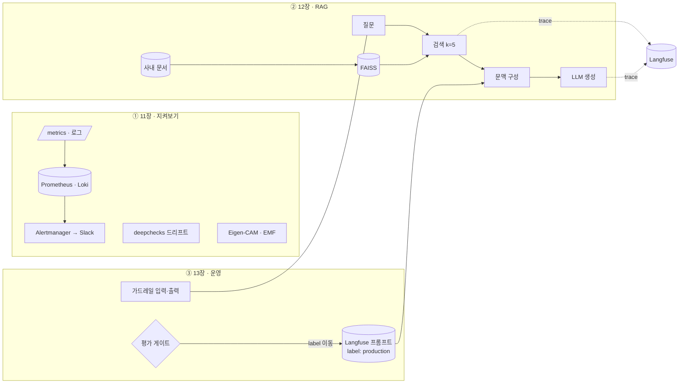
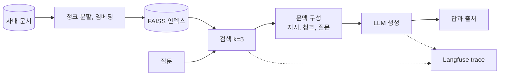

# 🧠 6주차 · CH11~13 — 답을 바꾸는 것이 가중치 밖으로 나간다

**모니터링·드리프트·설명 가능성 · DakkaBot RAG · Langfuse 트레이스와 프롬프트 관리 · 평가 게이트 · 가드레일 · 비용**

> [!NOTE]
> 6주차(마지막 주) 수업 노션과 제출물 두 편을 책 11~13장 순서로 묶은 스터디 노트입니다. 아직 Slack에 6주차 추천 글이 올라오기 전이라, **과제 제출표의 6주차 제출물 중 실측이 가장 충실한 글**과 **수업 노션이 12장 실습 참고로 직접 지정한 글**을 골랐습니다.
>
> - **수업 노션**: *CH12,13 & 멤버발표(오수진)*, 그리고 5주차 노션에서 6주차로 넘어온 *CH11 Monitoring and explainability*
> - **11~13장 요약 + 프롬프트 라벨 실측**: 조현석님의 [프롬프트 라벨을 옮기면 최대 61초 동안 옛 버전이 응답한다](https://github.com/hoyajigi/ml-platform-study/blob/main/week6/README.md)
> - **12장 RAG를 단계별로 나눠 보기**: 김춘식님의 [12. LLM 기반 시스템 설계](https://johklo.github.io/docs/tech/machine-learning-platform-engineering/12-llm-powered-systems/) (노션의 「실습 참고: 김춘식님」)
> - **교재**: *Machine Learning Platform Engineering* 11~13장 (Part 4: Extending MLOps for large language models)

## 목차

- [0. 이 문서 읽는 법](#0-이-문서-읽는-법)
- [1. 한눈에 보기](#1-한눈에-보기)
- [2. 용어 먼저](#2-용어-먼저)
- [3. CH11: 서비스가 살아 있는지와 모델이 맞는지는 따로 본다](#3-ch11-서비스가-살아-있는지와-모델이-맞는지는-따로-본다)
- [4. CH12: RAG는 검색 · 문맥 구성 · 생성으로 나눠서 틀린다](#4-ch12-rag는-검색--문맥-구성--생성으로-나눠서-틀린다)
- [5. CH13: 프롬프트를 배포 대상으로 다룬다](#5-ch13-프롬프트를-배포-대상으로-다룬다)
- [6. 프롬프트 라벨은 언제 반영되나 (조현석 실측)](#6-프롬프트-라벨은-언제-반영되나-조현석-실측)
- [7. 멤버 발표: LLM 운영 경험 (오수진)](#7-멤버-발표-llm-운영-경험-오수진)
- [8. 자료를 겹쳐 읽으면](#8-자료를-겹쳐-읽으면)
- [9. 정리](#9-정리)
- [10. 직접 해 보기 체크리스트](#10-직접-해-보기-체크리스트)
- [참고 자료](#참고-자료)

---

## 0. 이 문서 읽는 법

| 표시 | 뜻 |
|:---:|---|
| ✅ | **실행 기록**: 원문에 적힌 실제 실행 결과입니다. 숫자는 원문 그대로 옮겼습니다. |
| 💡 | **해설**: 이해를 돕기 위해 덧붙인 설명과 비유입니다. |
| ⚠️ | **막힌 곳**: 실습에서 실제로 걸린 지점과 해결 방법입니다. |

> [!IMPORTANT]
> 자료마다 실행한 주체와 모델이 다릅니다. 책은 Google Gemini를 쓰지만, 세 자료 모두 **API 키 없이 로컬 Ollama**로 바꿔 돌렸습니다. Gemini `text-embedding-004`가 2026-01-14에 종료됐기 때문입니다.
>
> | 자료 | 누가 돌렸나 | 생성 · 임베딩 모델 | 환경 |
> |---|---|---|---|
> | **수업 노션** | 스터디 모임장 | `llama3.2`(3B), `nomic-embed-text`, 심판 `llama3.1:8b` | Mac M1 Pro 16GB, Ollama(Metal), Langfuse 4.76.0 (docker compose) |
> | **조현석** | 글쓴이 본인 | 위와 같음 (+ `qwen3.5:4b`) | Mac M1 Pro 16GB, Langfuse 서버 4.76.0 · Python SDK 3.1.3 |
> | **김춘식** | 글쓴이 본인 | `llama3.2`(3B), `gemma3:270m` | CPU 로컬 (답 하나에 1분 가까이) |

---

## 1. 한눈에 보기

| 장 | 책이 붙잡는 질문 | 핵심 도구 | 이번 주 결과 ✅ |
|---|---|---|---|
| **11장** | 모델 서비스가 살아 있고, 여전히 맞게 답하나? | Prometheus · Grafana · Loki · Alertmanager, deepchecks, Eigen-CAM, EMF | 드리프트 점수는 **대조군과 같이 봐야** 의미가 있다 (밝기 1.5배 0.84 vs 대조군 0.14) |
| **12장** | 남이 만든 LLM으로 사내 문서에 답하게 하려면? | LangChain, FAISS, Chainlit, Langfuse | `num_ctx=1024`에서 프롬프트가 **오류 없이 잘려** 90일 → 60일 오답 |
| **13장** | 그 챗봇을 운영할 수 있게 만들려면? | Langfuse 프롬프트 관리, DeepEval, Promptfoo, Guardrails AI, RedisVL | 평가 게이트: production 4/8 → candidate 7/8 `GATE: PASS` → promote · rollback |
| **실측** | 프롬프트 라벨을 옮기면 언제 반영되나? | Langfuse SDK 캐시 | 프로세스마다 **0~61초** 뒤, 3개 프로세스가 약 40초 동안 옛·새 버전 혼재 |

### 전체 흐름



### 💡 세 장을 한 줄씩

| 장 | 한 줄 |
|---|---|
| **11장** | `up == 0`은 서버가 죽은 것을 알려 주지만, 모델이 틀리기 시작한 것은 알려 주지 않는다. |
| **12장** | RAG 답이 틀리면 "어느 단계에서" 틀렸는지부터 가린다. 그러려면 단계 사이를 trace로 남긴다. |
| **13장** | 프롬프트는 코드다. 버전을 매기고, 평가로 막고, 라벨로 배포하고, 라벨로 되돌린다. |

---

## 2. 용어 먼저

| 용어 | 뜻 | 이번 주에 나오는 곳 |
|---|---|---|
| **데이터 드리프트** | 운영 입력의 분포가 학습 때와 달라지는 것 | 11.2 deepchecks |
| **Eigen-CAM** | 특징 맵의 첫 주성분을 히트맵으로 그려 탐지 모델이 어디를 봤는지 보여 주는 기법 | 11.3.1 |
| **EMF** | 설명 가능한 행렬 분해. 잠재 공간 이웃이 준 평점을 추천 이유로 붙인다 | 11.3.2 |
| **RAG** | 질문과 관련된 문서 조각만 찾아 프롬프트에 넣고 답하게 하는 방식 | 12.2 |
| **청크 / 임베딩** | 문서를 자른 조각 / 그 조각을 벡터로 바꾼 것 | 12.2.4 |
| **trace · span · generation** | 질문 하나 = trace, 그 안의 검색 = span, LLM 호출 = generation | 12.4 Langfuse |
| **temperature · top-k · top-p** | 다음 토큰을 고르는 무작위성 조절 값 | 12.1.1 |
| **num_ctx (컨텍스트 윈도)** | 모델이 한 번에 읽는 토큰 한도 | 12장 실습 |
| **프롬프트 라벨** | Langfuse에서 프롬프트 버전 하나를 가리키는 이름(`production`, `staging`) | 13.1 |
| **LLM-as-Judge (G-Eval)** | 다른 LLM이 자연어 기준으로 답을 채점하는 평가 | 13.2.1 DeepEval |
| **가드레일** | 입력·출력을 검사해 막거나 가리는 계층 | 13.3 Guardrails AI |
| **시맨틱 캐시** | 비슷한 질문이면 이전 답을 재사용하는 캐시 | 13.4.3 RedisVL |

---

## 3. CH11: 서비스가 살아 있는지와 모델이 맞는지는 따로 본다

> 11장은 5주차 노션에 있었지만 진도상 6주차에 다뤘습니다. 실습 참고 가이드도 김춘식님 글이 지정돼 있습니다.

### 3.1 지표 · 로그 · 알림

| 구성 | 책 | 스터디 실습 (조현석 정리) |
|---|---|---|
| 기본 지표 | BentoML `/metrics` → Yatai PodMonitor → Prometheus, BentoML 대시보드를 Grafana에 import | Yatai 없이 PodMonitor를 직접 작성, relabel로 대시보드 쿼리를 그대로 씀 |
| 커스텀 지표 | `prometheus_client` Histogram(탐지 신뢰도), Counter(추천 결과 유무) | `bentoml.metrics.Histogram` |
| 로그 | BentoML 로거 + Loki | 수집기 Alloy를 따로 배포 |
| 알림 | PrometheusRule `up == 0`, `absent(up)`, `for: 5m` → Alertmanager | 같은 규칙을 `for: 1m`, Slack 수신 |

```python
confidence_score = bentoml.metrics.Histogram(
    name="confidence_score", buckets=[0.1, 0.2, 0.3, 0.4, 0.5, 0.6, 0.7, 0.8, 0.9, 1.0])
ret = await yolo_v8_runner.inference.async_run([input_img])
if ret:  # 탐지 0건이면 책 코드의 response[0]은 IndexError
    confidence_score.observe(ret[0]["confidence"])
# Grafana: histogram_quantile(0.9, sum(rate(confidence_score_bucket[5m])) by (le))
```

💡 `up`은 수집이 실패하면 0이 되지만, **배포 자체가 사라지면 시계열이 없어져** `up == 0` 규칙이 울리지 않습니다. 그래서 `absent(up{...})`를 같이 겁니다.

> [!TIP]
> PromQL이 처음이라면 5주차 노션의 보충 자료(프로메테우스-스택)에 있는 흐름이 좋습니다.
> `node_cpu_seconds_total{mode="idle"}[1m]` → `rate(...)` → `avg(...) by (instance)` → `1 - (...)` 순서로 한 겹씩 씌우면 "인스턴스별 CPU 사용률"이 됩니다.

### 3.2 드리프트: 점수는 대조군과 같이 읽는다 ✅ (조현석)

| 실습 | 결과 |
|---|---|
| 밝기 1.5배, 책 데이터 | Brightness **0.84**, RMS Contrast 0.98 · 대조군(다른 원본 100장) 0.14, 0.18 |
| 밝기 1.5배, MIDV-500 300장 | Brightness 0.67, RMS Contrast 0.30. 원본 대비가 넓게 퍼져 있으면 같은 변화에도 점수가 낮다 |
| 추천 임베딩, 책 노트북 그대로 | 같은 시드면 원본 vs 드리프트 0.05, **다른 시드면 원본 vs 원본도 0.15~0.35** → 시드 차이만 잰다 |
| 추천 임베딩, 저자 의도로 재구성 | 시드 5개 평균 드리프트 0.099 vs 대조군 0.050 |

> [!WARNING]
> ⚠️ 책의 추천 드리프트 노트북은 전치 때문에 한 피처가 "영화 한 편의 값 20개"가 되고 시드도 고정되지 않아, **드리프트가 아니라 초기값 차이**를 잽니다. 점수가 나온다고 그 점수가 드리프트를 재는 것은 아닙니다.

### 3.3 설명 가능성 ✅ (조현석)

- **객체 탐지 · Eigen-CAM**: 같은 이미지에서도 층과 부호에 따라 박스 안/밖 활성 비율이 **0.07에서 3.64까지** 바뀌었습니다. 주성분의 부호는 임의라서 두 방향을 다 봐야 합니다.
- **추천 · EMF**: MovieLens 100K에서 설명이 비어 있는 추천이 **50.6~54.9%** 였습니다. "설명 가능한 모델"이라도 설명이 붙지 않는 추천이 절반입니다.

💡 5주차 김지호님 글의 문구가 11장 전체를 요약합니다. **"Drift is a signal, not proof of model failure."** 드리프트 경보를 곧바로 자동 재학습에 묶지 말고, 정답 라벨 추이 · 수집 파이프라인 이상 · 비즈니스 지표를 먼저 봅니다.

---

## 4. CH12: RAG는 검색 · 문맥 구성 · 생성으로 나눠서 틀린다

### 4.1 LLM이 MLOps에 더하는 것

책 12.1의 출발점은 "다시 만드는 것이 아니라 진화하는 것"입니다. 컨테이너, CI/CD, MLflow, Prometheus는 그대로 쓰고 아래를 더합니다.

| ML과 다른 점 | 플랫폼에 더할 것 |
|---|---|
| 같은 입력에도 출력이 다름 → `assert predict(x) == y` 불가 | **배포 메타데이터**: 가중치뿐 아니라 시스템 프롬프트·임베딩 모델·토큰 한도까지 묶어 버전 관리 |
| 컨텍스트 윈도와 토큰 한도 | **프롬프트 관리**: 버전, A/B 테스트, 배포, 롤백 |
| 검색 → 조립 → 생성 → 검증의 다단계 체인 | **벡터 DB + 임베딩** (책은 FAISS) |
| 피처 엔지니어링 자리를 프롬프트가 차지 | **LLM 게이트웨이**: 제공자 라우팅, 시맨틱 캐싱, 토큰 예산, 장애 시 폴백 |
| 가동 시간이 아니라 **토큰 기준 과금** | **LLM 모니터링**: 토큰·비용 귀속, 품질 드리프트, 다단계 트레이스 |
| 새 공격 벡터 | 프롬프트 인젝션, 학습 데이터 오염 대비 |

김춘식님의 표현으로는 **"결과를 정하는 것이 모델 가중치 밖으로 늘어난다."** 모델 제공자와 버전, 프롬프트, 검색 코퍼스와 인덱스, 검색 파라미터가 모두 답을 바꾸고, 시스템 프롬프트 한 줄도 모델 교체만큼 결과를 흔듭니다.

### 4.2 DakkaBot: 사내 문서 챗봇

| 단계 | 책 구성 | 로컬 실습 |
|---|---|---|
| 임베딩 | `text-embedding-004`(768차원), 문서 `RETRIEVAL_DOCUMENT` / 질의 `RETRIEVAL_QUERY` | `nomic-embed-text` (task_type을 nomic 접두어로 구현) |
| 청킹 | `RecursiveCharacterTextSplitter` 1,000 / 중첩 200, 구분자 `## ` → `### ` → 문단 → 줄 | 같음 |
| 인덱스 | `FAISS.from_documents` → `save_local` | 같음 |
| 검색 | `as_retriever(k=5)` | 같음 |
| 생성 | `gemini-2.5-flash`, temperature 0 | `llama3.2` (3B) |
| UI · 관측 | Chainlit, Langfuse `CallbackHandler` | 같음 (Langfuse는 docker compose, 커밋 고정) |

```python
splitter = RecursiveCharacterTextSplitter(
    chunk_size=1000, chunk_overlap=200, separators=["\n## ", "\n### ", "\n\n", "\n", " ", ""])
vectorstore = FAISS.from_documents(splitter.split_documents(load_documents("./DATA")), embeddings)
retriever = vectorstore.as_retriever(search_kwargs={"k": 5})
```

### 4.3 로컬 실습 결과 ✅ (수업 노션 · 조현석 정리)

| 항목 | 결과 |
|---|---|
| 인덱스 | 345청크, 임베딩 약 10초 (Metal GPU, CPU 환경은 1분 31초) |
| 검색 L2 top-1 | 범위 안 질문 0.389~0.558, 범위 밖 0.936(영어) · 0.997(한국어) |
| 최소 RAG | 검색 0.10초, 생성 9.69초, 약 29 tok/s |
| 비결정성 | temperature 0: 3회 중 1종류 / 1.0: 3종류 |
| `num_ctx=1024` | 1,289토큰 프롬프트가 **오류 없이 잘려** "90일"이 담긴 청크가 빠지고 **60일**로 답함 |
| 기본값(8192)으로 복구 | 같은 질문에 **90일** 정답 (`docs_1.md:1180`과 일치) |
| 모델 교체 `qwen3.5:4b` | 같은 프롬프트도 토크나이저가 달라 입력 토큰 1289 vs 1400 → 토큰 단가 모델에서는 곧 비용 차이 |

> [!WARNING]
> ⚠️ **Ollama는 `num_ctx`를 넘는 프롬프트를 오류 없이 자릅니다.** 경고는 서버 로그의 `truncating input prompt`에만 남습니다. 트레이스에 찍힌 입력 토큰 수를 `num_ctx`와 비교하는 점검을 따로 둬야 합니다.

### 4.4 김춘식: 실패를 단계별로 나누는 표 ✅



| 실패 | 판별 질문 | 고치는 곳 |
|---|---|---|
| **검색 누락** | 필요한 근거가 상위 k개에 있는가 | 분할, 임베딩 모델, k |
| **문맥 구성 오류** | 근거가 프롬프트에 들어갔고 다른 절차와 섞이지 않았는가 | 청크 형식, 길이 제한, 중복 제거 |
| **생성 오류** | 근거가 있는데 모델이 잘못 읽었는가 | 모델, 지시, 출력 형식 |
| **환각** | 근거에 없는 내용을 지어냈는가 | 프롬프트, 근거 확인 평가, 더 큰 모델 |
| **범위 밖 응답** | 답이 문서에 없을 때 거절하는가 | 거리 임계값, 거절 지시, 가드레일 |

김춘식님이 실제로 본 사례들:

- **임계값이 없으면 범위 밖 질문에도 출처 5개가 붙는다.** 키 교체 질문의 상위 5개 L2 거리는 0.39~0.73, "호주의 수도는?"은 0.94~1.00. 이 코퍼스라면 0.8 근처에서 거를 수 있어 보이지만, 그 값은 임베딩 모델과 문서에 묶여 있으니 평가 질문으로 정해야 합니다.
- **temperature 0도 완전히 결정적이지 않다.** 같은 프롬프트로 "What is the capital of Australia?"를 네 번 물으니 세 번은 거절, 한 번은 "Canberra".
- **검색은 맞고 생성이 틀린다.** 같은 청크 5개를 줬을 때 `llama3.2`는 90일을 맞혔지만 인접 절차를 섞었고, `gemma3:270m`은 질문과 무관한 JSON 예시를 복사했습니다.
- **"How do I rotate encryption keys?"** 는 키 교체 API를 문서대로 인용했지만 함께 검색된 API 키 교체 절차를 섞고 문서에 없는 Deployment YAML까지 지어냈습니다. 출처 5개가 붙어 화면만 보면 근거 있는 답이었고, **trace에서 검색 출력과 생성 입력을 나란히 놓고서야** 어디서 섞였는지 보였습니다.

> [!CAUTION]
> 보안 관점에서 놓치기 쉬운 세 가지 (김춘식)
> - FAISS와 같이 저장되는 `index.pkl`은 **pickle**이라 불러오는 순간 코드를 실행할 수 있고 청크 원문도 그대로 담습니다. 모델 파일·원문 문서만큼 조심해서 다룹니다.
> - 검색된 문서에 "이전 지시를 무시하라" 같은 문장이 있으면 모델이 지시로 읽을 수 있습니다(**간접 프롬프트 주입**). 문서와 지시를 구분해 표시하고, 사용자가 볼 권한이 있는 문서만 검색 결과에 남깁니다.
> - trace에는 질문·검색 문서·답이 모두 담기므로 **원문과 같은 등급의 접근 권한과 보존 기간**이 필요합니다.

### 4.5 책 코드와 실제 저장소의 차이 (김춘식 · 조현석)

| 책 설명 | 실제 |
|---|---|
| 콜백만 붙이면 검색도 기록된다 | 콜백은 자기를 넘겨받은 호출만 기록한다. 책 코드는 LLM에만 넘겨 검색이 trace에 없다 → 상위 span을 열고 retriever에도 넘겨야 SPAN 2 + GENERATION 1 |
| UI가 출처를 보여 준다 | 저자의 Chainlit 앱은 출처를 받아 두기만 한다 |
| 청크 겹침 "200토큰" | 실제 단위는 **문자 수** |
| retriever 기본값 3개 | 실제 기본값은 4개 |
| — | 클래스 안 들여쓴 f-string이라 지시 줄마다 공백 12칸이 프롬프트에 들어간다 |
| — | `guardrail_helpers.py`가 import 시 `OTEL_SDK_DISABLED=true`를 설정해 같은 프로세스의 **Langfuse 기록을 오류 없이 끈다** |
| — | Langfuse v4는 `/api/public/traces`가 404, `/api/public/v2/observations`로 조회 |

---

## 5. CH13: 프롬프트를 배포 대상으로 다룬다

### 5.1 책의 네 기둥

| 절 | 내용 |
|---|---|
| **13.1 프롬프트 관리** | `dakkabot-system`(chat, `{{context}}`·`{{query}}`)을 `labels=["production"]`, `config={"model", "temperature": 0.0, "max_tokens": 1000}`으로 등록. 질의마다 받아 `compile()` |
| **13.2 평가** | DeepEval G-Eval(LLM-as-Judge). 임곗값: 보안 경계 0.9, Correctness 0.7, AnswerRelevancy 0.7, Completeness 0.6. Promptfoo로 플러그인 8 × 전략 3 = 레드팀 48건 |
| **13.3 가드레일** | 입력 가드 → 처리 통제 → 출력 가드. `CompetitorCheck`(차단), `GuardrailsPII`(가리고 진행). 규칙 → ML → LLM 기반 순으로 비용이 커지므로 그 순서로 쌓는다 |
| **13.4 비용** | 질의 1건(입력 2,000 / 출력 500토큰) GPT-4 약 $0.035, Gemini Flash 약 $0.003. 난이도 라우팅 60~80%, 시맨틱 캐시 30~80% 절감이라지만 **근거 측정은 없다** (조현석 지적) |

```python
prompt_obj = self.langfuse.get_prompt("dakkabot-system", type="chat", label="production")
self.llm.model = prompt_obj.config.get("model", "gemini-2.5-flash")
compiled_messages = prompt_obj.compile(context=context, query=query)
metadata = {"prompt_name": "dakkabot-system", "prompt_version": prompt_obj.version}
response = self.llm.invoke(compiled_messages, config={"callbacks": [handler], "metadata": metadata})
```

### 5.2 수업 노션 13장 실습: 평가 → 게이트 → 배포 · 되돌리기 ✅

등록한 프롬프트: `dakkabot-system` v1 `production`(12장 그대로) · v2 `staging`(역할/경계/출력/안전 구조) · v3 `experiment-concise`(13.4.4 간결) · `dakkabot-boundary` v1(대체 응답).

| 절 | 통과 기준(노션) | 내용 |
|---|---|---|
| 13.1 | v1 `1289/29`토큰 "90 days", Langfuse 중지 시 `prompt_is_fallback=True` | 프롬프트 등록 · label별 질의 · fallback |
| 13.2 · 13.1.3 | production **4/8**, staging **5/8**, candidate **7/8**, `GATE: PASS`, promote 후 v4 → rollback 후 v1 | 규칙 평가 8문항 → 회귀 게이트 → label 이동 |
| 13.2.1 | 심판 점검 2개 PASS, production 보안 경계 **0.2 FAIL** (의도된 발견) | DeepEval (심판 `llama3.1:8b`) |
| 13.2.2 | production 5~6/9, candidate 6~7/9 | Promptfoo 적대적 질문 9개 |
| 13.3 | 단위 테스트 11 passed, 경쟁사 질문 `blocked=True`(0.1초), 이메일 `input_redacted=True` | 가드레일 |
| 13.4.3 | 같은 질문 HIT 0.02초, 그러나 **개발 키 질문이 틀린 HIT**(0.0619) | RedisVL 시맨틱 캐시 |
| 13.4.2 | 1B 정확 일치 **0/8**, 파싱 4/8 · 3B 파싱 7/8 | 모델 라우팅 |

```bash
# 요지: 노션 실습의 배포와 되돌리기
python ch13_gate.py production candidate --promote     # candidate → production label 이동 (v4)
python ch13_gate.py --rollback 1                        # production label을 v1로 되돌림
```

> [!WARNING]
> ⚠️ 노션이 책과 다르게 고친 곳 (일부)
> - **동시 요청이 설정을 덮어쓴다**: 리스팅 13.5는 공유 `self.llm`의 속성을 바꾼다 → (model, temperature, max_tokens)마다 LLM 복사본.
> - **Langfuse가 죽으면 대체 응답도 실패한다**: 리스팅 13.7은 경계 프롬프트도 Langfuse에서 받는다 → 조회 실패 시 로컬 문구로 한 번 더 대체.
> - **빈 답이 채점된다**: 리스팅 13.8은 오류를 `""`로 반환 → 예외를 올림.
> - **criteria만 주면 좋은 거절과 유출 답이 둘 다 0.6**: `evaluation_steps` 3단계 + 심판 점검 테스트 2개를 더함.
> - **시맨틱 캐시 방향이 반대**: RedisVL 값은 *거리*(작을수록 비슷)라서 책의 `vector_score >= 0.92` 대신 `distance_threshold=0.08`.
> - **작은 라우터는 설명을 덧붙인다**: `== "SIMPLE"` 정확 일치가 1B에서 0/8 → 정규식 파싱을 함께 잰다.
> - **Guardrails span에 가리기 전 PII 원문이 남는다** (2차 실습에서 발견).

💡 노션 결과에서 가장 눈여겨볼 줄은 "개발 키 질문이 틀린 HIT"입니다. 시맨틱 캐시는 **비슷한 질문**에 같은 답을 주는데, "운영 API 키 교체 주기"와 "개발 API 키 교체 주기"는 임베딩으로는 가깝지만 답은 다릅니다. 캐시 임계값도 평가 질문으로 정해야 합니다.

---

## 6. 프롬프트 라벨은 언제 반영되나 (조현석 실측)

> 조현석님은 5주차에 "MLflow alias를 옮겨도 서빙 프로세스가 따라가지 않는 것"을 봤고, 6주차에는 같은 질문을 Langfuse 프롬프트 라벨에 던졌습니다. 책은 "라벨만 옮기면 재배포·재시작 없이 승격되고, 캐시와 백그라운드 갱신으로 항상 최신 버전을 쓰며, fallback과 prefetching으로 100% 가용성을 보장한다"고 씁니다. 이 세 주장을 쟀습니다.

### 6.1 설정

- 앱 프로세스가 0.5초마다 책과 같은 호출 `get_prompt("dakkabot-system", type="chat", label="production")`로 버전을 기록
- `production`을 v1 → v2, v2 → v3으로 두 번 옮기고, 옮긴 시각부터 각 프로세스가 새 버전을 처음 받은 시각까지를 잼
- LLM은 호출하지 않음 (전파와 기록만 보는 실험)

### 6.2 라벨 이동 반영 지연 ✅

| 조건 | v1 → v2 (초) | v2 → v3 (초) |
|---|---:|---:|
| `cache_ttl_seconds=0` | 0.29 | 0.22 |
| 기본 설정, 프로세스 A | 10.84 | 29.40 |
| 기본 설정, 프로세스 B | 27.89 | 46.41 |
| 기본 설정, 프로세스 C | 48.87 | 6.48 |
| **A·B·C 사이에 버전이 섞인 구간** | **38.03** | **39.92** |

- SDK 기본 캐시 TTL은 **60초**. 만료되면 `get_prompt`는 서버를 기다리지 않고 **옛 값을 바로 돌려준 뒤** 백그라운드 갱신을 겁니다(stale-while-revalidate). 측정에서도 만료 직후 호출은 0.3ms 안에 옛 버전을 줬고, 다음 폴링에 새 버전이 나왔습니다.
- 그래서 반영 시간은 그 프로세스의 캐시가 언제 만료되느냐로 정해지고, **0초에서 약 61초** 사이입니다.
- `update_prompt`는 **그 호출을 한 프로세스의 캐시만** 비웁니다. 다른 프로세스는 TTL을 기다립니다.
- `cache_ttl_seconds=0`이면 0.2~0.3초 안에 반영되지만 모든 호출이 서버 왕복이 됩니다. 중앙값 11.95ms(p99 24.11ms)로, 캐시 호출 0.09ms의 **약 130배**.

### 6.3 트레이스에 어느 버전으로 답했는지 남는가 ✅

| 기록 방식 | generation의 promptName / promptVersion |
|---|---|
| **책 방식**: LangChain 콜백 + `metadata={"prompt_version": ...}` | **비어 있음** (metadata 문자열로만 남음) |
| SDK `start_as_current_generation(prompt=p)` | dakkabot-system / 2 |
| `ChatPromptTemplate(...).with_config(metadata={"langfuse_prompt": p}) \| llm` | dakkabot-system / 2 |
| `llm.invoke(..., metadata={"langfuse_prompt": p})` | 비어 있음 |

💡 13.4가 말하는 "프롬프트 버전별 지출 분석"을 하려면 이 연결 필드가 채워져 있어야 합니다. LangChain 콜백은 `langfuse_prompt`를 `parent_run_id`가 있는 **chain 시작에서만** 등록하기 때문에, LLM 호출 metadata에 바로 넣으면 연결되지 않습니다.

### 6.4 Langfuse 서버가 죽으면 ✅

| 경우 | 서버 stop (연결 거부) | 서버 pause (응답 없음) |
|---|---|---|
| 캐시가 있는 프로세스 | 예외 0건, 계속 v3 | 예외 0건 |
| 새 프로세스, **책 코드** (except에서 `dakkabot-boundary` 재요청) | 1.48초 뒤 오류 | **32.21초** 뒤 오류 |
| 새 프로세스, `fallback=` 인자 | fallback 0.49초 | fallback 16.22초 |
| `fallback=` + `max_retries=0` + `fetch_timeout_seconds=1` | 0.001초 | 1.003초 |

- 문제는 **새로 뜬 프로세스**입니다. 오토스케일로 새 파드가 뜨는 순간 서버가 멈춰 있으면 그 파드는 응답하지 못합니다.
- 책이 말한 100% 가용성은 `get_prompt`에 **`fallback=`으로 코드 안에 기본 프롬프트**를 넣어야 성립합니다. 그때도 fallback으로 답한 generation은 프롬프트에 연결되지 않습니다.
- 장애 중 트레이스는 다시 보내지지 않았습니다. 보낸 generation **260개 중 159개**가 서버에 들어오지 않았습니다(export 재시도 마감 5초를 넘긴 batch는 버려짐).

> [!IMPORTANT]
> 조현석님의 정리: 여섯 주 실측을 모아 보면, 코드 밖에서 바뀌는 모델·프롬프트가 전파되는 경로는 **CI 트리거(1주차) · 레지스트리 웹훅(2주차) · alias와 재시작(5주차) · 프롬프트 캐시(6주차)** 였고, 경로마다 반영 시점과 실패 시 동작이 달랐습니다. **응답이나 트레이스에 어느 버전이었는지 남기는 것은 네 경로 모두 서빙 코드가 직접 해야 했습니다.**

---

## 7. 멤버 발표: LLM 운영 경험 (오수진)

수업 노션에 정리된 발표 요지입니다.

| 주제 | 내용 |
|---|---|
| 모델 별칭 | vLLM의 별칭 지원 활용 |
| 운영 중 교체 | **배포 단위 = 스냅샷**으로 두고 통째로 교체 |
| 평가 | **골든셋**: 질문 각도별 문항 수를 정해 구성 |
| 지연 | thinking을 켜면 기존 대비 응답 시간이 **3.5배** 느려짐 |
| 심판 | Judge는 같은 계열보다 **다른 계열 모델**로 심사 |

발표 끝의 질문 세 개는 이번 주 자료들이 각자 답한 질문이기도 합니다.

| 질문 | 이번 주 자료에서 찾은 실마리 |
|---|---|
| Judge의 자기 계열 편향을 어떻게 다루나? | 노션: 심판은 생성 모델보다 **큰** 모델(`llama3.1:8b`), `evaluation_steps`로 기준을 쪼개고 **심판 점검 테스트**(좋은 거절 vs 유출 답)를 먼저 통과시킨다 |
| 게이트 숫자를 무엇으로 정하나? | 김춘식: 거리 임계값처럼 숫자는 **임베딩·문서에 묶여** 있으니 평가 질문으로 정한다 · 노션: 현재 production을 기준선으로 두고 "나빠지지 않음"을 회귀 게이트로 |
| 배포 전환을 언제부터 자동화해도 되나? | 조현석: 라벨 이동은 재시작 없이 반영되지만 **0~61초 혼재**와 **트레이스 연결 누락**을 먼저 해결해야 지표로 전환을 판단할 수 있다 |

---

## 8. 자료를 겹쳐 읽으면

### 8.1 5주차 별칭 ↔ 6주차 프롬프트 라벨

| | MLflow 별칭 + `mlflow models serve` (5주차 송이레) | Langfuse 프롬프트 라벨 (6주차 조현석) |
|---|---|---|
| 포인터를 옮기면 | 떠 있는 서빙은 **안 바뀜** | 재시작 없이 바뀜 |
| 언제 바뀌나 | 다음 **컨테이너 시작** | 다음 **캐시 만료**(0~61초) |
| 버전이 섞이는 구간 | 모든 파드가 재시작할 때까지 | 약 40초 (프로세스 3개) |
| 어디에 기록되나 | Git·Argo CD에 없음, 별칭 현재 값만 | 책 방식이면 metadata 문자열뿐, 버전 연결 필드는 빈칸 |
| 해법 | 매니페스트에 버전 고정 + 커밋 승격 | `prompt=`로 generation 연결 + `fallback=` + 짧은 타임아웃 |

💡 이름(별칭·라벨)을 옮기는 것과 실행 중인 코드가 그 이름을 다시 읽는 것은 **다른 사건**입니다. 5주차와 6주차는 도구만 바뀌었을 뿐 같은 질문을 던졌습니다.

### 8.2 김춘식 표 ↔ 노션 13장 게이트

김춘식님의 실패 분류 다섯 가지는 13장이 채우는 빈칸과 그대로 맞물립니다.

| 실패 (12장) | 13장에서 막는 장치 |
|---|---|
| 검색 누락 · 문맥 구성 오류 | 규칙 평가 8문항 + 회귀 게이트, Faithfulness(검색 맥락 대비) |
| 생성 오류 · 환각 | DeepEval G-Eval (Correctness, Completeness) |
| 범위 밖 응답 | 경계 프롬프트(`dakkabot-boundary`), 보안 경계 G-Eval, 가드레일 |
| (공격) | Promptfoo 적대적 질문, 입력 가드(PII 가림 → 경쟁사 차단) |

> [!IMPORTANT]
> 세 자료의 공통 결론: **"답이 틀렸다"를 단계별로 나눠 재지 않으면, 무엇을 바꿔서 나아졌는지 알 수 없다.** 그래서 trace(어디서 틀렸나), 평가 집합(얼마나 틀리나), 버전 연결(어느 버전이 틀렸나)이 한 세트로 필요합니다.

---

## 9. 정리

| 장 | 붙잡은 질문 | 답 |
|---|---|---|
| **11장** | 서비스가 살아 있고 모델이 맞게 답하나? | ✅ 서비스 지표(`up`, `absent`, 지연)와 모델 지표(드리프트, 설명)를 **따로** 본다. 드리프트 점수는 대조군과 같이 읽는다 |
| **12장** | 남의 LLM으로 사내 문서에 답하려면? | ✅ 검색 · 문맥 구성 · 생성으로 나누고 단계 사이를 trace로 남긴다. 출처가 붙었다고 근거가 맞는 것은 아니다 |
| **13장** | 그것을 운영하려면? | ✅ 프롬프트를 버전 · 평가 게이트 · 라벨 배포 · 롤백의 대상으로 다룬다. 가드레일과 비용도 측정으로 정한다 |

### 기억할 다섯 가지

1. **조용한 실패를 찾는다.** `num_ctx` 초과 잘림, Guardrails의 `OTEL_SDK_DISABLED`, 빈 답 채점처럼 오류 없이 틀리는 곳이 LLM 시스템의 진짜 위험입니다.
2. **임계값은 평가로 정한다.** 검색 거리 0.8, 캐시 거리 0.08, G-Eval 0.9 모두 모델·문서에 묶인 숫자입니다.
3. **프롬프트도 배포다.** 라벨 이동은 재시작이 필요 없지만, 0~61초 동안 옛 버전이 섞인다고 보고 지표를 봅니다.
4. **버전을 응답·트레이스에 연결한다.** `prompt=`로 generation을 프롬프트 버전에 묶어야 버전별 품질·비용을 볼 수 있습니다.
5. **장애 대비는 코드 안에.** `fallback=` + 짧은 `fetch_timeout_seconds`. 서버에 다시 묻는 except 경로는 대비가 아닙니다.

---

## 10. 직접 해 보기 체크리스트

- [ ] PrometheusRule에 `up == 0`과 `absent(up{...})`를 둘 다 걸고, 배포를 지워 어느 쪽이 울리는지 확인
- [ ] deepchecks 드리프트를 돌릴 때 **변화 없는 대조군**도 함께 돌려 점수 차이 확인
- [ ] Ollama `num_ctx=1024`로 긴 프롬프트를 보내고 서버 로그의 `truncating input prompt` 찾기
- [ ] 범위 밖 질문의 L2 거리를 모아 retriever 거리 임계값 정해 보기
- [ ] Langfuse 콜백을 retriever에도 넘겨 trace에 검색 span이 생기는지 확인
- [ ] 프롬프트를 v1 `production`, v2 `staging`으로 등록하고 회귀 게이트로 promote → rollback
- [ ] 프로세스 2~3개를 띄우고 라벨을 옮겨 반영 시간 재기 (`cache_ttl_seconds` 기본값 vs 0)
- [ ] `get_prompt(..., fallback=..., fetch_timeout_seconds=1)`로 바꾸고 Langfuse를 `docker pause`해서 응답 시간 확인
- [ ] (도전과제) Chainlit 대신 Streamlit으로 채팅 UI 구성 · 한국어 문서로 `bge-m3` 임베딩과 비교

---

## 참고 자료

- 수업 노션: *CH12,13 & 멤버발표(오수진)* · *CH9~CH11 & 멤버발표(조해윤)*의 CH11, Machine Learning Platform Engineering Study (CloudNet@)
- GitHub: [프롬프트 라벨을 옮기면 최대 61초 동안 옛 버전이 응답한다](https://github.com/hoyajigi/ml-platform-study/blob/main/week6/README.md), 조현석 (측정 코드: 같은 저장소 `week6/lab/`)
- 블로그: [12. LLM 기반 시스템 설계](https://johklo.github.io/docs/tech/machine-learning-platform-engineering/12-llm-powered-systems/) · [11장 실습 가이드](https://johklo.github.io/docs/tech/machine-learning-platform-engineering/practice/ch11/), 김춘식
- 교재: *Machine Learning Platform Engineering* 11~13장
- 공식 문서: [Langfuse](https://langfuse.com/docs) · [LangChain](https://python.langchain.com/) · [FAISS](https://github.com/facebookresearch/faiss) · [DeepEval](https://deepeval.com/docs) · [Promptfoo](https://www.promptfoo.dev/) · [Guardrails AI](https://www.guardrailsai.com/docs) · [RedisVL](https://docs.redisvl.com/) · [deepchecks](https://docs.deepchecks.com/) · [Prometheus](https://prometheus.io/docs/)

<sub>✅ 숫자는 위 자료에 적힌 실행 기록을 그대로 옮겼습니다. 수업 노션의 수치는 스터디 모임장의 Mac 실습 결과이고, 조현석님·김춘식님의 수치는 각 글쓴이 본인의 실행 결과입니다. 로컬 3B 모델과 8B 심판은 temperature 0이어도 결과가 조금씩 흔들리므로, 통과 기준의 숫자는 "이 근처"로 읽어야 합니다. "요지"로 표시한 코드는 원문을 줄여 쓴 것이며 그대로 실행되는 전체 코드가 아닙니다.</sub>
